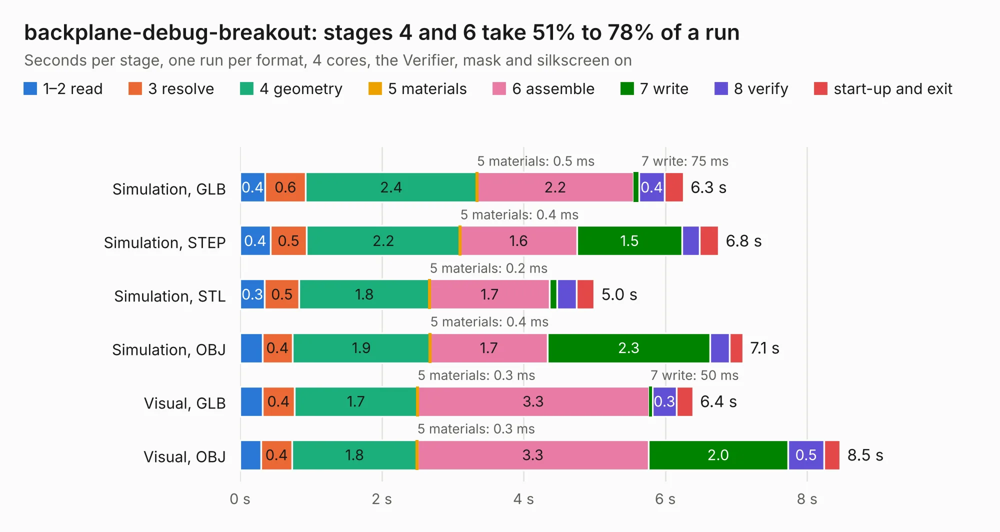

# 2158. backplane-debug-breakout

Board 2,158 of the 3,112 of [Corpus Testing](../Corpus-Testing.md), on [Corpus Page 20](../CorpusTestingPages/Corpus-Testing-20.md#2158-backplane-debug-breakout).

| Mode and format | 1–2 read | 3 resolve | 4 geometry | 5 materials | 6 assemble | 7 write | 8 verify | start-up and exit | Total |
|---|---:|---:|---:|---:|---:|---:|---:|---:|---:|
| Simulation, GLB | 0.4 | 0.6 | 2.4 | 0.5&nbsp;ms | 2.2 | 75&nbsp;ms | 0.4 | 0.3 | 6.3 |
| Simulation, STEP | 0.4 | 0.5 | 2.2 | 0.4&nbsp;ms | 1.6 | 1.5 | 0.2 | 0.3 | 6.8 |
| Simulation, STL | 0.3 | 0.5 | 1.8 | 0.2&nbsp;ms | 1.7 | 0.1 | 0.3 | 0.2 | 5.0 |
| Simulation, OBJ | 0.3 | 0.4 | 1.9 | 0.4&nbsp;ms | 1.7 | 2.3 | 0.3 | 0.2 | 7.1 |
| Visual, GLB | 0.3 | 0.4 | 1.7 | 0.3&nbsp;ms | 3.3 | 50&nbsp;ms | 0.3 | 0.2 | 6.4 |
| Visual, OBJ | 0.3 | 0.4 | 1.8 | 0.3&nbsp;ms | 3.3 | 2.0 | 0.5 | 0.2 | 8.5 |

<table align="center"><tr><td valign="top">

| Board | Repo: [oresat/oresat-flatsat](https://github.com/oresat/oresat-flatsat) Board: `backplane-debug-breakout.kicad_pcb` |
|---|---|
| Folder | backplane-debug-breakout |
| Complexity | 240&nbsp;/&nbsp;1000 (size&nbsp;135, features&nbsp;105) |
| KESE&nbsp;features | through vias, rounded, trapezoid or chamfered pads, filled zones, curved board outline, stack-up, dielectric εr and tanδ, copper finish, mask and silkscreen colours |
| Tested | 9th November 2026 |
| Copper&nbsp;layers | 2 |
| File&nbsp;format | KiCad 8 (20240108) |
| Parts,&nbsp;tracks,&nbsp;vias | 15, 97, 39 |
| Triangles,&nbsp;simulation | 433,812 in 41 parts |
| Verifier | PASS in all six runs |

</td><td valign="top">

<table>
<tr><th>File type</th><th>File size</th><th>Peak memory used</th></tr>
<tr><th colspan="3" align="left">Simulation</th></tr>
<tr><td>GLB</td><td align="right">15&nbsp;MB</td><td align="right">279&nbsp;MB</td></tr>
<tr><td>STEP</td><td align="right">71&nbsp;MB</td><td align="right">332&nbsp;MB</td></tr>
<tr><td>STL</td><td align="right">22&nbsp;MB</td><td align="right">291&nbsp;MB</td></tr>
<tr><td>OBJ</td><td align="right">44&nbsp;MB</td><td align="right">358&nbsp;MB</td></tr>
<tr><th colspan="3" align="left">Visual</th></tr>
<tr><td>GLB</td><td align="right">11&nbsp;MB</td><td align="right">326&nbsp;MB</td></tr>
<tr><td>OBJ</td><td align="right">32&nbsp;MB</td><td align="right">323&nbsp;MB</td></tr>
</table>

</td></tr></table>

| Previous | Next |
|:---|---:|
| [2157. backplane-debug](b2157b_oresat-flatsat_backplane-debug.md) | [2159. c3-proxy](b2159b_oresat-flatsat_c3-proxy.md) |
