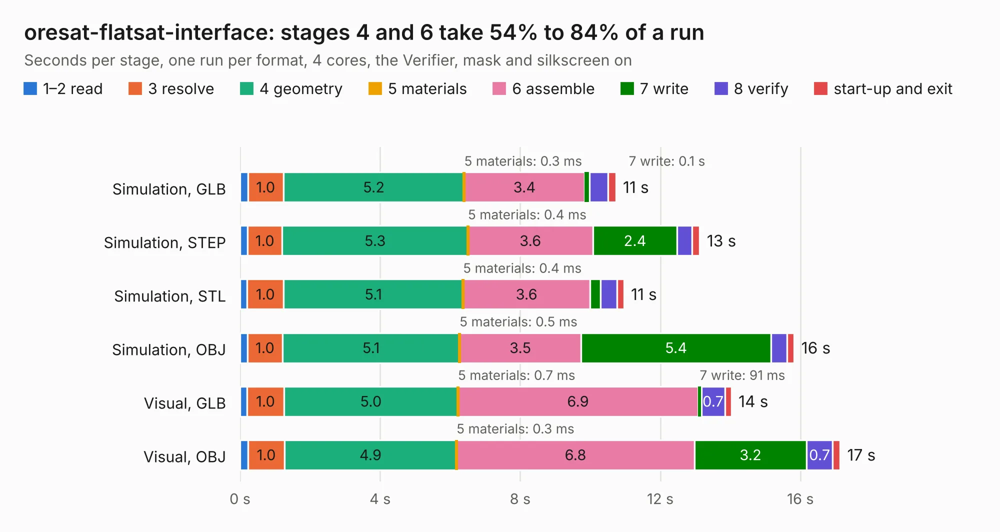

# 2158. oresat-flatsat-interface

Board 2,158 of the 3,105 of [Corpus Testing](../Corpus-Testing.md), on [Corpus Page 20](../CorpusTestingPages/Corpus-Testing-20.md#2158-oresat-flatsat-interface).

| Mode and format | 1–2 read | 3 resolve | 4 geometry | 5 materials | 6 assemble | 7 write | 8 verify | start-up and exit | Total |
|---|---:|---:|---:|---:|---:|---:|---:|---:|---:|
| Simulation, GLB | 0.2 | 1.0 | 5.2 | 0.3&nbsp;ms | 3.4 | 0.1 | 0.5 | 0.2 | 10.7 |
| Simulation, STEP | 0.2 | 1.0 | 5.3 | 0.4&nbsp;ms | 3.6 | 2.4 | 0.4 | 0.2 | 13.1 |
| Simulation, STL | 0.2 | 1.0 | 5.1 | 0.4&nbsp;ms | 3.6 | 0.3 | 0.5 | 0.2 | 11.0 |
| Simulation, OBJ | 0.2 | 1.0 | 5.1 | 0.5&nbsp;ms | 3.5 | 5.4 | 0.5 | 0.2 | 15.8 |
| Visual, GLB | 0.2 | 1.0 | 5.0 | 0.7&nbsp;ms | 6.9 | 91&nbsp;ms | 0.7 | 0.2 | 14.0 |
| Visual, OBJ | 0.2 | 1.0 | 4.9 | 0.3&nbsp;ms | 6.8 | 3.2 | 0.7 | 0.2 | 17.1 |

<table align="center"><tr><td valign="top">

| Board | Repo: [oresat/oresat-flatsat](https://github.com/oresat/oresat-flatsat) Board: `oresat-flatsat-interface.kicad_pcb` |
|---|---|
| Folder | flatsat-to-oresat-jumper-card |
| Complexity | 289&nbsp;/&nbsp;1000 (size&nbsp;159, features&nbsp;130) |
| KESE&nbsp;features | through vias, custom pads, rounded, trapezoid or chamfered pads, drill offsets, arc tracks, filled zones, copper drawings, stack-up, dielectric εr and tanδ, mask and silkscreen colours |
| Tested | 9th November 2026 |
| Copper&nbsp;layers | 2 |
| File&nbsp;format | KiCad 7 (20221018) |
| Parts,&nbsp;tracks,&nbsp;vias | 11, 267, 291 |
| Triangles,&nbsp;simulation | 1,034,332 in 60 parts |
| Verifier | PASS in all six runs |

</td><td valign="top">

<table>
<tr><th>File type</th><th>File size</th><th>Peak memory used</th></tr>
<tr><th colspan="3" align="left">Simulation</th></tr>
<tr><td>GLB</td><td align="right">35&nbsp;MB</td><td align="right">491&nbsp;MB</td></tr>
<tr><td>STEP</td><td align="right">126&nbsp;MB</td><td align="right">534&nbsp;MB</td></tr>
<tr><td>STL</td><td align="right">52&nbsp;MB</td><td align="right">476&nbsp;MB</td></tr>
<tr><td>OBJ</td><td align="right">105&nbsp;MB</td><td align="right">736&nbsp;MB</td></tr>
<tr><th colspan="3" align="left">Visual</th></tr>
<tr><td>GLB</td><td align="right">21&nbsp;MB</td><td align="right">561&nbsp;MB</td></tr>
<tr><td>OBJ</td><td align="right">64&nbsp;MB</td><td align="right">556&nbsp;MB</td></tr>
</table>

</td></tr></table>

| Previous | Next |
|:---|---:|
| [2157. flatsat-breakout-main](b2157b_oresat-flatsat_flatsat-breakout-main.md) | [2159. swd-to-card-debug-3](b2159b_oresat-flatsat_swd-to-card-debug-3.md) |
