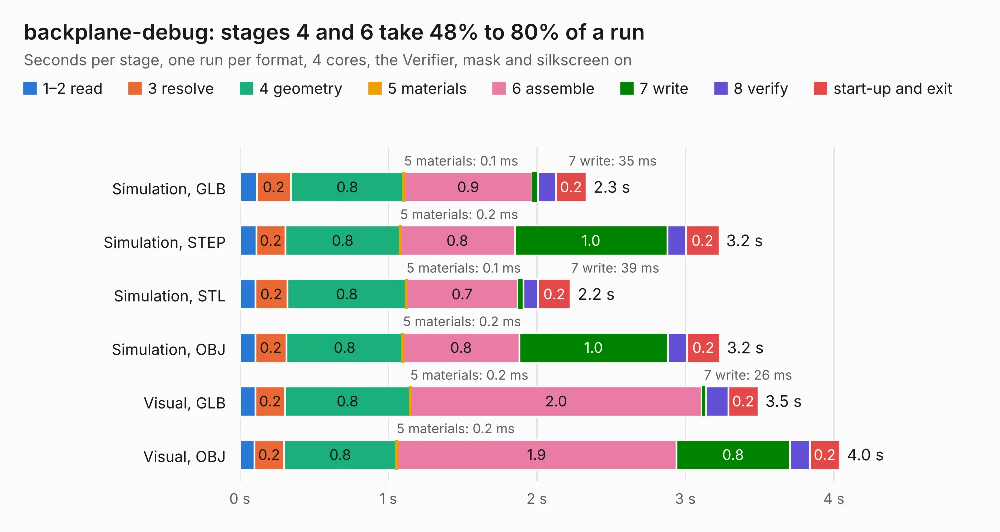

# 2161. backplane-debug

Board 2,161 of the 3,116 of [Corpus Testing](../Corpus-Testing.md), on [Corpus Page 21](../CorpusTestingPages/Corpus-Testing-21.md#2161-backplane-debug).

| Mode and format | 1–2 read | 3 resolve | 4 geometry | 5 materials | 6 assemble | 7 write | 8 verify | start-up and exit | Total |
|---|---:|---:|---:|---:|---:|---:|---:|---:|---:|
| Simulation, GLB | 0.1 | 0.2 | 0.8 | 0.1&nbsp;ms | 0.9 | 35&nbsp;ms | 0.1 | 0.2 | 2.3 |
| Simulation, STEP | 0.1 | 0.2 | 0.8 | 0.2&nbsp;ms | 0.8 | 1.0 | 0.1 | 0.2 | 3.2 |
| Simulation, STL | 0.1 | 0.2 | 0.8 | 0.1&nbsp;ms | 0.7 | 39&nbsp;ms | 98&nbsp;ms | 0.2 | 2.2 |
| Simulation, OBJ | 0.1 | 0.2 | 0.8 | 0.2&nbsp;ms | 0.8 | 1.0 | 0.1 | 0.2 | 3.2 |
| Visual, GLB | 0.1 | 0.2 | 0.8 | 0.2&nbsp;ms | 2.0 | 26&nbsp;ms | 0.2 | 0.2 | 3.5 |
| Visual, OBJ | 98&nbsp;ms | 0.2 | 0.8 | 0.2&nbsp;ms | 1.9 | 0.8 | 0.1 | 0.2 | 4.0 |

<table align="center"><tr><td valign="top">

| Board | Repo: [oresat/oresat-flatsat](https://github.com/oresat/oresat-flatsat) Board: `backplane-debug.kicad_pcb` |
|---|---|
| Folder | backplane-debug-board |
| Complexity | 206&nbsp;/&nbsp;1000 (size&nbsp;111, features&nbsp;95) |
| KESE&nbsp;features | through vias, rounded, trapezoid or chamfered pads, arc tracks, filled zones, stack-up, dielectric εr and tanδ, mask and silkscreen colours |
| Tested | 9th November 2026 |
| Copper&nbsp;layers | 2 |
| File&nbsp;format | KiCad 6 (20211014) |
| Parts,&nbsp;tracks,&nbsp;vias | 3, 76, 16 |
| Triangles,&nbsp;simulation | 213,296 in 24 parts |
| Verifier | PASS in all six runs |

</td><td valign="top">

<table>
<tr><th>File type</th><th>File size</th><th>Peak memory used</th></tr>
<tr><th colspan="3" align="left">Simulation</th></tr>
<tr><td>GLB</td><td align="right">7.5&nbsp;MB</td><td align="right">212&nbsp;MB</td></tr>
<tr><td>STEP</td><td align="right">41&nbsp;MB</td><td align="right">240&nbsp;MB</td></tr>
<tr><td>STL</td><td align="right">11&nbsp;MB</td><td align="right">228&nbsp;MB</td></tr>
<tr><td>OBJ</td><td align="right">21&nbsp;MB</td><td align="right">232&nbsp;MB</td></tr>
<tr><th colspan="3" align="left">Visual</th></tr>
<tr><td>GLB</td><td align="right">5.6&nbsp;MB</td><td align="right">210&nbsp;MB</td></tr>
<tr><td>OBJ</td><td align="right">16&nbsp;MB</td><td align="right">211&nbsp;MB</td></tr>
</table>

</td></tr></table>

| Previous | Next |
|:---|---:|
| [2160. oresat1-plusz-end-cap](b2160b_oresat-endcaps_oresat1-plusz-end-cap.md) | [2162. backplane-debug-breakout](b2162b_oresat-flatsat_backplane-debug-breakout.md) |
