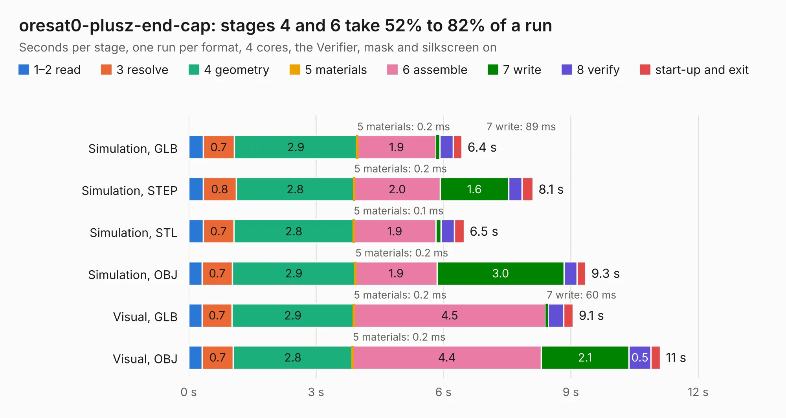

# 2163. oresat0-plusz-end-cap

Board 2,163 of the 3,123 of [Corpus Testing](../Corpus-Testing.md), on [Corpus Page 21](../CorpusTestingPages/Corpus-Testing-21.md#2163-oresat0-plusz-end-cap).

| Mode and format | 1–2 read | 3 resolve | 4 geometry | 5 materials | 6 assemble | 7 write | 8 verify | start-up and exit | Total |
|---|---:|---:|---:|---:|---:|---:|---:|---:|---:|
| Simulation, GLB | 0.3 | 0.7 | 2.9 | 0.2&nbsp;ms | 1.9 | 89&nbsp;ms | 0.3 | 0.2 | 6.4 |
| Simulation, STEP | 0.3 | 0.8 | 2.8 | 0.2&nbsp;ms | 2.0 | 1.6 | 0.3 | 0.3 | 8.1 |
| Simulation, STL | 0.3 | 0.7 | 2.8 | 0.1&nbsp;ms | 1.9 | 0.1 | 0.3 | 0.2 | 6.5 |
| Simulation, OBJ | 0.3 | 0.7 | 2.9 | 0.2&nbsp;ms | 1.9 | 3.0 | 0.3 | 0.2 | 9.3 |
| Visual, GLB | 0.3 | 0.7 | 2.9 | 0.2&nbsp;ms | 4.5 | 60&nbsp;ms | 0.4 | 0.2 | 9.1 |
| Visual, OBJ | 0.3 | 0.7 | 2.8 | 0.2&nbsp;ms | 4.4 | 2.1 | 0.5 | 0.2 | 11.1 |

<table align="center"><tr><td valign="top">

| Board | Repo: [oresat/oresat-endcaps](https://github.com/oresat/oresat-endcaps) Board: `oresat0-plusz-end-cap.kicad_pcb` |
|---|---|
| Folder | oresat0-plusz-end-cap / kicad |
| Complexity | 268&nbsp;/&nbsp;1000 (size&nbsp;163, features&nbsp;105) |
| KESE&nbsp;features | through vias, rounded, trapezoid or chamfered pads, filled zones, curved board outline, stack-up, dielectric εr and tanδ, copper finish, mask and silkscreen colours |
| Tested | 9th November 2026 |
| Copper&nbsp;layers | 2 |
| File&nbsp;format | KiCad 8 (20240108) |
| Parts,&nbsp;tracks,&nbsp;vias | 25, 242, 209 |
| Triangles,&nbsp;simulation | 598,388 in 30 parts |
| Verifier | PASS in all six runs |

</td><td valign="top">

<table>
<tr><th>File type</th><th>File size</th><th>Peak memory used</th></tr>
<tr><th colspan="3" align="left">Simulation</th></tr>
<tr><td>GLB</td><td align="right">21&nbsp;MB</td><td align="right">339&nbsp;MB</td></tr>
<tr><td>STEP</td><td align="right">87&nbsp;MB</td><td align="right">390&nbsp;MB</td></tr>
<tr><td>STL</td><td align="right">30&nbsp;MB</td><td align="right">359&nbsp;MB</td></tr>
<tr><td>OBJ</td><td align="right">62&nbsp;MB</td><td align="right">462&nbsp;MB</td></tr>
<tr><th colspan="3" align="left">Visual</th></tr>
<tr><td>GLB</td><td align="right">15&nbsp;MB</td><td align="right">385&nbsp;MB</td></tr>
<tr><td>OBJ</td><td align="right">45&nbsp;MB</td><td align="right">388&nbsp;MB</td></tr>
</table>

</td></tr></table>

| Previous | Next |
|:---|---:|
| [2162. esi-plusz-end-cap](b2162b_oresat-endcaps_esi-plusz-end-cap.md) | [2164. oresat0.5-minusz-end-cap](b2164b_oresat-endcaps_oresat0-5-minusz-end-cap.md) |
