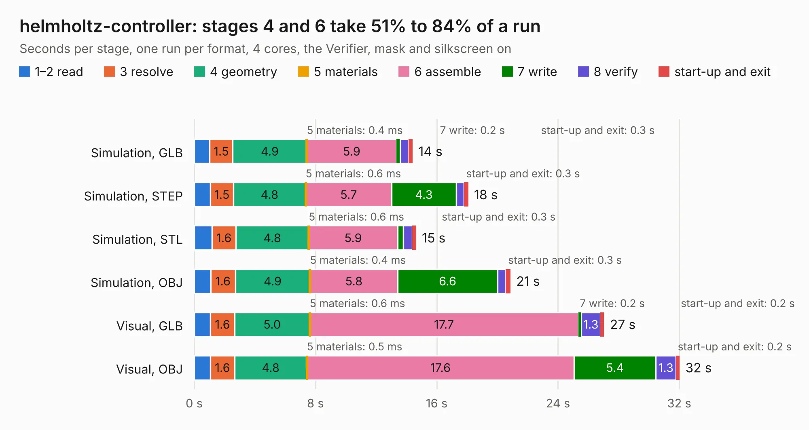

# 2163. helmholtz-controller

Board 2,163 of the 3,100 of [Corpus Testing](../Corpus-Testing.md), on [Corpus Page 21](../CorpusTestingPages/Corpus-Testing-21.md#2163-helmholtz-controller).

| Mode and format | 1–2 read | 3 resolve | 4 geometry | 5 materials | 6 assemble | 7 write | 8 verify | start-up and exit | Total |
|---|---:|---:|---:|---:|---:|---:|---:|---:|---:|
| Simulation, GLB | 1.0 | 1.5 | 4.9 | 0.4&nbsp;ms | 5.9 | 0.2 | 0.6 | 0.3 | 14.4 |
| Simulation, STEP | 1.1 | 1.5 | 4.8 | 0.6&nbsp;ms | 5.7 | 4.3 | 0.5 | 0.3 | 18.1 |
| Simulation, STL | 1.2 | 1.6 | 4.8 | 0.6&nbsp;ms | 5.9 | 0.4 | 0.6 | 0.3 | 14.6 |
| Simulation, OBJ | 1.1 | 1.6 | 4.9 | 0.4&nbsp;ms | 5.8 | 6.6 | 0.6 | 0.3 | 20.9 |
| Visual, GLB | 1.1 | 1.6 | 5.0 | 0.6&nbsp;ms | 17.7 | 0.2 | 1.3 | 0.2 | 27.0 |
| Visual, OBJ | 1.1 | 1.6 | 4.8 | 0.5&nbsp;ms | 17.6 | 5.4 | 1.3 | 0.2 | 32.0 |

<table align="center"><tr><td valign="top">

| Board | Repo: [oresat/oresat-helmholtz](https://github.com/oresat/oresat-helmholtz) Board: `helmholtz-controller.kicad_pcb` |
|---|---|
| Folder | controller-v3 |
| Complexity | 273&nbsp;/&nbsp;1000 (size&nbsp;168, features&nbsp;105) |
| KESE&nbsp;features | through vias, rounded, trapezoid or chamfered pads, filled zones, curved board outline, stack-up, dielectric εr and tanδ, copper finish, mask and silkscreen colours |
| Tested | 9th November 2026 |
| Copper&nbsp;layers | 2 |
| File&nbsp;format | KiCad 10 (20260206) |
| Parts,&nbsp;tracks,&nbsp;vias | 43, 272, 186 |
| Triangles,&nbsp;simulation | 1,060,614 in 66 parts |
| Verifier | PASS in all six runs |

</td><td valign="top">

<table>
<tr><th>File type</th><th>File size</th><th>Peak memory used</th></tr>
<tr><th colspan="3" align="left">Simulation</th></tr>
<tr><td>GLB</td><td align="right">39&nbsp;MB</td><td align="right">569&nbsp;MB</td></tr>
<tr><td>STEP</td><td align="right">176&nbsp;MB</td><td align="right">658&nbsp;MB</td></tr>
<tr><td>STL</td><td align="right">53&nbsp;MB</td><td align="right">560&nbsp;MB</td></tr>
<tr><td>OBJ</td><td align="right">114&nbsp;MB</td><td align="right">807&nbsp;MB</td></tr>
<tr><th colspan="3" align="left">Visual</th></tr>
<tr><td>GLB</td><td align="right">32&nbsp;MB</td><td align="right">689&nbsp;MB</td></tr>
<tr><td>OBJ</td><td align="right">95&nbsp;MB</td><td align="right">762&nbsp;MB</td></tr>
</table>

</td></tr></table>

| Previous | Next |
|:---|---:|
| [2162. helmholtz-controller-v2](b2162b_oresat-helmholtz_helmholtz-controller-v2.md) | [2164. at86rf215-design-block](b2164b_oresat-kicad_at86rf215-design-block.md) |
