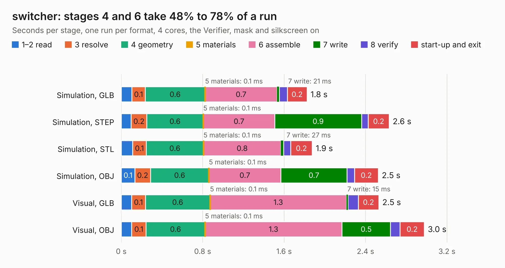

# 2166. switcher

Board 2,166 of the 3,107 of [Corpus Testing](../Corpus-Testing.md), on [Corpus Page 21](../CorpusTestingPages/Corpus-Testing-21.md#2166-switcher).

| Mode and format | 1–2 read | 3 resolve | 4 geometry | 5 materials | 6 assemble | 7 write | 8 verify | start-up and exit | Total |
|---|---:|---:|---:|---:|---:|---:|---:|---:|---:|
| Simulation, GLB | 0.1 | 0.1 | 0.6 | 0.1&nbsp;ms | 0.7 | 21&nbsp;ms | 79&nbsp;ms | 0.2 | 1.8 |
| Simulation, STEP | 97&nbsp;ms | 0.2 | 0.6 | 0.1&nbsp;ms | 0.7 | 0.9 | 66&nbsp;ms | 0.2 | 2.6 |
| Simulation, STL | 0.1 | 0.1 | 0.6 | 0.1&nbsp;ms | 0.8 | 27&nbsp;ms | 69&nbsp;ms | 0.2 | 1.9 |
| Simulation, OBJ | 0.1 | 0.2 | 0.6 | 0.1&nbsp;ms | 0.7 | 0.7 | 72&nbsp;ms | 0.2 | 2.5 |
| Visual, GLB | 0.1 | 0.1 | 0.6 | 0.1&nbsp;ms | 1.3 | 15&nbsp;ms | 0.1 | 0.2 | 2.5 |
| Visual, OBJ | 0.1 | 0.1 | 0.6 | 0.1&nbsp;ms | 1.3 | 0.5 | 95&nbsp;ms | 0.2 | 3.0 |

<table align="center"><tr><td valign="top">

| Board | Repo: [oresat/oresat-gps-hardware](https://github.com/oresat/oresat-gps-hardware) Board: `switcher.kicad_pcb` |
|---|---|
| Folder | MicroSemi_FPGA_Dev_Board / kicad_switcher_board / switcher |
| Complexity | 187&nbsp;/&nbsp;1000 (size&nbsp;142, features&nbsp;45) |
| KESE&nbsp;features | through vias, rounded, trapezoid or chamfered pads, filled zones |
| Tested | 9th November 2026 |
| Copper&nbsp;layers | 4 |
| File&nbsp;format | KiCad 5 (20171130) |
| Parts,&nbsp;tracks,&nbsp;vias | 12, 133, 2 |
| Triangles,&nbsp;simulation | 112,630 in 21 parts |
| Verifier | PASS in all six runs |

</td><td valign="top">

<table>
<tr><th>File type</th><th>File size</th><th>Peak memory used</th></tr>
<tr><th colspan="3" align="left">Simulation</th></tr>
<tr><td>GLB</td><td align="right">4.0&nbsp;MB</td><td align="right">182&nbsp;MB</td></tr>
<tr><td>STEP</td><td align="right">22&nbsp;MB</td><td align="right">197&nbsp;MB</td></tr>
<tr><td>STL</td><td align="right">5.6&nbsp;MB</td><td align="right">186&nbsp;MB</td></tr>
<tr><td>OBJ</td><td align="right">11&nbsp;MB</td><td align="right">185&nbsp;MB</td></tr>
<tr><th colspan="3" align="left">Visual</th></tr>
<tr><td>GLB</td><td align="right">2.6&nbsp;MB</td><td align="right">156&nbsp;MB</td></tr>
<tr><td>OBJ</td><td align="right">7.2&nbsp;MB</td><td align="right">157&nbsp;MB</td></tr>
</table>

</td></tr></table>

| Previous | Next |
|:---|---:|
| [2165. A3P250_Dev_Board](b2165b_oresat-gps-hardware_A3P250-Dev-Board.md) | [2167. switcher_close](b2167b_oresat-gps-hardware_switcher-close.md) |
