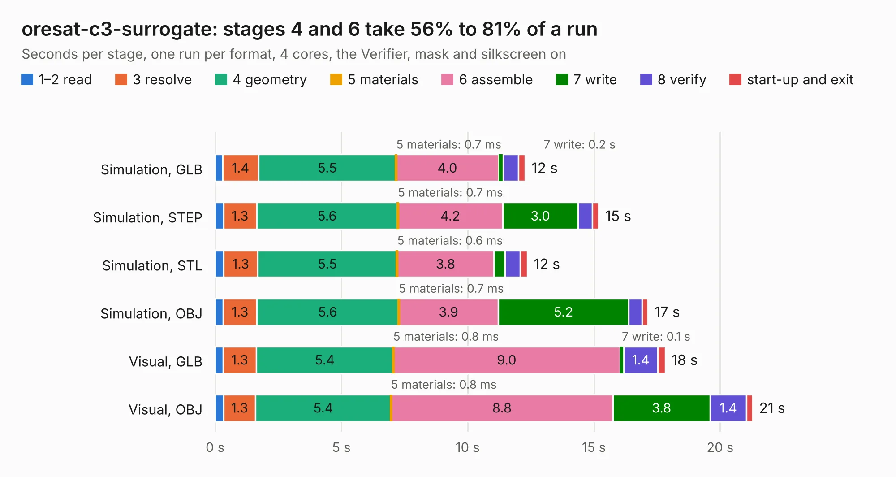

# 2167. oresat-c3-surrogate

Board 2,167 of the 3,119 of [Corpus Testing](../Corpus-Testing.md), on [Corpus Page 21](../CorpusTestingPages/Corpus-Testing-21.md#2167-oresat-c3-surrogate).

| Mode and format | 1–2 read | 3 resolve | 4 geometry | 5 materials | 6 assemble | 7 write | 8 verify | start-up and exit | Total |
|---|---:|---:|---:|---:|---:|---:|---:|---:|---:|
| Simulation, GLB | 0.3 | 1.4 | 5.5 | 0.7&nbsp;ms | 4.0 | 0.2 | 0.6 | 0.3 | 12.3 |
| Simulation, STEP | 0.3 | 1.3 | 5.6 | 0.7&nbsp;ms | 4.2 | 3.0 | 0.6 | 0.3 | 15.2 |
| Simulation, STL | 0.3 | 1.3 | 5.5 | 0.6&nbsp;ms | 3.8 | 0.4 | 0.6 | 0.3 | 12.4 |
| Simulation, OBJ | 0.3 | 1.3 | 5.6 | 0.7&nbsp;ms | 3.9 | 5.2 | 0.5 | 0.2 | 17.1 |
| Visual, GLB | 0.3 | 1.3 | 5.4 | 0.8&nbsp;ms | 9.0 | 0.1 | 1.4 | 0.3 | 17.8 |
| Visual, OBJ | 0.3 | 1.3 | 5.4 | 0.8&nbsp;ms | 8.8 | 3.8 | 1.4 | 0.3 | 21.3 |

<table align="center"><tr><td valign="top">

| Board | Repo: [oresat/oresat-flatsat](https://github.com/oresat/oresat-flatsat) Board: `oresat-c3-surrogate.kicad_pcb` |
|---|---|
| Folder | c3-surrogate-card |
| Complexity | 272&nbsp;/&nbsp;1000 (size&nbsp;167, features&nbsp;105) |
| KESE&nbsp;features | through vias, rounded, trapezoid or chamfered pads, drill offsets, filled zones, stack-up, dielectric εr and tanδ, copper finish, mask and silkscreen colours |
| Tested | 9th November 2026 |
| Copper&nbsp;layers | 2 |
| File&nbsp;format | KiCad 9 (20241229) |
| Parts,&nbsp;tracks,&nbsp;vias | 37, 318, 185 |
| Triangles,&nbsp;simulation | 1,085,502 in 79 parts |
| Verifier | PASS in all six runs |

</td><td valign="top">

<table>
<tr><th>File type</th><th>File size</th><th>Peak memory used</th></tr>
<tr><th colspan="3" align="left">Simulation</th></tr>
<tr><td>GLB</td><td align="right">37&nbsp;MB</td><td align="right">462&nbsp;MB</td></tr>
<tr><td>STEP</td><td align="right">152&nbsp;MB</td><td align="right">572&nbsp;MB</td></tr>
<tr><td>STL</td><td align="right">54&nbsp;MB</td><td align="right">492&nbsp;MB</td></tr>
<tr><td>OBJ</td><td align="right">110&nbsp;MB</td><td align="right">742&nbsp;MB</td></tr>
<tr><th colspan="3" align="left">Visual</th></tr>
<tr><td>GLB</td><td align="right">26&nbsp;MB</td><td align="right">628&nbsp;MB</td></tr>
<tr><td>OBJ</td><td align="right">80&nbsp;MB</td><td align="right">636&nbsp;MB</td></tr>
</table>

</td></tr></table>

| Previous | Next |
|:---|---:|
| [2166. c3-proxy](b2166b_oresat-flatsat_c3-proxy.md) | [2168. c3s-card-adapter](b2168b_oresat-flatsat_c3s-card-adapter.md) |
