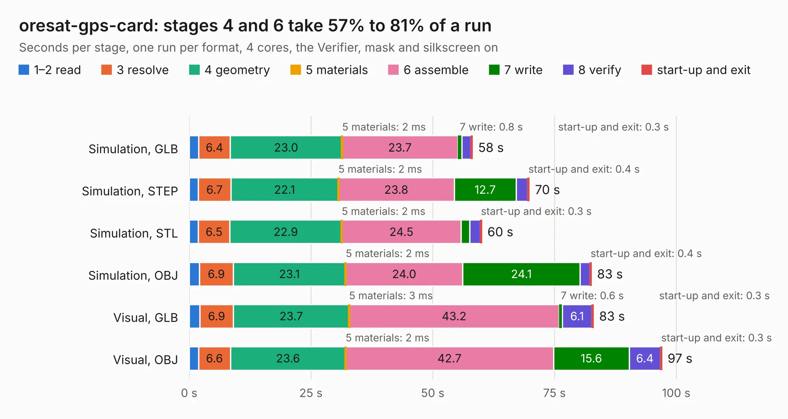

# 2167. oresat-gps-card

Board 2,167 of the 3,106 of [Corpus Testing](../Corpus-Testing.md), on [Corpus Page 21](../CorpusTestingPages/Corpus-Testing-21.md#2167-oresat-gps-card).

| Mode and format | 1–2 read | 3 resolve | 4 geometry | 5 materials | 6 assemble | 7 write | 8 verify | start-up and exit | Total |
|---|---:|---:|---:|---:|---:|---:|---:|---:|---:|
| Simulation, GLB | 2.0 | 6.4 | 23.0 | 2&nbsp;ms | 23.7 | 0.8 | 1.9 | 0.3 | 58.2 |
| Simulation, STEP | 1.9 | 6.7 | 22.1 | 2&nbsp;ms | 23.8 | 12.7 | 2.3 | 0.4 | 69.8 |
| Simulation, STL | 1.9 | 6.5 | 22.9 | 2&nbsp;ms | 24.5 | 1.8 | 2.1 | 0.3 | 60.1 |
| Simulation, OBJ | 2.1 | 6.9 | 23.1 | 2&nbsp;ms | 24.0 | 24.1 | 2.0 | 0.4 | 82.6 |
| Visual, GLB | 2.2 | 6.9 | 23.7 | 3&nbsp;ms | 43.2 | 0.6 | 6.1 | 0.3 | 83.0 |
| Visual, OBJ | 1.9 | 6.6 | 23.6 | 2&nbsp;ms | 42.7 | 15.6 | 6.4 | 0.3 | 97.1 |

<table align="center"><tr><td valign="top">

| Board | Repo: [oresat/oresat-gps-hardware](https://github.com/oresat/oresat-gps-hardware) Board: `oresat-gps-card.kicad_pcb` |
|---|---|
| Folder | oresat-gps-card |
| Complexity | 438&nbsp;/&nbsp;1000 (size&nbsp;293, features&nbsp;145) |
| KESE&nbsp;features | through vias, custom pads, rounded, trapezoid or chamfered pads, drill offsets, arc tracks, filled zones, copper drawings, tracks bare of mask, stack-up, dielectric εr and tanδ, mask and silkscreen colours |
| Tested | 9th November 2026 |
| Copper&nbsp;layers | 4 |
| File&nbsp;format | KiCad 10 (20260206) |
| Parts,&nbsp;tracks,&nbsp;vias | 215, 3,296, 767 |
| Triangles,&nbsp;simulation | 4,929,222 in 472 parts |
| Verifier | PASS in all six runs |

</td><td valign="top">

<table>
<tr><th>File type</th><th>File size</th><th>Peak memory used</th></tr>
<tr><th colspan="3" align="left">Simulation</th></tr>
<tr><td>GLB</td><td align="right">170&nbsp;MB</td><td align="right">1.5&nbsp;GB</td></tr>
<tr><td>STEP</td><td align="right">723&nbsp;MB</td><td align="right">2.0&nbsp;GB</td></tr>
<tr><td>STL</td><td align="right">247&nbsp;MB</td><td align="right">1.5&nbsp;GB</td></tr>
<tr><td>OBJ</td><td align="right">535&nbsp;MB</td><td align="right">3.2&nbsp;GB</td></tr>
<tr><th colspan="3" align="left">Visual</th></tr>
<tr><td>GLB</td><td align="right">112&nbsp;MB</td><td align="right">1.8&nbsp;GB</td></tr>
<tr><td>OBJ</td><td align="right">357&nbsp;MB</td><td align="right">2.3&nbsp;GB</td></tr>
</table>

</td></tr></table>

| Previous | Next |
|:---|---:|
| [2166. switcher_close](b2166b_oresat-gps-hardware_switcher-close.md) | [2168. helmholtz-controller-v2](b2168b_oresat-helmholtz_helmholtz-controller-v2.md) |
