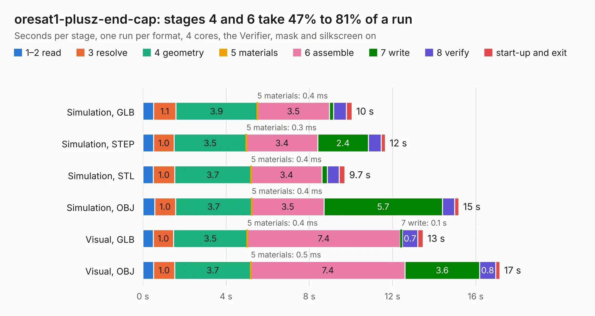

# 2168. oresat1-plusz-end-cap

Board 2,168 of the 3,124 of [Corpus Testing](../Corpus-Testing.md), on [Corpus Page 21](../CorpusTestingPages/Corpus-Testing-21.md#2168-oresat1-plusz-end-cap).

| Mode and format | 1–2 read | 3 resolve | 4 geometry | 5 materials | 6 assemble | 7 write | 8 verify | start-up and exit | Total |
|---|---:|---:|---:|---:|---:|---:|---:|---:|---:|
| Simulation, GLB | 0.5 | 1.1 | 3.9 | 0.4&nbsp;ms | 3.5 | 0.2 | 0.6 | 0.3 | 10.1 |
| Simulation, STEP | 0.5 | 1.0 | 3.5 | 0.3&nbsp;ms | 3.4 | 2.4 | 0.6 | 0.2 | 11.7 |
| Simulation, STL | 0.5 | 1.0 | 3.7 | 0.4&nbsp;ms | 3.4 | 0.3 | 0.6 | 0.3 | 9.7 |
| Simulation, OBJ | 0.6 | 1.0 | 3.7 | 0.4&nbsp;ms | 3.5 | 5.7 | 0.6 | 0.2 | 15.2 |
| Visual, GLB | 0.5 | 1.0 | 3.5 | 0.4&nbsp;ms | 7.4 | 0.1 | 0.7 | 0.3 | 13.5 |
| Visual, OBJ | 0.5 | 1.0 | 3.7 | 0.5&nbsp;ms | 7.4 | 3.6 | 0.8 | 0.2 | 17.2 |

<table align="center"><tr><td valign="top">

| Board | Repo: [oresat/oresat-endcaps](https://github.com/oresat/oresat-endcaps) Board: `oresat1-plusz-end-cap.kicad_pcb` |
|---|---|
| Folder | oresat1-plusz-end-cap |
| Complexity | 293&nbsp;/&nbsp;1000 (size&nbsp;188, features&nbsp;105) |
| KESE&nbsp;features | through vias, rounded, trapezoid or chamfered pads, filled zones, curved board outline, stack-up, dielectric εr and tanδ, copper finish, mask and silkscreen colours |
| Tested | 9th November 2026 |
| Copper&nbsp;layers | 4 |
| File&nbsp;format | KiCad 10 (20260206) |
| Parts,&nbsp;tracks,&nbsp;vias | 42, 302, 240 |
| Triangles,&nbsp;simulation | 1,070,180 in 60 parts |
| Verifier | PASS in all six runs |

</td><td valign="top">

<table>
<tr><th>File type</th><th>File size</th><th>Peak memory used</th></tr>
<tr><th colspan="3" align="left">Simulation</th></tr>
<tr><td>GLB</td><td align="right">36&nbsp;MB</td><td align="right">520&nbsp;MB</td></tr>
<tr><td>STEP</td><td align="right">124&nbsp;MB</td><td align="right">538&nbsp;MB</td></tr>
<tr><td>STL</td><td align="right">54&nbsp;MB</td><td align="right">518&nbsp;MB</td></tr>
<tr><td>OBJ</td><td align="right">109&nbsp;MB</td><td align="right">735&nbsp;MB</td></tr>
<tr><th colspan="3" align="left">Visual</th></tr>
<tr><td>GLB</td><td align="right">22&nbsp;MB</td><td align="right">549&nbsp;MB</td></tr>
<tr><td>OBJ</td><td align="right">69&nbsp;MB</td><td align="right">542&nbsp;MB</td></tr>
</table>

</td></tr></table>

| Previous | Next |
|:---|---:|
| [2167. oresat1-minusZ-end-cap](b2167b_oresat-endcaps_oresat1-minusZ-end-cap.md) | [2169. backplane-debug](b2169b_oresat-flatsat_backplane-debug.md) |
