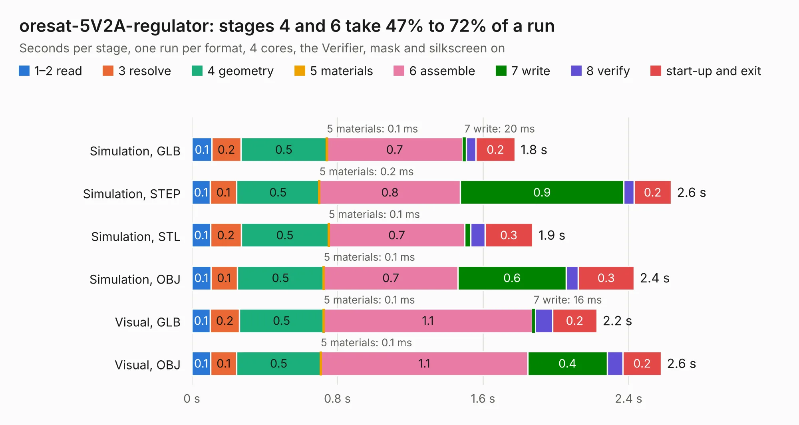

# 2169. oresat-5V2A-regulator

Board 2,169 of the 3,103 of [Corpus Testing](../Corpus-Testing.md), on [Corpus Page 21](../CorpusTestingPages/Corpus-Testing-21.md#2169-oresat-5v2a-regulator).

| Mode and format | 1–2 read | 3 resolve | 4 geometry | 5 materials | 6 assemble | 7 write | 8 verify | start-up and exit | Total |
|---|---:|---:|---:|---:|---:|---:|---:|---:|---:|
| Simulation, GLB | 0.1 | 0.2 | 0.5 | 0.1&nbsp;ms | 0.7 | 20&nbsp;ms | 54&nbsp;ms | 0.2 | 1.8 |
| Simulation, STEP | 0.1 | 0.1 | 0.5 | 0.2&nbsp;ms | 0.8 | 0.9 | 57&nbsp;ms | 0.2 | 2.6 |
| Simulation, STL | 0.1 | 0.2 | 0.5 | 0.1&nbsp;ms | 0.7 | 32&nbsp;ms | 78&nbsp;ms | 0.3 | 1.9 |
| Simulation, OBJ | 0.1 | 0.1 | 0.5 | 0.1&nbsp;ms | 0.7 | 0.6 | 66&nbsp;ms | 0.3 | 2.4 |
| Visual, GLB | 0.1 | 0.2 | 0.5 | 0.1&nbsp;ms | 1.1 | 16&nbsp;ms | 95&nbsp;ms | 0.2 | 2.2 |
| Visual, OBJ | 0.1 | 0.1 | 0.5 | 0.1&nbsp;ms | 1.1 | 0.4 | 87&nbsp;ms | 0.2 | 2.6 |

<table align="center"><tr><td valign="top">

| Board | Repo: [oresat/oresat-kicad](https://github.com/oresat/oresat-kicad) Board: `oresat-5V2A-regulator.kicad_pcb` |
|---|---|
| Folder | oresat-design-blocks / oresat-5V2A-regulator |
| Complexity | 198&nbsp;/&nbsp;1000 (size&nbsp;123, features&nbsp;75) |
| KESE&nbsp;features | through vias, rounded, trapezoid or chamfered pads, filled zones, stack-up, dielectric εr and tanδ |
| Tested | 9th November 2026 |
| Copper&nbsp;layers | 2 |
| File&nbsp;format | KiCad 6 (20211014) |
| Parts,&nbsp;tracks,&nbsp;vias | 10, 15, 39 |
| Triangles,&nbsp;simulation | 109,708 in 15 parts |
| Verifier | PASS in all six runs |

</td><td valign="top">

<table>
<tr><th>File type</th><th>File size</th><th>Peak memory used</th></tr>
<tr><th colspan="3" align="left">Simulation</th></tr>
<tr><td>GLB</td><td align="right">3.8&nbsp;MB</td><td align="right">199&nbsp;MB</td></tr>
<tr><td>STEP</td><td align="right">16&nbsp;MB</td><td align="right">201&nbsp;MB</td></tr>
<tr><td>STL</td><td align="right">5.5&nbsp;MB</td><td align="right">189&nbsp;MB</td></tr>
<tr><td>OBJ</td><td align="right">11&nbsp;MB</td><td align="right">194&nbsp;MB</td></tr>
<tr><th colspan="3" align="left">Visual</th></tr>
<tr><td>GLB</td><td align="right">2.9&nbsp;MB</td><td align="right">159&nbsp;MB</td></tr>
<tr><td>OBJ</td><td align="right">8.0&nbsp;MB</td><td align="right">155&nbsp;MB</td></tr>
</table>

</td></tr></table>

| Previous | Next |
|:---|---:|
| [2168. transceiver-AX5043](b2168b_oresat-kicad_transceiver-AX5043.md) | [2170. synthesizer-IF-Si4112](b2170b_oresat-kicad_synthesizer-IF-Si4112.md) |
