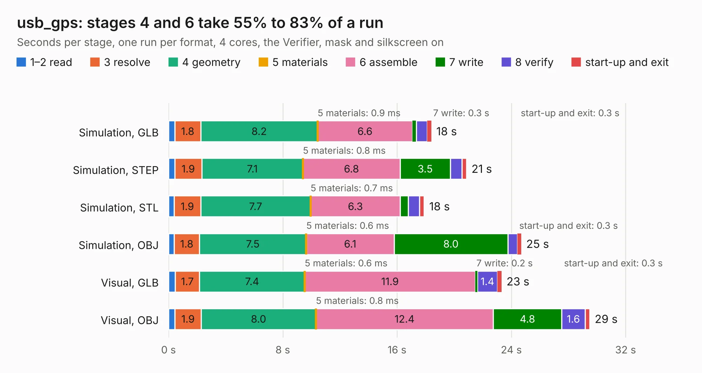

# 2171. usb_gps

Board 2,171 of the 3,116 of [Corpus Testing](../Corpus-Testing.md), on [Corpus Page 21](../CorpusTestingPages/Corpus-Testing-21.md#2171-usb_gps).

| Mode and format | 1–2 read | 3 resolve | 4 geometry | 5 materials | 6 assemble | 7 write | 8 verify | start-up and exit | Total |
|---|---:|---:|---:|---:|---:|---:|---:|---:|---:|
| Simulation, GLB | 0.4 | 1.8 | 8.2 | 0.9&nbsp;ms | 6.6 | 0.3 | 0.8 | 0.3 | 18.4 |
| Simulation, STEP | 0.4 | 1.9 | 7.1 | 0.8&nbsp;ms | 6.8 | 3.5 | 0.8 | 0.3 | 20.9 |
| Simulation, STL | 0.4 | 1.9 | 7.7 | 0.7&nbsp;ms | 6.3 | 0.6 | 0.8 | 0.3 | 17.9 |
| Simulation, OBJ | 0.4 | 1.8 | 7.5 | 0.6&nbsp;ms | 6.1 | 8.0 | 0.7 | 0.3 | 24.7 |
| Visual, GLB | 0.5 | 1.7 | 7.4 | 0.6&nbsp;ms | 11.9 | 0.2 | 1.4 | 0.3 | 23.3 |
| Visual, OBJ | 0.4 | 1.9 | 8.0 | 0.8&nbsp;ms | 12.4 | 4.8 | 1.6 | 0.3 | 29.5 |

<table align="center"><tr><td valign="top">

| Board | Repo: [oresat/oresat-gps-hardware](https://github.com/oresat/oresat-gps-hardware) Board: `usb_gps.kicad_pcb` |
|---|---|
| Folder | GPS-USB_Front_End_Board / kicad_board_design |
| Complexity | 284&nbsp;/&nbsp;1000 (size&nbsp;239, features&nbsp;45) |
| KESE&nbsp;features | through vias, slotted holes, filled zones |
| Tested | 9th November 2026 |
| Copper&nbsp;layers | 4 |
| File&nbsp;format | KiCad 4 (4) |
| Parts,&nbsp;tracks,&nbsp;vias | 91, 888, 119 |
| Triangles,&nbsp;simulation | 1,683,098 in 118 parts |
| Verifier | PASS in all six runs |

</td><td valign="top">

<table>
<tr><th>File type</th><th>File size</th><th>Peak memory used</th></tr>
<tr><th colspan="3" align="left">Simulation</th></tr>
<tr><td>GLB</td><td align="right">58&nbsp;MB</td><td align="right">742&nbsp;MB</td></tr>
<tr><td>STEP</td><td align="right">200&nbsp;MB</td><td align="right">777&nbsp;MB</td></tr>
<tr><td>STL</td><td align="right">84&nbsp;MB</td><td align="right">714&nbsp;MB</td></tr>
<tr><td>OBJ</td><td align="right">176&nbsp;MB</td><td align="right">1.1&nbsp;GB</td></tr>
<tr><th colspan="3" align="left">Visual</th></tr>
<tr><td>GLB</td><td align="right">34&nbsp;MB</td><td align="right">721&nbsp;MB</td></tr>
<tr><td>OBJ</td><td align="right">101&nbsp;MB</td><td align="right">788&nbsp;MB</td></tr>
</table>

</td></tr></table>

| Previous | Next |
|:---|---:|
| [2170. swd-to-card-debug-3](b2170b_oresat-flatsat_swd-to-card-debug-3.md) | [2172. BaseBoard](b2172b_oresat-gps-hardware_BaseBoard.md) |
