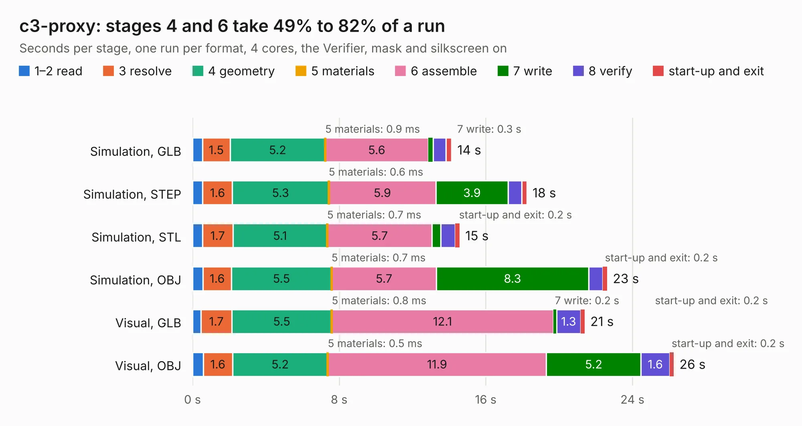

# 2172. c3-proxy

Board 2,172 of the 3,128 of [Corpus Testing](../Corpus-Testing.md), on [Corpus Page 21](../CorpusTestingPages/Corpus-Testing-21.md#2172-c3-proxy).

| Mode and format | 1–2 read | 3 resolve | 4 geometry | 5 materials | 6 assemble | 7 write | 8 verify | start-up and exit | Total |
|---|---:|---:|---:|---:|---:|---:|---:|---:|---:|
| Simulation, GLB | 0.5 | 1.5 | 5.2 | 0.9&nbsp;ms | 5.6 | 0.3 | 0.7 | 0.3 | 14.1 |
| Simulation, STEP | 0.6 | 1.6 | 5.3 | 0.6&nbsp;ms | 5.9 | 3.9 | 0.7 | 0.3 | 18.2 |
| Simulation, STL | 0.5 | 1.7 | 5.1 | 0.7&nbsp;ms | 5.7 | 0.5 | 0.8 | 0.2 | 14.6 |
| Simulation, OBJ | 0.6 | 1.6 | 5.5 | 0.7&nbsp;ms | 5.7 | 8.3 | 0.8 | 0.2 | 22.6 |
| Visual, GLB | 0.5 | 1.7 | 5.5 | 0.8&nbsp;ms | 12.1 | 0.2 | 1.3 | 0.2 | 21.4 |
| Visual, OBJ | 0.6 | 1.6 | 5.2 | 0.5&nbsp;ms | 11.9 | 5.2 | 1.6 | 0.2 | 26.3 |

<table align="center"><tr><td valign="top">

| Board | Repo: [oresat/oresat-flatsat](https://github.com/oresat/oresat-flatsat) Board: `c3-proxy.kicad_pcb` |
|---|---|
| Folder | c3-proxy |
| Complexity | 329&nbsp;/&nbsp;1000 (size&nbsp;199, features&nbsp;130) |
| KESE&nbsp;features | through vias, slotted holes, rounded, trapezoid or chamfered pads, drill offsets, filled zones, TrueType text, stack-up, dielectric εr and tanδ, copper finish, mask and silkscreen colours |
| Tested | 9th November 2026 |
| Copper&nbsp;layers | 4 |
| File&nbsp;format | KiCad 10 (20260206) |
| Parts,&nbsp;tracks,&nbsp;vias | 64, 706, 265 |
| Triangles,&nbsp;simulation | 1,736,256 in 93 parts |
| Verifier | PASS in all six runs |

</td><td valign="top">

<table>
<tr><th>File type</th><th>File size</th><th>Peak memory used</th></tr>
<tr><th colspan="3" align="left">Simulation</th></tr>
<tr><td>GLB</td><td align="right">59&nbsp;MB</td><td align="right">665&nbsp;MB</td></tr>
<tr><td>STEP</td><td align="right">243&nbsp;MB</td><td align="right">805&nbsp;MB</td></tr>
<tr><td>STL</td><td align="right">87&nbsp;MB</td><td align="right">672&nbsp;MB</td></tr>
<tr><td>OBJ</td><td align="right">182&nbsp;MB</td><td align="right">1.2&nbsp;GB</td></tr>
<tr><th colspan="3" align="left">Visual</th></tr>
<tr><td>GLB</td><td align="right">38&nbsp;MB</td><td align="right">912&nbsp;MB</td></tr>
<tr><td>OBJ</td><td align="right">115&nbsp;MB</td><td align="right">881&nbsp;MB</td></tr>
</table>

</td></tr></table>

| Previous | Next |
|:---|---:|
| [2171. backplane-debug-breakout](b2171b_oresat-flatsat_backplane-debug-breakout.md) | [2173. oresat-c3-surrogate](b2173b_oresat-flatsat_oresat-c3-surrogate.md) |
