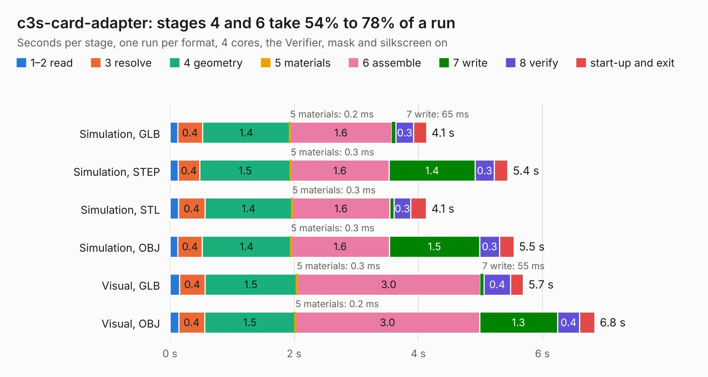

# 2173. c3s-card-adapter

Board 2,173 of the 3,125 of [Corpus Testing](../Corpus-Testing.md), on [Corpus Page 21](../CorpusTestingPages/Corpus-Testing-21.md#2173-c3s-card-adapter).

| Mode and format | 1–2 read | 3 resolve | 4 geometry | 5 materials | 6 assemble | 7 write | 8 verify | start-up and exit | Total |
|---|---:|---:|---:|---:|---:|---:|---:|---:|---:|
| Simulation, GLB | 0.1 | 0.4 | 1.4 | 0.2&nbsp;ms | 1.6 | 65&nbsp;ms | 0.3 | 0.2 | 4.1 |
| Simulation, STEP | 0.1 | 0.4 | 1.5 | 0.3&nbsp;ms | 1.6 | 1.4 | 0.3 | 0.2 | 5.4 |
| Simulation, STL | 0.1 | 0.4 | 1.4 | 0.3&nbsp;ms | 1.6 | 69&nbsp;ms | 0.3 | 0.3 | 4.1 |
| Simulation, OBJ | 0.1 | 0.4 | 1.4 | 0.3&nbsp;ms | 1.6 | 1.5 | 0.3 | 0.2 | 5.5 |
| Visual, GLB | 0.2 | 0.4 | 1.5 | 0.3&nbsp;ms | 3.0 | 55&nbsp;ms | 0.4 | 0.2 | 5.7 |
| Visual, OBJ | 0.1 | 0.4 | 1.5 | 0.2&nbsp;ms | 3.0 | 1.3 | 0.4 | 0.2 | 6.8 |

<table align="center"><tr><td valign="top">

| Board | Repo: [oresat/oresat-flatsat](https://github.com/oresat/oresat-flatsat) Board: `c3s-card-adapter.kicad_pcb` |
|---|---|
| Folder | c3s-card-adapter |
| Complexity | 225&nbsp;/&nbsp;1000 (size&nbsp;130, features&nbsp;95) |
| KESE&nbsp;features | through vias, filled zones, curved board outline, stack-up, dielectric εr and tanδ, copper finish, mask and silkscreen colours |
| Tested | 9th November 2026 |
| Copper&nbsp;layers | 2 |
| File&nbsp;format | KiCad 9 (20241229) |
| Parts,&nbsp;tracks,&nbsp;vias | 2, 213, 88 |
| Triangles,&nbsp;simulation | 289,626 in 53 parts |
| Verifier | PASS in all six runs |

</td><td valign="top">

<table>
<tr><th>File type</th><th>File size</th><th>Peak memory used</th></tr>
<tr><th colspan="3" align="left">Simulation</th></tr>
<tr><td>GLB</td><td align="right">9.6&nbsp;MB</td><td align="right">251&nbsp;MB</td></tr>
<tr><td>STEP</td><td align="right">46&nbsp;MB</td><td align="right">278&nbsp;MB</td></tr>
<tr><td>STL</td><td align="right">14&nbsp;MB</td><td align="right">247&nbsp;MB</td></tr>
<tr><td>OBJ</td><td align="right">29&nbsp;MB</td><td align="right">246&nbsp;MB</td></tr>
<tr><th colspan="3" align="left">Visual</th></tr>
<tr><td>GLB</td><td align="right">8.4&nbsp;MB</td><td align="right">406&nbsp;MB</td></tr>
<tr><td>OBJ</td><td align="right">26&nbsp;MB</td><td align="right">406&nbsp;MB</td></tr>
</table>

</td></tr></table>

| Previous | Next |
|:---|---:|
| [2172. oresat-c3-surrogate](b2172b_oresat-flatsat_oresat-c3-surrogate.md) | [2174. card-debug-board-2](b2174b_oresat-flatsat_card-debug-board-2.md) |
