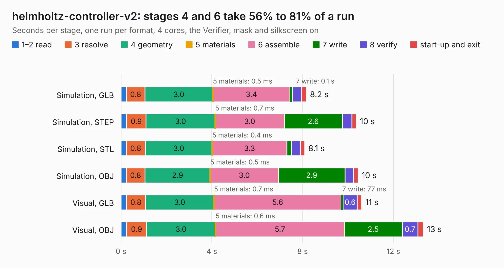

# 2174. helmholtz-controller-v2

Board 2,174 of the 3,112 of [Corpus Testing](../Corpus-Testing.md), on [Corpus Page 21](../CorpusTestingPages/Corpus-Testing-21.md#2174-helmholtz-controller-v2).

| Mode and format | 1–2 read | 3 resolve | 4 geometry | 5 materials | 6 assemble | 7 write | 8 verify | start-up and exit | Total |
|---|---:|---:|---:|---:|---:|---:|---:|---:|---:|
| Simulation, GLB | 0.2 | 0.8 | 3.0 | 0.5&nbsp;ms | 3.4 | 0.1 | 0.4 | 0.2 | 8.2 |
| Simulation, STEP | 0.2 | 0.9 | 3.0 | 0.7&nbsp;ms | 3.0 | 2.6 | 0.4 | 0.2 | 10.4 |
| Simulation, STL | 0.2 | 0.8 | 3.0 | 0.4&nbsp;ms | 3.3 | 0.2 | 0.4 | 0.2 | 8.1 |
| Simulation, OBJ | 0.2 | 0.8 | 2.9 | 0.5&nbsp;ms | 3.0 | 2.9 | 0.4 | 0.2 | 10.4 |
| Visual, GLB | 0.2 | 0.8 | 3.0 | 0.7&nbsp;ms | 5.6 | 77&nbsp;ms | 0.6 | 0.2 | 10.6 |
| Visual, OBJ | 0.2 | 0.9 | 3.0 | 0.6&nbsp;ms | 5.7 | 2.5 | 0.7 | 0.2 | 13.3 |

<table align="center"><tr><td valign="top">

| Board | Repo: [oresat/oresat-helmholtz](https://github.com/oresat/oresat-helmholtz) Board: `helmholtz-controller-v2.kicad_pcb` |
|---|---|
| Folder | controller-v2 |
| Complexity | 277&nbsp;/&nbsp;1000 (size&nbsp;172, features&nbsp;105) |
| KESE&nbsp;features | through vias, rounded, trapezoid or chamfered pads, filled zones, curved board outline, stack-up, dielectric εr and tanδ, copper finish, mask and silkscreen colours |
| Tested | 9th November 2026 |
| Copper&nbsp;layers | 2 |
| File&nbsp;format | KiCad 9 (20241229) |
| Parts,&nbsp;tracks,&nbsp;vias | 46, 416, 200 |
| Triangles,&nbsp;simulation | 776,982 in 109 parts |
| Verifier | PASS in all six runs |

</td><td valign="top">

<table>
<tr><th>File type</th><th>File size</th><th>Peak memory used</th></tr>
<tr><th colspan="3" align="left">Simulation</th></tr>
<tr><td>GLB</td><td align="right">26&nbsp;MB</td><td align="right">433&nbsp;MB</td></tr>
<tr><td>STEP</td><td align="right">123&nbsp;MB</td><td align="right">514&nbsp;MB</td></tr>
<tr><td>STL</td><td align="right">39&nbsp;MB</td><td align="right">445&nbsp;MB</td></tr>
<tr><td>OBJ</td><td align="right">79&nbsp;MB</td><td align="right">565&nbsp;MB</td></tr>
<tr><th colspan="3" align="left">Visual</th></tr>
<tr><td>GLB</td><td align="right">21&nbsp;MB</td><td align="right">594&nbsp;MB</td></tr>
<tr><td>OBJ</td><td align="right">64&nbsp;MB</td><td align="right">569&nbsp;MB</td></tr>
</table>

</td></tr></table>

| Previous | Next |
|:---|---:|
| [2173. oresat-gps-card](b2173b_oresat-gps-hardware_oresat-gps-card.md) | [2175. helmholtz-controller](b2175b_oresat-helmholtz_helmholtz-controller.md) |
