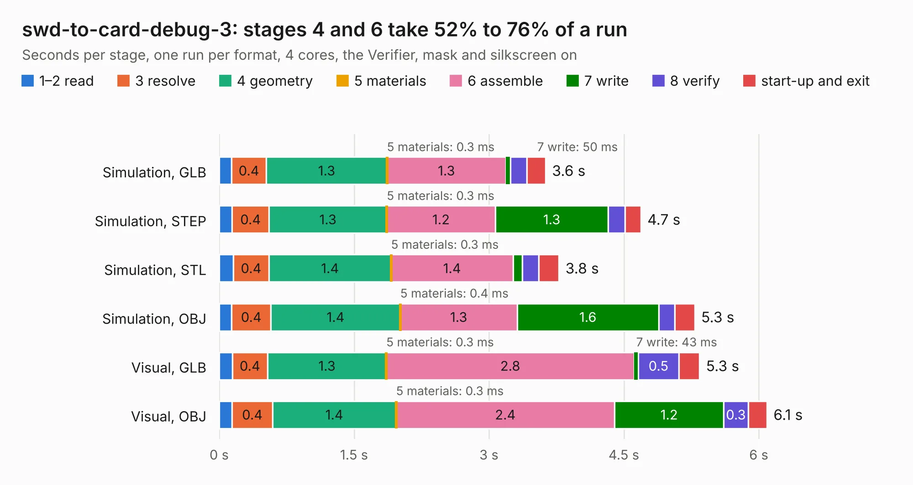

# 2175. swd-to-card-debug-3

Board 2,175 of the 3,121 of [Corpus Testing](../Corpus-Testing.md), on [Corpus Page 21](../CorpusTestingPages/Corpus-Testing-21.md#2175-swd-to-card-debug-3).

| Mode and format | 1–2 read | 3 resolve | 4 geometry | 5 materials | 6 assemble | 7 write | 8 verify | start-up and exit | Total |
|---|---:|---:|---:|---:|---:|---:|---:|---:|---:|
| Simulation, GLB | 0.1 | 0.4 | 1.3 | 0.3&nbsp;ms | 1.3 | 50&nbsp;ms | 0.2 | 0.2 | 3.6 |
| Simulation, STEP | 0.1 | 0.4 | 1.3 | 0.3&nbsp;ms | 1.2 | 1.3 | 0.2 | 0.2 | 4.7 |
| Simulation, STL | 0.2 | 0.4 | 1.4 | 0.3&nbsp;ms | 1.4 | 0.1 | 0.2 | 0.2 | 3.8 |
| Simulation, OBJ | 0.1 | 0.4 | 1.4 | 0.4&nbsp;ms | 1.3 | 1.6 | 0.2 | 0.2 | 5.3 |
| Visual, GLB | 0.1 | 0.4 | 1.3 | 0.3&nbsp;ms | 2.8 | 43&nbsp;ms | 0.5 | 0.2 | 5.3 |
| Visual, OBJ | 0.1 | 0.4 | 1.4 | 0.3&nbsp;ms | 2.4 | 1.2 | 0.3 | 0.2 | 6.1 |

<table align="center"><tr><td valign="top">

| Board | Repo: [oresat/oresat-flatsat](https://github.com/oresat/oresat-flatsat) Board: `swd-to-card-debug-3.kicad_pcb` |
|---|---|
| Folder | swd-to-card-debug-3 |
| Complexity | 263&nbsp;/&nbsp;1000 (size&nbsp;148, features&nbsp;115) |
| KESE&nbsp;features | through vias, slotted holes, rounded, trapezoid or chamfered pads, filled zones, curved board outline, stack-up, dielectric εr and tanδ, copper finish, mask and silkscreen colours |
| Tested | 9th November 2026 |
| Copper&nbsp;layers | 2 |
| File&nbsp;format | KiCad 9 (20241229) |
| Parts,&nbsp;tracks,&nbsp;vias | 14, 184, 103 |
| Triangles,&nbsp;simulation | 405,560 in 39 parts |
| Verifier | PASS in all six runs |

</td><td valign="top">

<table>
<tr><th>File type</th><th>File size</th><th>Peak memory used</th></tr>
<tr><th colspan="3" align="left">Simulation</th></tr>
<tr><td>GLB</td><td align="right">14&nbsp;MB</td><td align="right">272&nbsp;MB</td></tr>
<tr><td>STEP</td><td align="right">57&nbsp;MB</td><td align="right">321&nbsp;MB</td></tr>
<tr><td>STL</td><td align="right">20&nbsp;MB</td><td align="right">272&nbsp;MB</td></tr>
<tr><td>OBJ</td><td align="right">41&nbsp;MB</td><td align="right">331&nbsp;MB</td></tr>
<tr><th colspan="3" align="left">Visual</th></tr>
<tr><td>GLB</td><td align="right">11&nbsp;MB</td><td align="right">314&nbsp;MB</td></tr>
<tr><td>OBJ</td><td align="right">32&nbsp;MB</td><td align="right">314&nbsp;MB</td></tr>
</table>

</td></tr></table>

| Previous | Next |
|:---|---:|
| [2174. oresat-flatsat-interface](b2174b_oresat-flatsat_oresat-flatsat-interface.md) | [2176. usb_gps](b2176b_oresat-gps-hardware_usb-gps.md) |
