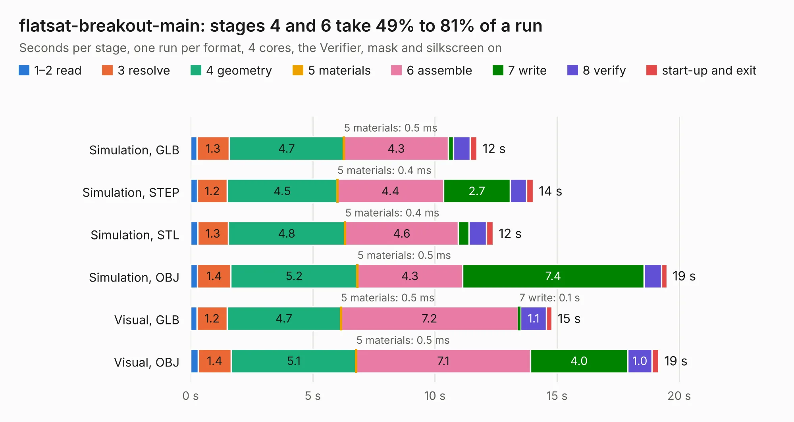

# 2176. flatsat-breakout-main

Board 2,176 of the 3,124 of [Corpus Testing](../Corpus-Testing.md), on [Corpus Page 21](../CorpusTestingPages/Corpus-Testing-21.md#2176-flatsat-breakout-main).

| Mode and format | 1–2 read | 3 resolve | 4 geometry | 5 materials | 6 assemble | 7 write | 8 verify | start-up and exit | Total |
|---|---:|---:|---:|---:|---:|---:|---:|---:|---:|
| Simulation, GLB | 0.3 | 1.3 | 4.7 | 0.5&nbsp;ms | 4.3 | 0.2 | 0.7 | 0.3 | 11.7 |
| Simulation, STEP | 0.3 | 1.2 | 4.5 | 0.4&nbsp;ms | 4.4 | 2.7 | 0.7 | 0.3 | 14.0 |
| Simulation, STL | 0.3 | 1.3 | 4.8 | 0.4&nbsp;ms | 4.6 | 0.4 | 0.7 | 0.3 | 12.4 |
| Simulation, OBJ | 0.3 | 1.4 | 5.2 | 0.5&nbsp;ms | 4.3 | 7.4 | 0.7 | 0.2 | 19.5 |
| Visual, GLB | 0.3 | 1.2 | 4.7 | 0.5&nbsp;ms | 7.2 | 0.1 | 1.1 | 0.2 | 14.8 |
| Visual, OBJ | 0.3 | 1.4 | 5.1 | 0.5&nbsp;ms | 7.1 | 4.0 | 1.0 | 0.3 | 19.2 |

<table align="center"><tr><td valign="top">

| Board | Repo: [oresat/oresat-flatsat](https://github.com/oresat/oresat-flatsat) Board: `flatsat-breakout-main.kicad_pcb` |
|---|---|
| Folder | flatsat-breakout |
| Complexity | 269&nbsp;/&nbsp;1000 (size&nbsp;164, features&nbsp;105) |
| KESE&nbsp;features | through vias, rounded, trapezoid or chamfered pads, filled zones, curved board outline, stack-up, dielectric εr and tanδ, copper finish, mask and silkscreen colours |
| Tested | 9th November 2026 |
| Copper&nbsp;layers | 4 |
| File&nbsp;format | KiCad 9 (20241229) |
| Parts,&nbsp;tracks,&nbsp;vias | 5, 380, 162 |
| Triangles,&nbsp;simulation | 1,354,072 in 34 parts |
| Verifier | PASS in all six runs |

</td><td valign="top">

<table>
<tr><th>File type</th><th>File size</th><th>Peak memory used</th></tr>
<tr><th colspan="3" align="left">Simulation</th></tr>
<tr><td>GLB</td><td align="right">46&nbsp;MB</td><td align="right">512&nbsp;MB</td></tr>
<tr><td>STEP</td><td align="right">140&nbsp;MB</td><td align="right">607&nbsp;MB</td></tr>
<tr><td>STL</td><td align="right">68&nbsp;MB</td><td align="right">494&nbsp;MB</td></tr>
<tr><td>OBJ</td><td align="right">140&nbsp;MB</td><td align="right">914&nbsp;MB</td></tr>
<tr><th colspan="3" align="left">Visual</th></tr>
<tr><td>GLB</td><td align="right">23&nbsp;MB</td><td align="right">551&nbsp;MB</td></tr>
<tr><td>OBJ</td><td align="right">70&nbsp;MB</td><td align="right">599&nbsp;MB</td></tr>
</table>

</td></tr></table>

| Previous | Next |
|:---|---:|
| [2175. card-debug-board-3](b2175b_oresat-flatsat_card-debug-board-3.md) | [2177. oresat-flatsat-interface](b2177b_oresat-flatsat_oresat-flatsat-interface.md) |
