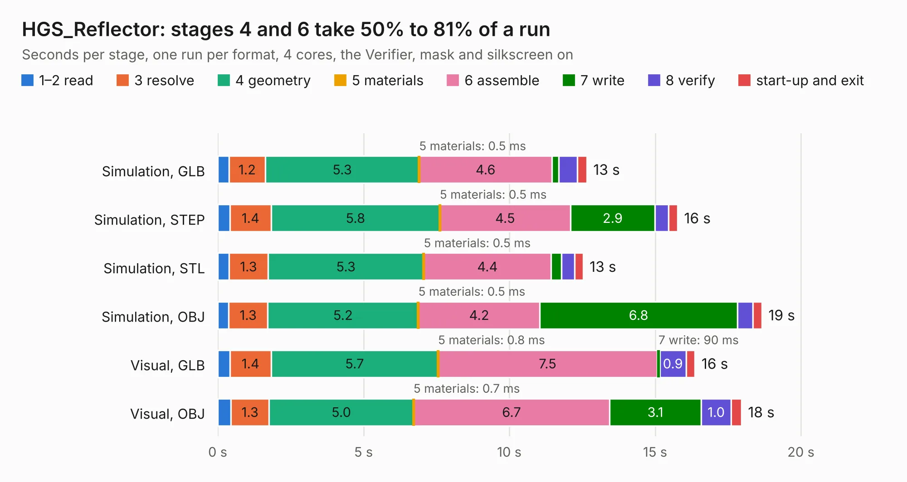

# 2176. HGS_Reflector

Board 2,176 of the 3,101 of [Corpus Testing](../Corpus-Testing.md), on [Corpus Page 21](../CorpusTestingPages/Corpus-Testing-21.md#2176-hgs_reflector).

| Mode and format | 1–2 read | 3 resolve | 4 geometry | 5 materials | 6 assemble | 7 write | 8 verify | start-up and exit | Total |
|---|---:|---:|---:|---:|---:|---:|---:|---:|---:|
| Simulation, GLB | 0.4 | 1.2 | 5.3 | 0.5&nbsp;ms | 4.6 | 0.2 | 0.6 | 0.3 | 12.7 |
| Simulation, STEP | 0.4 | 1.4 | 5.8 | 0.5&nbsp;ms | 4.5 | 2.9 | 0.5 | 0.3 | 15.8 |
| Simulation, STL | 0.4 | 1.3 | 5.3 | 0.5&nbsp;ms | 4.4 | 0.4 | 0.5 | 0.3 | 12.5 |
| Simulation, OBJ | 0.4 | 1.3 | 5.2 | 0.5&nbsp;ms | 4.2 | 6.8 | 0.5 | 0.3 | 18.7 |
| Visual, GLB | 0.4 | 1.4 | 5.7 | 0.8&nbsp;ms | 7.5 | 90&nbsp;ms | 0.9 | 0.3 | 16.4 |
| Visual, OBJ | 0.5 | 1.3 | 5.0 | 0.7&nbsp;ms | 6.7 | 3.1 | 1.0 | 0.3 | 18.0 |

<table align="center"><tr><td valign="top">

| Board | Repo: [oresat/oresat-live-handheld-ground-station](https://github.com/oresat/oresat-live-handheld-ground-station) Board: `HGS_Reflector.kicad_pcb` |
|---|---|
| Folder | pcba / KiCad |
| Complexity | 270&nbsp;/&nbsp;1000 (size&nbsp;180, features&nbsp;90) |
| KESE&nbsp;features | through vias, rounded, trapezoid or chamfered pads, filled zones, curved board outline, stack-up, dielectric εr and tanδ, mask and silkscreen colours |
| Tested | 9th November 2026 |
| Copper&nbsp;layers | 4 |
| File&nbsp;format | KiCad 8 (20240108) |
| Parts,&nbsp;tracks,&nbsp;vias | 55, 145, 134 |
| Triangles,&nbsp;simulation | 1,008,332 in 63 parts |
| Verifier | PASS in all six runs |

</td><td valign="top">

<table>
<tr><th>File type</th><th>File size</th><th>Peak memory used</th></tr>
<tr><th colspan="3" align="left">Simulation</th></tr>
<tr><td>GLB</td><td align="right">34&nbsp;MB</td><td align="right">452&nbsp;MB</td></tr>
<tr><td>STEP</td><td align="right">119&nbsp;MB</td><td align="right">481&nbsp;MB</td></tr>
<tr><td>STL</td><td align="right">50&nbsp;MB</td><td align="right">463&nbsp;MB</td></tr>
<tr><td>OBJ</td><td align="right">103&nbsp;MB</td><td align="right">721&nbsp;MB</td></tr>
<tr><th colspan="3" align="left">Visual</th></tr>
<tr><td>GLB</td><td align="right">18&nbsp;MB</td><td align="right">442&nbsp;MB</td></tr>
<tr><td>OBJ</td><td align="right">55&nbsp;MB</td><td align="right">467&nbsp;MB</td></tr>
</table>

</td></tr></table>

| Previous | Next |
|:---|---:|
| [2175. transformer](b2175b_oresat-live-handheld-ground-station_transformer.md) | [2177. oresat-live-card](b2177b_oresat-proto-card_oresat-live-card.md) |
