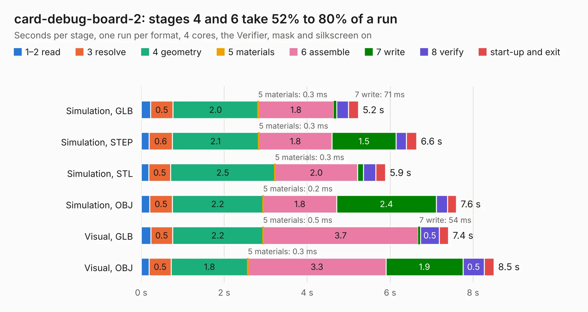

# 2177. card-debug-board-2

Board 2,177 of the 3,130 of [Corpus Testing](../Corpus-Testing.md), on [Corpus Page 21](../CorpusTestingPages/Corpus-Testing-21.md#2177-card-debug-board-2).

| Mode and format | 1–2 read | 3 resolve | 4 geometry | 5 materials | 6 assemble | 7 write | 8 verify | start-up and exit | Total |
|---|---:|---:|---:|---:|---:|---:|---:|---:|---:|
| Simulation, GLB | 0.2 | 0.5 | 2.0 | 0.3&nbsp;ms | 1.8 | 71&nbsp;ms | 0.3 | 0.2 | 5.2 |
| Simulation, STEP | 0.2 | 0.6 | 2.1 | 0.3&nbsp;ms | 1.8 | 1.5 | 0.2 | 0.2 | 6.6 |
| Simulation, STL | 0.2 | 0.5 | 2.5 | 0.3&nbsp;ms | 2.0 | 0.1 | 0.3 | 0.2 | 5.9 |
| Simulation, OBJ | 0.2 | 0.5 | 2.2 | 0.2&nbsp;ms | 1.8 | 2.4 | 0.3 | 0.2 | 7.6 |
| Visual, GLB | 0.2 | 0.5 | 2.2 | 0.5&nbsp;ms | 3.7 | 54&nbsp;ms | 0.5 | 0.2 | 7.4 |
| Visual, OBJ | 0.2 | 0.5 | 1.8 | 0.3&nbsp;ms | 3.3 | 1.9 | 0.5 | 0.2 | 8.5 |

<table align="center"><tr><td valign="top">

| Board | Repo: [oresat/oresat-flatsat](https://github.com/oresat/oresat-flatsat) Board: `card-debug-board-2.kicad_pcb` |
|---|---|
| Folder | card-debug-board-2 |
| Complexity | 234&nbsp;/&nbsp;1000 (size&nbsp;144, features&nbsp;90) |
| KESE&nbsp;features | through vias, rounded, trapezoid or chamfered pads, filled zones, stack-up, dielectric εr and tanδ, copper finish |
| Tested | 9th November 2026 |
| Copper&nbsp;layers | 2 |
| File&nbsp;format | KiCad 9 (20241229) |
| Parts,&nbsp;tracks,&nbsp;vias | 16, 198, 55 |
| Triangles,&nbsp;simulation | 428,828 in 58 parts |
| Verifier | PASS in all six runs |

</td><td valign="top">

<table>
<tr><th>File type</th><th>File size</th><th>Peak memory used</th></tr>
<tr><th colspan="3" align="left">Simulation</th></tr>
<tr><td>GLB</td><td align="right">15&nbsp;MB</td><td align="right">277&nbsp;MB</td></tr>
<tr><td>STEP</td><td align="right">70&nbsp;MB</td><td align="right">335&nbsp;MB</td></tr>
<tr><td>STL</td><td align="right">21&nbsp;MB</td><td align="right">279&nbsp;MB</td></tr>
<tr><td>OBJ</td><td align="right">43&nbsp;MB</td><td align="right">348&nbsp;MB</td></tr>
<tr><th colspan="3" align="left">Visual</th></tr>
<tr><td>GLB</td><td align="right">12&nbsp;MB</td><td align="right">334&nbsp;MB</td></tr>
<tr><td>OBJ</td><td align="right">34&nbsp;MB</td><td align="right">330&nbsp;MB</td></tr>
</table>

</td></tr></table>

| Previous | Next |
|:---|---:|
| [2176. c3s-card-adapter](b2176b_oresat-flatsat_c3s-card-adapter.md) | [2178. card-debug-board-3](b2178b_oresat-flatsat_card-debug-board-3.md) |
