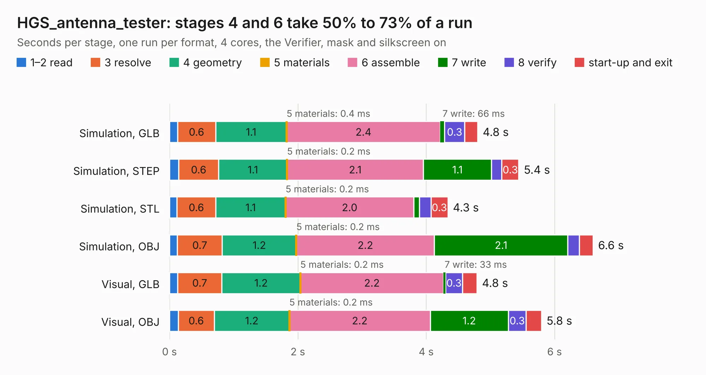

# 2177. HGS_antenna_tester

Board 2,177 of the 3,106 of [Corpus Testing](../Corpus-Testing.md), on [Corpus Page 21](../CorpusTestingPages/Corpus-Testing-21.md#2177-hgs_antenna_tester).

| Mode and format | 1–2 read | 3 resolve | 4 geometry | 5 materials | 6 assemble | 7 write | 8 verify | start-up and exit | Total |
|---|---:|---:|---:|---:|---:|---:|---:|---:|---:|
| Simulation, GLB | 0.1 | 0.6 | 1.1 | 0.4&nbsp;ms | 2.4 | 66&nbsp;ms | 0.3 | 0.2 | 4.8 |
| Simulation, STEP | 0.1 | 0.6 | 1.1 | 0.2&nbsp;ms | 2.1 | 1.1 | 0.2 | 0.3 | 5.4 |
| Simulation, STL | 0.1 | 0.6 | 1.1 | 0.2&nbsp;ms | 2.0 | 91&nbsp;ms | 0.2 | 0.3 | 4.3 |
| Simulation, OBJ | 0.1 | 0.7 | 1.2 | 0.2&nbsp;ms | 2.2 | 2.1 | 0.2 | 0.2 | 6.6 |
| Visual, GLB | 0.1 | 0.7 | 1.2 | 0.2&nbsp;ms | 2.2 | 33&nbsp;ms | 0.3 | 0.2 | 4.8 |
| Visual, OBJ | 0.1 | 0.6 | 1.2 | 0.2&nbsp;ms | 2.2 | 1.2 | 0.3 | 0.2 | 5.8 |

<table align="center"><tr><td valign="top">

| Board | Repo: [oresat/oresat-live-handheld-ground-station](https://github.com/oresat/oresat-live-handheld-ground-station) Board: `HGS_antenna_tester.kicad_pcb` |
|---|---|
| Folder | PCB-Legos / Antenna tester |
| Complexity | 267&nbsp;/&nbsp;1000 (size&nbsp;157, features&nbsp;110) |
| KESE&nbsp;features | through vias, custom pads, rounded, trapezoid or chamfered pads, filled zones, copper drawings, curved board outline, stack-up, dielectric εr and tanδ |
| Tested | 9th November 2026 |
| Copper&nbsp;layers | 4 |
| File&nbsp;format | KiCad 6 (20211014) |
| Parts,&nbsp;tracks,&nbsp;vias | 4, 9, 209 |
| Triangles,&nbsp;simulation | 392,316 in 15 parts |
| Verifier | PASS in all six runs |

</td><td valign="top">

<table>
<tr><th>File type</th><th>File size</th><th>Peak memory used</th></tr>
<tr><th colspan="3" align="left">Simulation</th></tr>
<tr><td>GLB</td><td align="right">12&nbsp;MB</td><td align="right">313&nbsp;MB</td></tr>
<tr><td>STEP</td><td align="right">15&nbsp;MB</td><td align="right">340&nbsp;MB</td></tr>
<tr><td>STL</td><td align="right">20&nbsp;MB</td><td align="right">316&nbsp;MB</td></tr>
<tr><td>OBJ</td><td align="right">38&nbsp;MB</td><td align="right">329&nbsp;MB</td></tr>
<tr><th colspan="3" align="left">Visual</th></tr>
<tr><td>GLB</td><td align="right">7.6&nbsp;MB</td><td align="right">299&nbsp;MB</td></tr>
<tr><td>OBJ</td><td align="right">22&nbsp;MB</td><td align="right">298&nbsp;MB</td></tr>
</table>

</td></tr></table>

| Previous | Next |
|:---|---:|
| [2176. 50_ohm_microstrip_experiment](b2176b_oresat-live-handheld-ground-station_50-ohm-microstrip-experiment.md) | [2178. open_stub_experiment](b2178b_oresat-live-handheld-ground-station_open-stub-experiment.md) |
