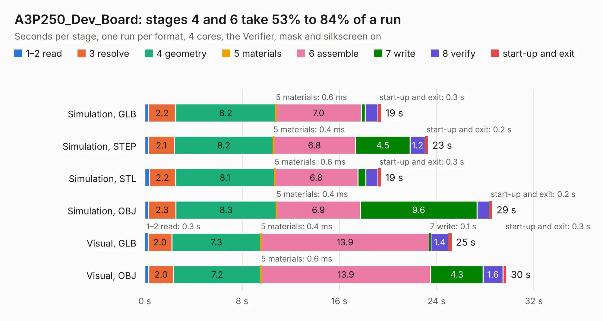

# 2180. A3P250_Dev_Board

Board 2,180 of the 3,122 of [Corpus Testing](../Corpus-Testing.md), on [Corpus Page 21](../CorpusTestingPages/Corpus-Testing-21.md#2180-a3p250_dev_board).

| Mode and format | 1–2 read | 3 resolve | 4 geometry | 5 materials | 6 assemble | 7 write | 8 verify | start-up and exit | Total |
|---|---:|---:|---:|---:|---:|---:|---:|---:|---:|
| Simulation, GLB | 0.3 | 2.2 | 8.2 | 0.6&nbsp;ms | 7.0 | 0.3 | 1.0 | 0.3 | 19.4 |
| Simulation, STEP | 0.3 | 2.1 | 8.2 | 0.4&nbsp;ms | 6.8 | 4.5 | 1.2 | 0.2 | 23.3 |
| Simulation, STL | 0.4 | 2.2 | 8.1 | 0.6&nbsp;ms | 6.8 | 0.7 | 1.0 | 0.3 | 19.4 |
| Simulation, OBJ | 0.3 | 2.3 | 8.3 | 0.4&nbsp;ms | 6.9 | 9.6 | 1.0 | 0.2 | 28.6 |
| Visual, GLB | 0.3 | 2.0 | 7.3 | 0.4&nbsp;ms | 13.9 | 0.1 | 1.4 | 0.3 | 25.2 |
| Visual, OBJ | 0.3 | 2.0 | 7.2 | 0.6&nbsp;ms | 13.9 | 4.3 | 1.6 | 0.3 | 29.8 |

<table align="center"><tr><td valign="top">

| Board | Repo: [oresat/oresat-gps-hardware](https://github.com/oresat/oresat-gps-hardware) Board: `A3P250_Dev_Board.kicad_pcb` |
|---|---|
| Folder | MicroSemi_FPGA_Dev_Board / kicad_board_design / A3P250_Dev_Board |
| Complexity | 282&nbsp;/&nbsp;1000 (size&nbsp;237, features&nbsp;45) |
| KESE&nbsp;features | through vias, rounded, trapezoid or chamfered pads, filled zones |
| Tested | 9th November 2026 to 10th November 2026 |
| Copper&nbsp;layers | 4 |
| File&nbsp;format | KiCad 5 (20171130) |
| Parts,&nbsp;tracks,&nbsp;vias | 53, 1,191, 123 |
| Triangles,&nbsp;simulation | 1,856,362 in 107 parts |
| Verifier | PASS in all six runs |
| Run&nbsp;again | Simulation, GLB; Simulation, STEP; Simulation, STL; Simulation, OBJ: failed in the corpus run, run again with fixes to KESE made after the corpus run, and passed |

</td><td valign="top">

<table>
<tr><th>File type</th><th>File size</th><th>Peak memory used</th></tr>
<tr><th colspan="3" align="left">Simulation</th></tr>
<tr><td>GLB</td><td align="right">65&nbsp;MB</td><td align="right">577&nbsp;MB</td></tr>
<tr><td>STEP</td><td align="right">301&nbsp;MB</td><td align="right">698&nbsp;MB</td></tr>
<tr><td>STL</td><td align="right">93&nbsp;MB</td><td align="right">602&nbsp;MB</td></tr>
<tr><td>OBJ</td><td align="right">197&nbsp;MB</td><td align="right">1.3&nbsp;GB</td></tr>
<tr><th colspan="3" align="left">Visual</th></tr>
<tr><td>GLB</td><td align="right">34&nbsp;MB</td><td align="right">685&nbsp;MB</td></tr>
<tr><td>OBJ</td><td align="right">103&nbsp;MB</td><td align="right">758&nbsp;MB</td></tr>
</table>

</td></tr></table>

| Previous | Next |
|:---|---:|
| [2179. 1.5V_switcher_test](b2179b_oresat-gps-hardware_1-5V-switcher-test.md) | [2181. switcher](b2181b_oresat-gps-hardware_switcher.md) |
