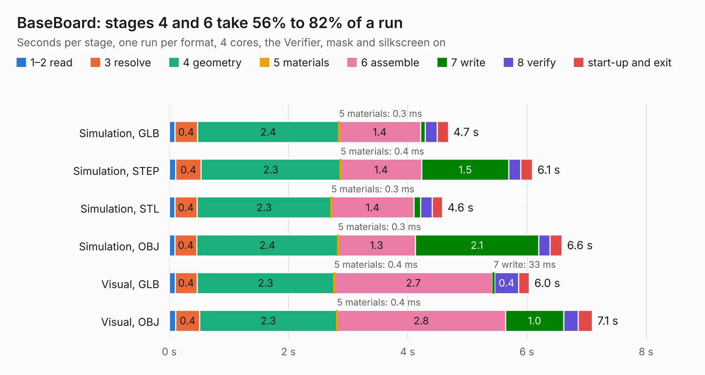

# 2180. BaseBoard

Board 2,180 of the 3,124 of [Corpus Testing](../Corpus-Testing.md), on [Corpus Page 21](../CorpusTestingPages/Corpus-Testing-21.md#2180-baseboard).

| Mode and format | 1–2 read | 3 resolve | 4 geometry | 5 materials | 6 assemble | 7 write | 8 verify | start-up and exit | Total |
|---|---:|---:|---:|---:|---:|---:|---:|---:|---:|
| Simulation, GLB | 95&nbsp;ms | 0.4 | 2.4 | 0.3&nbsp;ms | 1.4 | 81&nbsp;ms | 0.2 | 0.2 | 4.7 |
| Simulation, STEP | 0.1 | 0.4 | 2.3 | 0.4&nbsp;ms | 1.4 | 1.5 | 0.2 | 0.2 | 6.1 |
| Simulation, STL | 94&nbsp;ms | 0.4 | 2.3 | 0.3&nbsp;ms | 1.4 | 0.1 | 0.2 | 0.2 | 4.6 |
| Simulation, OBJ | 94&nbsp;ms | 0.4 | 2.4 | 0.3&nbsp;ms | 1.3 | 2.1 | 0.2 | 0.2 | 6.6 |
| Visual, GLB | 99&nbsp;ms | 0.4 | 2.3 | 0.4&nbsp;ms | 2.7 | 33&nbsp;ms | 0.4 | 0.2 | 6.0 |
| Visual, OBJ | 0.1 | 0.4 | 2.3 | 0.4&nbsp;ms | 2.8 | 1.0 | 0.2 | 0.2 | 7.1 |

<table align="center"><tr><td valign="top">

| Board | Repo: [oresat/oresat-gps-hardware](https://github.com/oresat/oresat-gps-hardware) Board: `BaseBoard.kicad_pcb` |
|---|---|
| Folder | MicroSemi_FPGA_Dev_Board / kicad_base_board_design / BaseBoard |
| Complexity | 136&nbsp;/&nbsp;1000 (size&nbsp;126, features&nbsp;10) |
| KESE&nbsp;features | rounded, trapezoid or chamfered pads |
| Tested | 9th November 2026 |
| Copper&nbsp;layers | 2 |
| File&nbsp;format | KiCad 5 (20171130) |
| Parts,&nbsp;tracks,&nbsp;vias | 8, 189, 0 |
| Triangles,&nbsp;simulation | 486,040 in 102 parts |
| Verifier | PASS in all six runs |

</td><td valign="top">

<table>
<tr><th>File type</th><th>File size</th><th>Peak memory used</th></tr>
<tr><th colspan="3" align="left">Simulation</th></tr>
<tr><td>GLB</td><td align="right">17&nbsp;MB</td><td align="right">314&nbsp;MB</td></tr>
<tr><td>STEP</td><td align="right">85&nbsp;MB</td><td align="right">337&nbsp;MB</td></tr>
<tr><td>STL</td><td align="right">24&nbsp;MB</td><td align="right">304&nbsp;MB</td></tr>
<tr><td>OBJ</td><td align="right">49&nbsp;MB</td><td align="right">376&nbsp;MB</td></tr>
<tr><th colspan="3" align="left">Visual</th></tr>
<tr><td>GLB</td><td align="right">8.1&nbsp;MB</td><td align="right">316&nbsp;MB</td></tr>
<tr><td>OBJ</td><td align="right">24&nbsp;MB</td><td align="right">312&nbsp;MB</td></tr>
</table>

</td></tr></table>

| Previous | Next |
|:---|---:|
| [2179. usb_gps](b2179b_oresat-gps-hardware_usb-gps.md) | [2181. 1.5V_switcher_test](b2181b_oresat-gps-hardware_1-5V-switcher-test.md) |
