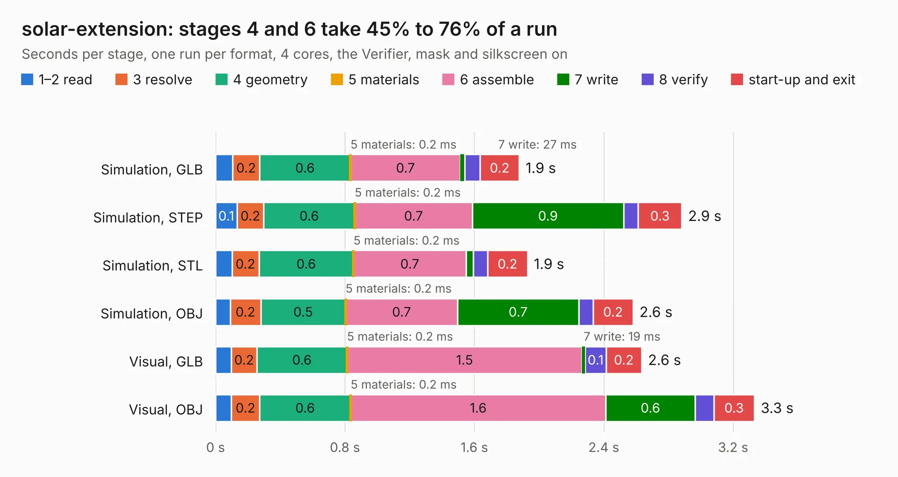

# 2180. solar-extension

Board 2,180 of the 3,100 of [Corpus Testing](../Corpus-Testing.md), on [Corpus Page 21](../CorpusTestingPages/Corpus-Testing-21.md#2180-solar-extension).

| Mode and format | 1–2 read | 3 resolve | 4 geometry | 5 materials | 6 assemble | 7 write | 8 verify | start-up and exit | Total |
|---|---:|---:|---:|---:|---:|---:|---:|---:|---:|
| Simulation, GLB | 0.1 | 0.2 | 0.6 | 0.2&nbsp;ms | 0.7 | 27&nbsp;ms | 95&nbsp;ms | 0.2 | 1.9 |
| Simulation, STEP | 0.1 | 0.2 | 0.6 | 0.2&nbsp;ms | 0.7 | 0.9 | 91&nbsp;ms | 0.3 | 2.9 |
| Simulation, STL | 0.1 | 0.2 | 0.6 | 0.2&nbsp;ms | 0.7 | 44&nbsp;ms | 89&nbsp;ms | 0.2 | 1.9 |
| Simulation, OBJ | 90&nbsp;ms | 0.2 | 0.5 | 0.2&nbsp;ms | 0.7 | 0.7 | 89&nbsp;ms | 0.2 | 2.6 |
| Visual, GLB | 98&nbsp;ms | 0.2 | 0.6 | 0.2&nbsp;ms | 1.5 | 19&nbsp;ms | 0.1 | 0.2 | 2.6 |
| Visual, OBJ | 98&nbsp;ms | 0.2 | 0.6 | 0.2&nbsp;ms | 1.6 | 0.6 | 0.1 | 0.3 | 3.3 |

<table align="center"><tr><td valign="top">

| Board | Repo: [oresat/oresat-solar-hardware](https://github.com/oresat/oresat-solar-hardware) Board: `solar-extension.kicad_pcb` |
|---|---|
| Folder | solar-extension |
| Complexity | 193&nbsp;/&nbsp;1000 (size&nbsp;98, features&nbsp;95) |
| KESE&nbsp;features | through vias, rounded, trapezoid or chamfered pads, filled zones, stack-up, dielectric εr and tanδ, copper finish, mask and silkscreen colours |
| Tested | 9th November 2026 |
| Copper&nbsp;layers | 2 |
| File&nbsp;format | KiCad 10 (20260206) |
| Parts,&nbsp;tracks,&nbsp;vias | 2, 34, 12 |
| Triangles,&nbsp;simulation | 163,872 in 18 parts |
| Verifier | PASS in all six runs |

</td><td valign="top">

<table>
<tr><th>File type</th><th>File size</th><th>Peak memory used</th></tr>
<tr><th colspan="3" align="left">Simulation</th></tr>
<tr><td>GLB</td><td align="right">5.7&nbsp;MB</td><td align="right">204&nbsp;MB</td></tr>
<tr><td>STEP</td><td align="right">23&nbsp;MB</td><td align="right">212&nbsp;MB</td></tr>
<tr><td>STL</td><td align="right">8.2&nbsp;MB</td><td align="right">203&nbsp;MB</td></tr>
<tr><td>OBJ</td><td align="right">16&nbsp;MB</td><td align="right">204&nbsp;MB</td></tr>
<tr><th colspan="3" align="left">Visual</th></tr>
<tr><td>GLB</td><td align="right">3.8&nbsp;MB</td><td align="right">176&nbsp;MB</td></tr>
<tr><td>OBJ</td><td align="right">11&nbsp;MB</td><td align="right">176&nbsp;MB</td></tr>
</table>

</td></tr></table>

| Previous | Next |
|:---|---:|
| [2179. 1u_panel](b2179b_oresat-solar-hardware_1u-panel.md) | [2181. solar-module-1u-gaas](b2181b_oresat-solar-hardware_solar-module-1u-gaas-MCXN_solar-module-1u-gaas.md) |
