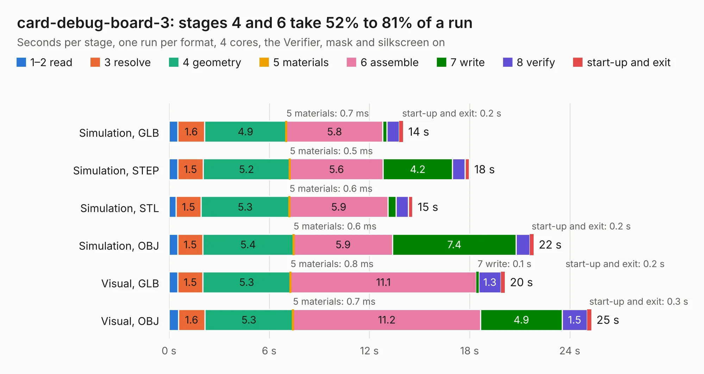

# 2184. card-debug-board-3

Board 2,184 of the 3,138 of [Corpus Testing](../Corpus-Testing.md), on [Corpus Page 21](../CorpusTestingPages/Corpus-Testing-21.md#2184-card-debug-board-3).

| Mode and format | 1–2 read | 3 resolve | 4 geometry | 5 materials | 6 assemble | 7 write | 8 verify | start-up and exit | Total |
|---|---:|---:|---:|---:|---:|---:|---:|---:|---:|
| Simulation, GLB | 0.5 | 1.6 | 4.9 | 0.7&nbsp;ms | 5.8 | 0.3 | 0.7 | 0.2 | 14.0 |
| Simulation, STEP | 0.5 | 1.5 | 5.2 | 0.5&nbsp;ms | 5.6 | 4.2 | 0.7 | 0.3 | 18.0 |
| Simulation, STL | 0.4 | 1.5 | 5.3 | 0.6&nbsp;ms | 5.9 | 0.5 | 0.7 | 0.3 | 14.6 |
| Simulation, OBJ | 0.5 | 1.5 | 5.4 | 0.6&nbsp;ms | 5.9 | 7.4 | 0.8 | 0.2 | 21.8 |
| Visual, GLB | 0.5 | 1.5 | 5.3 | 0.8&nbsp;ms | 11.1 | 0.1 | 1.3 | 0.2 | 20.1 |
| Visual, OBJ | 0.6 | 1.6 | 5.3 | 0.7&nbsp;ms | 11.2 | 4.9 | 1.5 | 0.3 | 25.3 |

<table align="center"><tr><td valign="top">

| Board | Repo: [oresat/oresat-flatsat](https://github.com/oresat/oresat-flatsat) Board: `card-debug-board-3.kicad_pcb` |
|---|---|
| Folder | card-debug-board-3 |
| Complexity | 354&nbsp;/&nbsp;1000 (size&nbsp;239, features&nbsp;115) |
| KESE&nbsp;features | through vias, slotted holes, rounded, trapezoid or chamfered pads, filled zones, curved board outline, stack-up, dielectric εr and tanδ, copper finish, mask and silkscreen colours |
| Tested | 9th November 2026 |
| Copper&nbsp;layers | 4 |
| File&nbsp;format | KiCad 10 (20260206) |
| Parts,&nbsp;tracks,&nbsp;vias | 78, 599, 249 |
| Triangles,&nbsp;simulation | 1,544,806 in 114 parts |
| Verifier | PASS in all six runs |

</td><td valign="top">

<table>
<tr><th>File type</th><th>File size</th><th>Peak memory used</th></tr>
<tr><th colspan="3" align="left">Simulation</th></tr>
<tr><td>GLB</td><td align="right">52&nbsp;MB</td><td align="right">591&nbsp;MB</td></tr>
<tr><td>STEP</td><td align="right">208&nbsp;MB</td><td align="right">740&nbsp;MB</td></tr>
<tr><td>STL</td><td align="right">77&nbsp;MB</td><td align="right">595&nbsp;MB</td></tr>
<tr><td>OBJ</td><td align="right">160&nbsp;MB</td><td align="right">1.0&nbsp;GB</td></tr>
<tr><th colspan="3" align="left">Visual</th></tr>
<tr><td>GLB</td><td align="right">34&nbsp;MB</td><td align="right">686&nbsp;MB</td></tr>
<tr><td>OBJ</td><td align="right">104&nbsp;MB</td><td align="right">779&nbsp;MB</td></tr>
</table>

</td></tr></table>

| Previous | Next |
|:---|---:|
| [2183. card-debug-board-2](b2183b_oresat-flatsat_card-debug-board-2.md) | [2185. flatsat-breakout-main](b2185b_oresat-flatsat_flatsat-breakout-main.md) |
