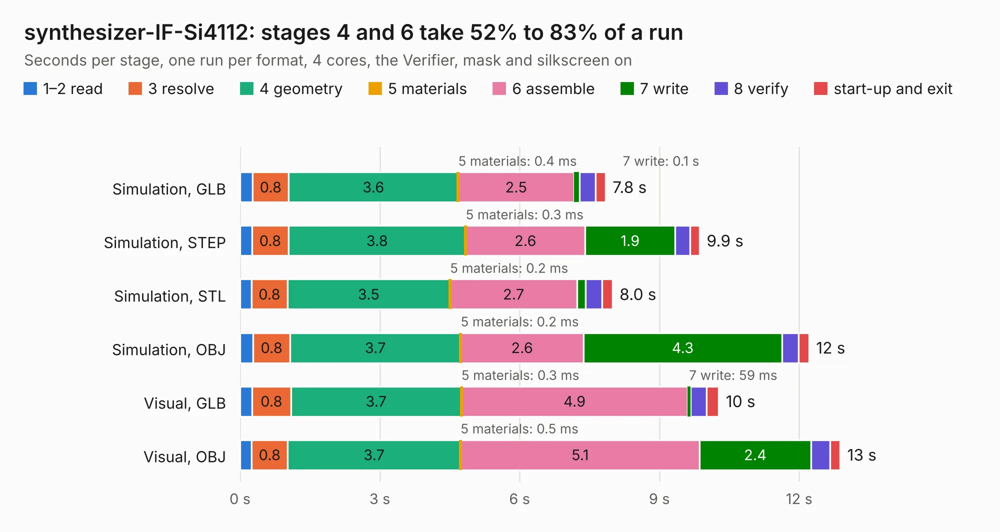

# 2185. synthesizer-IF-Si4112

Board 2,185 of the 3,118 of [Corpus Testing](../Corpus-Testing.md), on [Corpus Page 21](../CorpusTestingPages/Corpus-Testing-21.md#2185-synthesizer-if-si4112).

| Mode and format | 1–2 read | 3 resolve | 4 geometry | 5 materials | 6 assemble | 7 write | 8 verify | start-up and exit | Total |
|---|---:|---:|---:|---:|---:|---:|---:|---:|---:|
| Simulation, GLB | 0.3 | 0.8 | 3.6 | 0.4&nbsp;ms | 2.5 | 0.1 | 0.3 | 0.2 | 7.8 |
| Simulation, STEP | 0.3 | 0.8 | 3.8 | 0.3&nbsp;ms | 2.6 | 1.9 | 0.3 | 0.2 | 9.9 |
| Simulation, STL | 0.2 | 0.8 | 3.5 | 0.2&nbsp;ms | 2.7 | 0.2 | 0.4 | 0.2 | 8.0 |
| Simulation, OBJ | 0.3 | 0.8 | 3.7 | 0.2&nbsp;ms | 2.6 | 4.3 | 0.4 | 0.2 | 12.2 |
| Visual, GLB | 0.3 | 0.8 | 3.7 | 0.3&nbsp;ms | 4.9 | 59&nbsp;ms | 0.3 | 0.3 | 10.3 |
| Visual, OBJ | 0.3 | 0.8 | 3.7 | 0.5&nbsp;ms | 5.1 | 2.4 | 0.4 | 0.2 | 12.9 |

<table align="center"><tr><td valign="top">

| Board | Repo: [oresat/oresat-kicad](https://github.com/oresat/oresat-kicad) Board: `synthesizer-IF-Si4112.kicad_pcb` |
|---|---|
| Folder | oresat-design-blocks / si4112-design-block |
| Complexity | 237&nbsp;/&nbsp;1000 (size&nbsp;182, features&nbsp;55) |
| KESE&nbsp;features | through vias, rounded, trapezoid or chamfered pads, filled zones, curved board outline |
| Tested | 9th November 2026 |
| Copper&nbsp;layers | 4 |
| File&nbsp;format | KiCad 9 (20241229) |
| Parts,&nbsp;tracks,&nbsp;vias | 40, 202, 178 |
| Triangles,&nbsp;simulation | 778,938 in 35 parts |
| Verifier | PASS in all six runs |

</td><td valign="top">

<table>
<tr><th>File type</th><th>File size</th><th>Peak memory used</th></tr>
<tr><th colspan="3" align="left">Simulation</th></tr>
<tr><td>GLB</td><td align="right">27&nbsp;MB</td><td align="right">402&nbsp;MB</td></tr>
<tr><td>STEP</td><td align="right">88&nbsp;MB</td><td align="right">454&nbsp;MB</td></tr>
<tr><td>STL</td><td align="right">39&nbsp;MB</td><td align="right">403&nbsp;MB</td></tr>
<tr><td>OBJ</td><td align="right">80&nbsp;MB</td><td align="right">574&nbsp;MB</td></tr>
<tr><th colspan="3" align="left">Visual</th></tr>
<tr><td>GLB</td><td align="right">14&nbsp;MB</td><td align="right">377&nbsp;MB</td></tr>
<tr><td>OBJ</td><td align="right">42&nbsp;MB</td><td align="right">377&nbsp;MB</td></tr>
</table>

</td></tr></table>

| Previous | Next |
|:---|---:|
| [2184. oresat-5V2A-regulator](b2184b_oresat-kicad_oresat-5V2A-regulator.md) | [2186. stm32u595-breakout](b2186b_oresat-kicad_stm32u595-breakout.md) |
