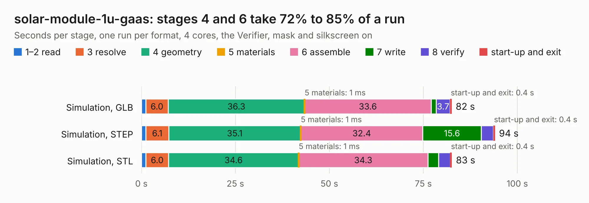

# 2187. solar-module-1u-gaas

Board 2,187 of the 3,106 of [Corpus Testing](../Corpus-Testing.md), on [Corpus Page 21](../CorpusTestingPages/Corpus-Testing-21.md#2187-solar-module-1u-gaas).

| Mode and format | 1–2 read | 3 resolve | 4 geometry | 5 materials | 6 assemble | 7 write | 8 verify | start-up and exit | Total |
|---|---:|---:|---:|---:|---:|---:|---:|---:|---:|
| Simulation, GLB | 1.2 | 6.0 | 36.3 | 1&nbsp;ms | 33.6 | 1.3 | 3.7 | 0.4 | 82.5 |
| Simulation, STEP | 1.2 | 6.1 | 35.1 | 1&nbsp;ms | 32.4 | 15.6 | 3.2 | 0.4 | 94.0 |
| Simulation, STL | 1.2 | 6.0 | 34.6 | 1&nbsp;ms | 34.3 | 2.8 | 3.2 | 0.4 | 82.6 |
| Simulation, OBJ | 1.1 | 5.9 | 33.0 | 1&nbsp;ms | 33.2 | 41.0 | 3.1 | 0.4 | 117.8 |
| Visual, GLB | 1.2 | 5.7 | 34.2 | 1&nbsp;ms | 45.4 | 0.4 | 4.1 | 0.3 | 91.3 |
| Visual, OBJ | 1.1 | 5.8 | 34.9 | 1&nbsp;ms | 44.2 | 13.1 | 4.4 | 0.3 | 103.8 |

<table align="center"><tr><td valign="top">

| Board | Repo: [oresat/oresat-solar-hardware](https://github.com/oresat/oresat-solar-hardware) Board: `solar-module-1u-gaas.kicad_pcb` |
|---|---|
| Folder | solar-module-1u-gaas-MCXN |
| Complexity | 397&nbsp;/&nbsp;1000 (size&nbsp;262, features&nbsp;135) |
| KESE&nbsp;features | through vias, custom pads, rounded, trapezoid or chamfered pads, arc tracks, filled zones, copper drawings, stack-up, dielectric εr and tanδ, copper finish, mask and silkscreen colours |
| Tested | 9th November 2026 |
| Copper&nbsp;layers | 4 |
| File&nbsp;format | KiCad 10 (20260206) |
| Parts,&nbsp;tracks,&nbsp;vias | 85, 660, 1,503 |
| Triangles,&nbsp;simulation | 7,159,088 in 134 parts |
| Verifier | PASS in all six runs |

</td><td valign="top">

<table>
<tr><th>File type</th><th>File size</th><th>Peak memory used</th></tr>
<tr><th colspan="3" align="left">Simulation</th></tr>
<tr><td>GLB</td><td align="right">240&nbsp;MB</td><td align="right">1.9&nbsp;GB</td></tr>
<tr><td>STEP</td><td align="right">699&nbsp;MB</td><td align="right">2.7&nbsp;GB</td></tr>
<tr><td>STL</td><td align="right">358&nbsp;MB</td><td align="right">1.9&nbsp;GB</td></tr>
<tr><td>OBJ</td><td align="right">763&nbsp;MB</td><td align="right">4.5&nbsp;GB</td></tr>
<tr><th colspan="3" align="left">Visual</th></tr>
<tr><td>GLB</td><td align="right">84&nbsp;MB</td><td align="right">1.8&nbsp;GB</td></tr>
<tr><td>OBJ</td><td align="right">272&nbsp;MB</td><td align="right">1.8&nbsp;GB</td></tr>
</table>

</td></tr></table>

| Previous | Next |
|:---|---:|
| [2186. solar-extension](b2186b_oresat-solar-hardware_solar-extension.md) | [2188. solar-module-1u-gaas](b2188b_oresat-solar-hardware_solar-module-1u-gaas_solar-module-1u-gaas.md) |
