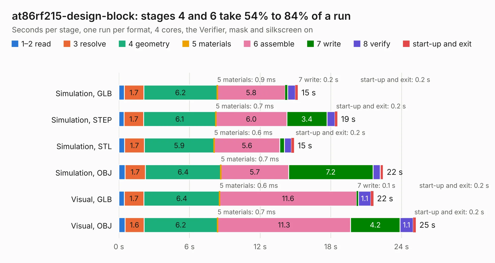

# 2188. at86rf215-design-block

Board 2,188 of the 3,124 of [Corpus Testing](../Corpus-Testing.md), on [Corpus Page 21](../CorpusTestingPages/Corpus-Testing-21.md#2188-at86rf215-design-block).

| Mode and format | 1–2 read | 3 resolve | 4 geometry | 5 materials | 6 assemble | 7 write | 8 verify | start-up and exit | Total |
|---|---:|---:|---:|---:|---:|---:|---:|---:|---:|
| Simulation, GLB | 0.5 | 1.7 | 6.2 | 0.9&nbsp;ms | 5.8 | 0.2 | 0.6 | 0.2 | 15.2 |
| Simulation, STEP | 0.4 | 1.7 | 6.1 | 0.7&nbsp;ms | 6.0 | 3.4 | 0.7 | 0.2 | 18.6 |
| Simulation, STL | 0.5 | 1.7 | 5.9 | 0.6&nbsp;ms | 5.6 | 0.4 | 0.6 | 0.2 | 14.9 |
| Simulation, OBJ | 0.5 | 1.7 | 6.4 | 0.7&nbsp;ms | 5.7 | 7.2 | 0.6 | 0.3 | 22.4 |
| Visual, GLB | 0.5 | 1.7 | 6.4 | 0.6&nbsp;ms | 11.6 | 0.1 | 1.1 | 0.2 | 21.6 |
| Visual, OBJ | 0.5 | 1.6 | 6.2 | 0.7&nbsp;ms | 11.3 | 4.2 | 1.1 | 0.2 | 25.2 |

<table align="center"><tr><td valign="top">

| Board | Repo: [oresat/oresat-kicad](https://github.com/oresat/oresat-kicad) Board: `at86rf215-design-block.kicad_pcb` |
|---|---|
| Folder | oresat-design-blocks / at86rf215-design-block |
| Complexity | 368&nbsp;/&nbsp;1000 (size&nbsp;238, features&nbsp;130) |
| KESE&nbsp;features | through vias, slotted holes, rounded, trapezoid or chamfered pads, arc tracks, filled zones, curved board outline, stack-up, dielectric εr and tanδ, copper finish, mask and silkscreen colours |
| Tested | 9th November 2026 |
| Copper&nbsp;layers | 4 |
| File&nbsp;format | KiCad 10 (20260206) |
| Parts,&nbsp;tracks,&nbsp;vias | 65, 419, 345 |
| Triangles,&nbsp;simulation | 1,570,480 in 76 parts |
| Verifier | PASS in all six runs |

</td><td valign="top">

<table>
<tr><th>File type</th><th>File size</th><th>Peak memory used</th></tr>
<tr><th colspan="3" align="left">Simulation</th></tr>
<tr><td>GLB</td><td align="right">54&nbsp;MB</td><td align="right">692&nbsp;MB</td></tr>
<tr><td>STEP</td><td align="right">195&nbsp;MB</td><td align="right">756&nbsp;MB</td></tr>
<tr><td>STL</td><td align="right">79&nbsp;MB</td><td align="right">694&nbsp;MB</td></tr>
<tr><td>OBJ</td><td align="right">165&nbsp;MB</td><td align="right">1.1&nbsp;GB</td></tr>
<tr><th colspan="3" align="left">Visual</th></tr>
<tr><td>GLB</td><td align="right">32&nbsp;MB</td><td align="right">687&nbsp;MB</td></tr>
<tr><td>OBJ</td><td align="right">97&nbsp;MB</td><td align="right">759&nbsp;MB</td></tr>
</table>

</td></tr></table>

| Previous | Next |
|:---|---:|
| [2187. helmholtz-controller](b2187b_oresat-helmholtz_helmholtz-controller.md) | [2189. transceiver-AX5043](b2189b_oresat-kicad_transceiver-AX5043.md) |
