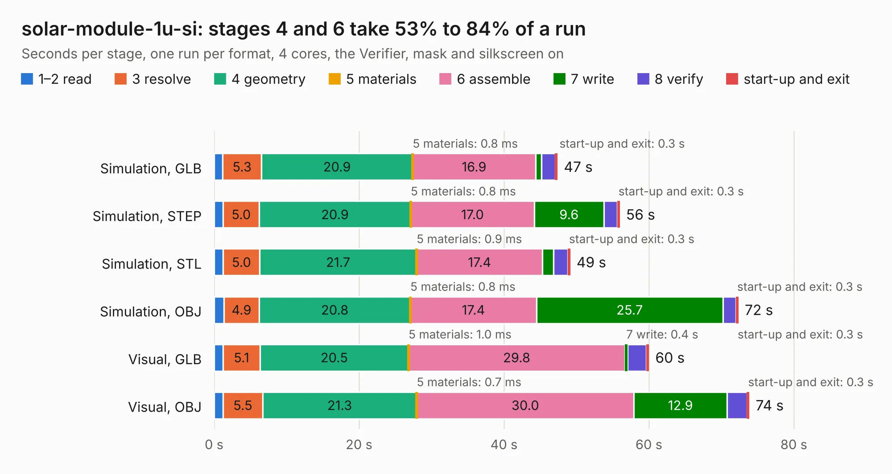

# 2188. solar-module-1u-si

Board 2,188 of the 3,105 of [Corpus Testing](../Corpus-Testing.md), on [Corpus Page 21](../CorpusTestingPages/Corpus-Testing-21.md#2188-solar-module-1u-si).

| Mode and format | 1–2 read | 3 resolve | 4 geometry | 5 materials | 6 assemble | 7 write | 8 verify | start-up and exit | Total |
|---|---:|---:|---:|---:|---:|---:|---:|---:|---:|
| Simulation, GLB | 1.2 | 5.3 | 20.9 | 0.8&nbsp;ms | 16.9 | 0.8 | 1.9 | 0.3 | 47.4 |
| Simulation, STEP | 1.3 | 5.0 | 20.9 | 0.8&nbsp;ms | 17.0 | 9.6 | 1.9 | 0.3 | 56.0 |
| Simulation, STL | 1.3 | 5.0 | 21.7 | 0.9&nbsp;ms | 17.4 | 1.5 | 2.0 | 0.3 | 49.1 |
| Simulation, OBJ | 1.3 | 4.9 | 20.8 | 0.8&nbsp;ms | 17.4 | 25.7 | 1.8 | 0.3 | 72.3 |
| Visual, GLB | 1.2 | 5.1 | 20.5 | 1.0&nbsp;ms | 29.8 | 0.4 | 2.6 | 0.3 | 60.0 |
| Visual, OBJ | 1.2 | 5.5 | 21.3 | 0.7&nbsp;ms | 30.0 | 12.9 | 2.8 | 0.3 | 73.9 |

<table align="center"><tr><td valign="top">

| Board | Repo: [oresat/oresat-solar-hardware](https://github.com/oresat/oresat-solar-hardware) Board: `solar-module-1u-si.kicad_pcb` |
|---|---|
| Folder | solar-module-1u-si-MCXN |
| Complexity | 399&nbsp;/&nbsp;1000 (size&nbsp;264, features&nbsp;135) |
| KESE&nbsp;features | through vias, custom pads, rounded, trapezoid or chamfered pads, arc tracks, filled zones, copper drawings, stack-up, dielectric εr and tanδ, copper finish, mask and silkscreen colours |
| Tested | 9th November 2026 |
| Copper&nbsp;layers | 4 |
| File&nbsp;format | KiCad 9 (20241229) |
| Parts,&nbsp;tracks,&nbsp;vias | 123, 597, 1,365 |
| Triangles,&nbsp;simulation | 4,929,576 in 160 parts |
| Verifier | PASS in all six runs |

</td><td valign="top">

<table>
<tr><th>File type</th><th>File size</th><th>Peak memory used</th></tr>
<tr><th colspan="3" align="left">Simulation</th></tr>
<tr><td>GLB</td><td align="right">168&nbsp;MB</td><td align="right">1.8&nbsp;GB</td></tr>
<tr><td>STEP</td><td align="right">495&nbsp;MB</td><td align="right">2.0&nbsp;GB</td></tr>
<tr><td>STL</td><td align="right">246&nbsp;MB</td><td align="right">1.7&nbsp;GB</td></tr>
<tr><td>OBJ</td><td align="right">529&nbsp;MB</td><td align="right">3.2&nbsp;GB</td></tr>
<tr><th colspan="3" align="left">Visual</th></tr>
<tr><td>GLB</td><td align="right">79&nbsp;MB</td><td align="right">1.5&nbsp;GB</td></tr>
<tr><td>OBJ</td><td align="right">252&nbsp;MB</td><td align="right">1.8&nbsp;GB</td></tr>
</table>

</td></tr></table>

| Previous | Next |
|:---|---:|
| [2187. solar-module-1u-gaas](b2187b_oresat-solar-hardware_solar-module-1u-gaas_solar-module-1u-gaas.md) | [2189. solar-module-1u-si](b2189b_oresat-solar-hardware_solar-module-1u-si_solar-module-1u-si.md) |
