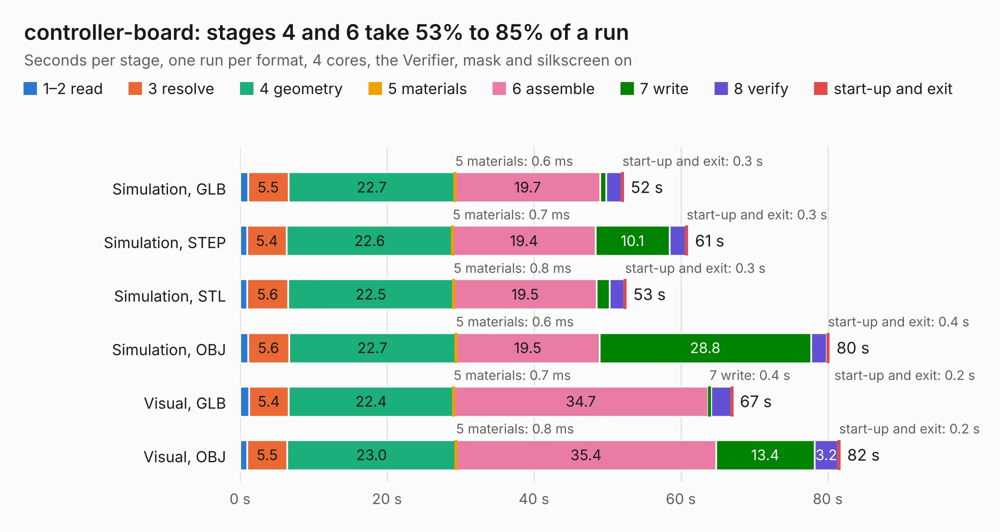

# 2188. controller-board

Board 2,188 of the 3,101 of [Corpus Testing](../Corpus-Testing.md), on [Corpus Page 21](../CorpusTestingPages/Corpus-Testing-21.md#2188-controller-board).

| Mode and format | 1–2 read | 3 resolve | 4 geometry | 5 materials | 6 assemble | 7 write | 8 verify | start-up and exit | Total |
|---|---:|---:|---:|---:|---:|---:|---:|---:|---:|
| Simulation, GLB | 1.1 | 5.5 | 22.7 | 0.6&nbsp;ms | 19.7 | 0.9 | 2.1 | 0.3 | 52.2 |
| Simulation, STEP | 1.0 | 5.4 | 22.6 | 0.7&nbsp;ms | 19.4 | 10.1 | 2.2 | 0.3 | 61.0 |
| Simulation, STL | 0.9 | 5.6 | 22.5 | 0.8&nbsp;ms | 19.5 | 1.7 | 2.0 | 0.3 | 52.5 |
| Simulation, OBJ | 1.1 | 5.6 | 22.7 | 0.6&nbsp;ms | 19.5 | 28.8 | 2.1 | 0.4 | 80.2 |
| Visual, GLB | 1.2 | 5.4 | 22.4 | 0.7&nbsp;ms | 34.7 | 0.4 | 2.8 | 0.2 | 67.1 |
| Visual, OBJ | 1.0 | 5.5 | 23.0 | 0.8&nbsp;ms | 35.4 | 13.4 | 3.2 | 0.2 | 81.7 |

<table align="center"><tr><td valign="top">

| Board | Repo: [oresat/oresat-solar-simulator-hardware](https://github.com/oresat/oresat-solar-simulator-hardware) Board: `controller-board.kicad_pcb` |
|---|---|
| Folder | boards / controller-board |
| Complexity | 329&nbsp;/&nbsp;1000 (size&nbsp;224, features&nbsp;105) |
| KESE&nbsp;features | through vias, rounded, trapezoid or chamfered pads, filled zones, curved board outline, stack-up, dielectric εr and tanδ, copper finish, mask and silkscreen colours |
| Tested | 9th November 2026 |
| Copper&nbsp;layers | 4 |
| File&nbsp;format | KiCad 10 (20260206) |
| Parts,&nbsp;tracks,&nbsp;vias | 96, 456, 1,687 |
| Triangles,&nbsp;simulation | 5,365,408 in 90 parts |
| Verifier | PASS in all six runs |

</td><td valign="top">

<table>
<tr><th>File type</th><th>File size</th><th>Peak memory used</th></tr>
<tr><th colspan="3" align="left">Simulation</th></tr>
<tr><td>GLB</td><td align="right">179&nbsp;MB</td><td align="right">1.8&nbsp;GB</td></tr>
<tr><td>STEP</td><td align="right">489&nbsp;MB</td><td align="right">2.1&nbsp;GB</td></tr>
<tr><td>STL</td><td align="right">268&nbsp;MB</td><td align="right">1.8&nbsp;GB</td></tr>
<tr><td>OBJ</td><td align="right">569&nbsp;MB</td><td align="right">3.4&nbsp;GB</td></tr>
<tr><th colspan="3" align="left">Visual</th></tr>
<tr><td>GLB</td><td align="right">84&nbsp;MB</td><td align="right">1.7&nbsp;GB</td></tr>
<tr><td>OBJ</td><td align="right">272&nbsp;MB</td><td align="right">1.9&nbsp;GB</td></tr>
</table>

</td></tr></table>

| Previous | Next |
|:---|---:|
| [2187. connector-breakout](b2187b_oresat-solar-simulator-hardware_connector-breakout.md) | [2189. cree-xega-led-breakout](b2189b_oresat-solar-simulator-hardware_cree-xega-led-breakout.md) |
