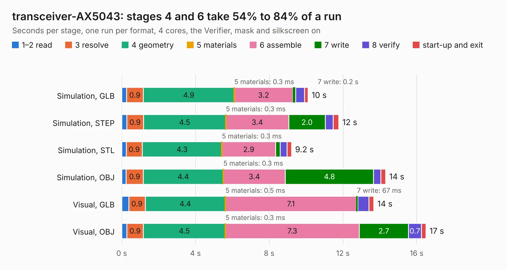

# 2189. transceiver-AX5043

Board 2,189 of the 3,124 of [Corpus Testing](../Corpus-Testing.md), on [Corpus Page 21](../CorpusTestingPages/Corpus-Testing-21.md#2189-transceiver-ax5043).

| Mode and format | 1–2 read | 3 resolve | 4 geometry | 5 materials | 6 assemble | 7 write | 8 verify | start-up and exit | Total |
|---|---:|---:|---:|---:|---:|---:|---:|---:|---:|
| Simulation, GLB | 0.3 | 0.9 | 4.9 | 0.3&nbsp;ms | 3.2 | 0.2 | 0.5 | 0.2 | 10.1 |
| Simulation, STEP | 0.3 | 0.9 | 4.5 | 0.3&nbsp;ms | 3.4 | 2.0 | 0.4 | 0.3 | 11.8 |
| Simulation, STL | 0.2 | 0.9 | 4.3 | 0.3&nbsp;ms | 2.9 | 0.3 | 0.4 | 0.2 | 9.2 |
| Simulation, OBJ | 0.2 | 0.9 | 4.4 | 0.3&nbsp;ms | 3.4 | 4.8 | 0.4 | 0.3 | 14.3 |
| Visual, GLB | 0.4 | 0.9 | 4.4 | 0.5&nbsp;ms | 7.1 | 67&nbsp;ms | 0.6 | 0.3 | 13.7 |
| Visual, OBJ | 0.3 | 0.9 | 4.5 | 0.3&nbsp;ms | 7.3 | 2.7 | 0.7 | 0.2 | 16.5 |

<table align="center"><tr><td valign="top">

| Board | Repo: [oresat/oresat-kicad](https://github.com/oresat/oresat-kicad) Board: `transceiver-AX5043.kicad_pcb` |
|---|---|
| Folder | oresat-design-blocks / ax5043-design-block |
| Complexity | 255&nbsp;/&nbsp;1000 (size&nbsp;185, features&nbsp;70) |
| KESE&nbsp;features | through vias, rounded, trapezoid or chamfered pads, arc tracks, filled zones, curved board outline |
| Tested | 9th November 2026 |
| Copper&nbsp;layers | 4 |
| File&nbsp;format | KiCad 9 (20241229) |
| Parts,&nbsp;tracks,&nbsp;vias | 43, 158, 234 |
| Triangles,&nbsp;simulation | 901,424 in 46 parts |
| Verifier | PASS in all six runs |

</td><td valign="top">

<table>
<tr><th>File type</th><th>File size</th><th>Peak memory used</th></tr>
<tr><th colspan="3" align="left">Simulation</th></tr>
<tr><td>GLB</td><td align="right">31&nbsp;MB</td><td align="right">446&nbsp;MB</td></tr>
<tr><td>STEP</td><td align="right">95&nbsp;MB</td><td align="right">483&nbsp;MB</td></tr>
<tr><td>STL</td><td align="right">45&nbsp;MB</td><td align="right">436&nbsp;MB</td></tr>
<tr><td>OBJ</td><td align="right">91&nbsp;MB</td><td align="right">646&nbsp;MB</td></tr>
<tr><th colspan="3" align="left">Visual</th></tr>
<tr><td>GLB</td><td align="right">16&nbsp;MB</td><td align="right">426&nbsp;MB</td></tr>
<tr><td>OBJ</td><td align="right">49&nbsp;MB</td><td align="right">439&nbsp;MB</td></tr>
</table>

</td></tr></table>

| Previous | Next |
|:---|---:|
| [2188. at86rf215-design-block](b2188b_oresat-kicad_at86rf215-design-block.md) | [2190. oresat-5V2A-regulator](b2190b_oresat-kicad_oresat-5V2A-regulator.md) |
