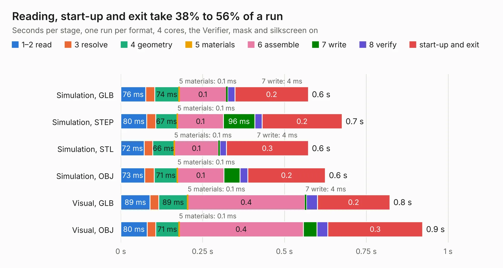

# 2189. open_stub_experiment

Board 2,189 of the 3,117 of [Corpus Testing](../Corpus-Testing.md), on [Corpus Page 21](../CorpusTestingPages/Corpus-Testing-21.md#2189-open_stub_experiment).

| Mode and format | 1–2 read | 3 resolve | 4 geometry | 5 materials | 6 assemble | 7 write | 8 verify | start-up and exit | Total |
|---|---:|---:|---:|---:|---:|---:|---:|---:|---:|
| Simulation, GLB | 76&nbsp;ms | 27&nbsp;ms | 74&nbsp;ms | 0.1&nbsp;ms | 0.1 | 4&nbsp;ms | 22&nbsp;ms | 0.2 | 0.6 |
| Simulation, STEP | 80&nbsp;ms | 27&nbsp;ms | 67&nbsp;ms | 0.1&nbsp;ms | 0.1 | 96&nbsp;ms | 22&nbsp;ms | 0.2 | 0.7 |
| Simulation, STL | 72&nbsp;ms | 26&nbsp;ms | 66&nbsp;ms | 0.1&nbsp;ms | 0.1 | 4&nbsp;ms | 20&nbsp;ms | 0.3 | 0.6 |
| Simulation, OBJ | 73&nbsp;ms | 29&nbsp;ms | 71&nbsp;ms | 0.1&nbsp;ms | 0.1 | 50&nbsp;ms | 24&nbsp;ms | 0.2 | 0.6 |
| Visual, GLB | 89&nbsp;ms | 27&nbsp;ms | 89&nbsp;ms | 0.1&nbsp;ms | 0.4 | 4&nbsp;ms | 34&nbsp;ms | 0.2 | 0.8 |
| Visual, OBJ | 80&nbsp;ms | 26&nbsp;ms | 71&nbsp;ms | 0.1&nbsp;ms | 0.4 | 41&nbsp;ms | 34&nbsp;ms | 0.3 | 0.9 |

<table align="center"><tr><td valign="top">

| Board | Repo: [oresat/oresat-live-handheld-ground-station](https://github.com/oresat/oresat-live-handheld-ground-station) Board: `open_stub_experiment.kicad_pcb` |
|---|---|
| Folder | PCB-Legos / Antenna tester / open_stub_experiment |
| Complexity | 67&nbsp;/&nbsp;1000 (size&nbsp;47, features&nbsp;20) |
| KESE&nbsp;features | filled zones |
| Tested | 9th November 2026 |
| Copper&nbsp;layers | 2 |
| File&nbsp;format | KiCad 6 (20211014) |
| Parts,&nbsp;tracks,&nbsp;vias | 1, 3, 0 |
| Triangles,&nbsp;simulation | 10,008 in 12 parts |
| Verifier | PASS in all six runs |

</td><td valign="top">

<table>
<tr><th>File type</th><th>File size</th><th>Peak memory used</th></tr>
<tr><th colspan="3" align="left">Simulation</th></tr>
<tr><td>GLB</td><td align="right">375&nbsp;kB</td><td align="right">60&nbsp;MB</td></tr>
<tr><td>STEP</td><td align="right">2.1&nbsp;MB</td><td align="right">63&nbsp;MB</td></tr>
<tr><td>STL</td><td align="right">501&nbsp;kB</td><td align="right">60&nbsp;MB</td></tr>
<tr><td>OBJ</td><td align="right">950&nbsp;kB</td><td align="right">64&nbsp;MB</td></tr>
<tr><th colspan="3" align="left">Visual</th></tr>
<tr><td>GLB</td><td align="right">295&nbsp;kB</td><td align="right">79&nbsp;MB</td></tr>
<tr><td>OBJ</td><td align="right">740&nbsp;kB</td><td align="right">80&nbsp;MB</td></tr>
</table>

</td></tr></table>

| Previous | Next |
|:---|---:|
| [2188. HGS_antenna_tester](b2188b_oresat-live-handheld-ground-station_HGS-antenna-tester.md) | [2190. LNA](b2190b_oresat-live-handheld-ground-station_LNA.md) |
