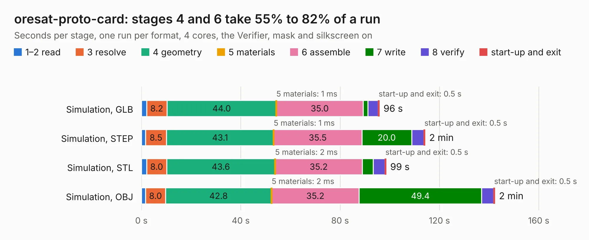

# 2189. oresat-proto-card

Board 2,189 of the 3,111 of [Corpus Testing](../Corpus-Testing.md), on [Corpus Page 21](../CorpusTestingPages/Corpus-Testing-21.md#2189-oresat-proto-card).

| Mode and format | 1–2 read | 3 resolve | 4 geometry | 5 materials | 6 assemble | 7 write | 8 verify | start-up and exit | Total |
|---|---:|---:|---:|---:|---:|---:|---:|---:|---:|
| Simulation, GLB | 2.1 | 8.2 | 44.0 | 1&nbsp;ms | 35.0 | 1.9 | 4.1 | 0.5 | 95.8 |
| Simulation, STEP | 1.6 | 8.5 | 43.1 | 1&nbsp;ms | 35.5 | 20.0 | 4.9 | 0.5 | 114.2 |
| Simulation, STL | 2.1 | 8.0 | 43.6 | 2&nbsp;ms | 35.2 | 4.4 | 4.6 | 0.5 | 98.5 |
| Simulation, OBJ | 1.7 | 8.0 | 42.8 | 2&nbsp;ms | 35.2 | 49.4 | 4.8 | 0.5 | 142.3 |
| Visual, GLB | 2.0 | 7.8 | 42.1 | 1&nbsp;ms | 63.9 | 0.6 | 7.9 | 0.4 | 124.6 |
| Visual, OBJ | 1.8 | 7.7 | 42.6 | 2&nbsp;ms | 63.5 | 19.5 | 7.7 | 0.4 | 143.2 |

<table align="center"><tr><td valign="top">

| Board | Repo: [oresat/oresat-proto-card](https://github.com/oresat/oresat-proto-card) Board: `oresat-proto-card.kicad_pcb` |
|---|---|
| Folder | mcxn-proto-card |
| Complexity | 379&nbsp;/&nbsp;1000 (size&nbsp;264, features&nbsp;115) |
| KESE&nbsp;features | through vias, custom pads, rounded, trapezoid or chamfered pads, drill offsets, filled zones, copper drawings, stack-up, dielectric εr and tanδ, mask and silkscreen colours |
| Tested | 9th November 2026 |
| Copper&nbsp;layers | 4 |
| File&nbsp;format | KiCad 10 (20260206) |
| Parts,&nbsp;tracks,&nbsp;vias | 117, 1,348, 1,117 |
| Triangles,&nbsp;simulation | 8,534,848 in 188 parts |
| Verifier | PASS in all six runs |

</td><td valign="top">

<table>
<tr><th>File type</th><th>File size</th><th>Peak memory used</th></tr>
<tr><th colspan="3" align="left">Simulation</th></tr>
<tr><td>GLB</td><td align="right">288&nbsp;MB</td><td align="right">2.0&nbsp;GB</td></tr>
<tr><td>STEP</td><td align="right">1.1&nbsp;GB</td><td align="right">2.7&nbsp;GB</td></tr>
<tr><td>STL</td><td align="right">427&nbsp;MB</td><td align="right">2.0&nbsp;GB</td></tr>
<tr><td>OBJ</td><td align="right">916&nbsp;MB</td><td align="right">5.4&nbsp;GB</td></tr>
<tr><th colspan="3" align="left">Visual</th></tr>
<tr><td>GLB</td><td align="right">125&nbsp;MB</td><td align="right">2.3&nbsp;GB</td></tr>
<tr><td>OBJ</td><td align="right">406&nbsp;MB</td><td align="right">2.8&nbsp;GB</td></tr>
</table>

</td></tr></table>

| Previous | Next |
|:---|---:|
| [2188. oresat-proto-card](b2188b_oresat-proto-card_m0-proto-card_oresat-proto-card.md) | [2190. 1u_panel](b2190b_oresat-solar-hardware_1u-panel.md) |
