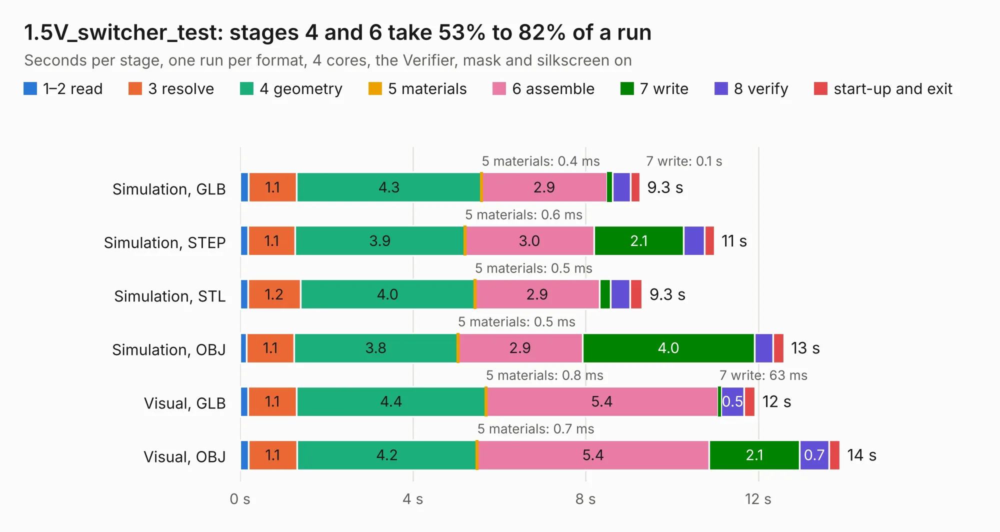

# 2190. 1.5V_switcher_test

Board 2,190 of the 3,138 of [Corpus Testing](../Corpus-Testing.md), on [Corpus Page 21](../CorpusTestingPages/Corpus-Testing-21.md#2190-15v_switcher_test).

| Mode and format | 1–2 read | 3 resolve | 4 geometry | 5 materials | 6 assemble | 7 write | 8 verify | start-up and exit | Total |
|---|---:|---:|---:|---:|---:|---:|---:|---:|---:|
| Simulation, GLB | 0.2 | 1.1 | 4.3 | 0.4&nbsp;ms | 2.9 | 0.1 | 0.4 | 0.2 | 9.3 |
| Simulation, STEP | 0.2 | 1.1 | 3.9 | 0.6&nbsp;ms | 3.0 | 2.1 | 0.5 | 0.2 | 11.0 |
| Simulation, STL | 0.2 | 1.2 | 4.0 | 0.5&nbsp;ms | 2.9 | 0.3 | 0.5 | 0.3 | 9.3 |
| Simulation, OBJ | 0.2 | 1.1 | 3.8 | 0.5&nbsp;ms | 2.9 | 4.0 | 0.4 | 0.2 | 12.6 |
| Visual, GLB | 0.2 | 1.1 | 4.4 | 0.8&nbsp;ms | 5.4 | 63&nbsp;ms | 0.5 | 0.3 | 11.9 |
| Visual, OBJ | 0.2 | 1.1 | 4.2 | 0.7&nbsp;ms | 5.4 | 2.1 | 0.7 | 0.3 | 13.9 |

<table align="center"><tr><td valign="top">

| Board | Repo: [oresat/oresat-gps-hardware](https://github.com/oresat/oresat-gps-hardware) Board: `1.5V_switcher_test.kicad_pcb` |
|---|---|
| Folder | MicroSemi_FPGA_Dev_Board / kicad_board_design / A3P250_Dev_Board |
| Complexity | 257&nbsp;/&nbsp;1000 (size&nbsp;212, features&nbsp;45) |
| KESE&nbsp;features | through vias, rounded, trapezoid or chamfered pads, filled zones |
| Tested | 9th November 2026 |
| Copper&nbsp;layers | 4 |
| File&nbsp;format | KiCad 5 (20171130) |
| Parts,&nbsp;tracks,&nbsp;vias | 39, 266, 50 |
| Triangles,&nbsp;simulation | 851,012 in 105 parts |
| Verifier | PASS in all six runs |

</td><td valign="top">

<table>
<tr><th>File type</th><th>File size</th><th>Peak memory used</th></tr>
<tr><th colspan="3" align="left">Simulation</th></tr>
<tr><td>GLB</td><td align="right">28&nbsp;MB</td><td align="right">366&nbsp;MB</td></tr>
<tr><td>STEP</td><td align="right">115&nbsp;MB</td><td align="right">435&nbsp;MB</td></tr>
<tr><td>STL</td><td align="right">43&nbsp;MB</td><td align="right">345&nbsp;MB</td></tr>
<tr><td>OBJ</td><td align="right">87&nbsp;MB</td><td align="right">594&nbsp;MB</td></tr>
<tr><th colspan="3" align="left">Visual</th></tr>
<tr><td>GLB</td><td align="right">14&nbsp;MB</td><td align="right">403&nbsp;MB</td></tr>
<tr><td>OBJ</td><td align="right">42&nbsp;MB</td><td align="right">396&nbsp;MB</td></tr>
</table>

</td></tr></table>

| Previous | Next |
|:---|---:|
| [2189. BaseBoard](b2189b_oresat-gps-hardware_BaseBoard.md) | [2191. A3P250_Dev_Board](b2191b_oresat-gps-hardware_A3P250-Dev-Board.md) |
