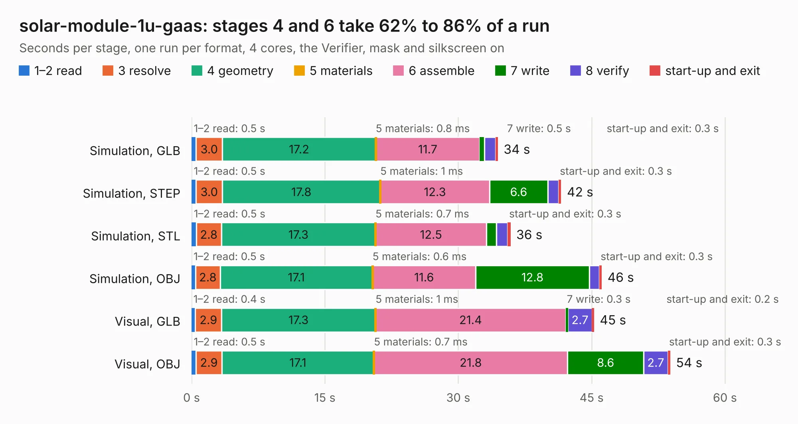

# 2190. solar-module-1u-gaas

Board 2,190 of the 3,108 of [Corpus Testing](../Corpus-Testing.md), on [Corpus Page 21](../CorpusTestingPages/Corpus-Testing-21.md#2190-solar-module-1u-gaas).

| Mode and format | 1–2 read | 3 resolve | 4 geometry | 5 materials | 6 assemble | 7 write | 8 verify | start-up and exit | Total |
|---|---:|---:|---:|---:|---:|---:|---:|---:|---:|
| Simulation, GLB | 0.5 | 3.0 | 17.2 | 0.8&nbsp;ms | 11.7 | 0.5 | 1.2 | 0.3 | 34.5 |
| Simulation, STEP | 0.5 | 3.0 | 17.8 | 1&nbsp;ms | 12.3 | 6.6 | 1.2 | 0.3 | 41.6 |
| Simulation, STL | 0.5 | 2.8 | 17.3 | 0.7&nbsp;ms | 12.5 | 1.1 | 1.3 | 0.3 | 35.9 |
| Simulation, OBJ | 0.5 | 2.8 | 17.1 | 0.6&nbsp;ms | 11.6 | 12.8 | 1.1 | 0.3 | 46.1 |
| Visual, GLB | 0.4 | 2.9 | 17.3 | 1&nbsp;ms | 21.4 | 0.3 | 2.7 | 0.2 | 45.3 |
| Visual, OBJ | 0.5 | 2.9 | 17.1 | 0.7&nbsp;ms | 21.8 | 8.6 | 2.7 | 0.3 | 53.9 |

<table align="center"><tr><td valign="top">

| Board | Repo: [oresat/oresat-solar-hardware](https://github.com/oresat/oresat-solar-hardware) Board: `solar-module-1u-gaas.kicad_pcb` |
|---|---|
| Folder | solar-module-1u-gaas |
| Complexity | 376&nbsp;/&nbsp;1000 (size&nbsp;241, features&nbsp;135) |
| KESE&nbsp;features | through vias, custom pads, rounded, trapezoid or chamfered pads, arc tracks, filled zones, copper drawings, stack-up, dielectric εr and tanδ, copper finish, mask and silkscreen colours |
| Tested | 9th November 2026 |
| Copper&nbsp;layers | 2 |
| File&nbsp;format | KiCad 9 (20241229) |
| Parts,&nbsp;tracks,&nbsp;vias | 77, 689, 1,169 |
| Triangles,&nbsp;simulation | 2,823,184 in 97 parts |
| Verifier | PASS in all six runs |

</td><td valign="top">

<table>
<tr><th>File type</th><th>File size</th><th>Peak memory used</th></tr>
<tr><th colspan="3" align="left">Simulation</th></tr>
<tr><td>GLB</td><td align="right">97&nbsp;MB</td><td align="right">937&nbsp;MB</td></tr>
<tr><td>STEP</td><td align="right">350&nbsp;MB</td><td align="right">1.3&nbsp;GB</td></tr>
<tr><td>STL</td><td align="right">141&nbsp;MB</td><td align="right">925&nbsp;MB</td></tr>
<tr><td>OBJ</td><td align="right">300&nbsp;MB</td><td align="right">1.9&nbsp;GB</td></tr>
<tr><th colspan="3" align="left">Visual</th></tr>
<tr><td>GLB</td><td align="right">57&nbsp;MB</td><td align="right">1.1&nbsp;GB</td></tr>
<tr><td>OBJ</td><td align="right">178&nbsp;MB</td><td align="right">1.3&nbsp;GB</td></tr>
</table>

</td></tr></table>

| Previous | Next |
|:---|---:|
| [2189. solar-module-1u-gaas](b2189b_oresat-solar-hardware_solar-module-1u-gaas-MCXN_solar-module-1u-gaas.md) | [2191. solar-module-1u-si](b2191b_oresat-solar-hardware_solar-module-1u-si-MCXN_solar-module-1u-si.md) |
