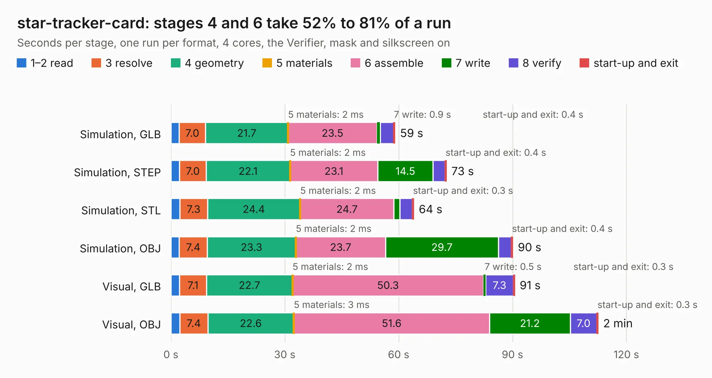

# 2190. star-tracker-card

Board 2,190 of the 3,100 of [Corpus Testing](../Corpus-Testing.md), on [Corpus Page 21](../CorpusTestingPages/Corpus-Testing-21.md#2190-star-tracker-card).

| Mode and format | 1–2 read | 3 resolve | 4 geometry | 5 materials | 6 assemble | 7 write | 8 verify | start-up and exit | Total |
|---|---:|---:|---:|---:|---:|---:|---:|---:|---:|
| Simulation, GLB | 2.1 | 7.0 | 21.7 | 2&nbsp;ms | 23.5 | 0.9 | 3.5 | 0.4 | 59.0 |
| Simulation, STEP | 2.3 | 7.0 | 22.1 | 2&nbsp;ms | 23.1 | 14.5 | 3.1 | 0.4 | 72.6 |
| Simulation, STL | 2.3 | 7.3 | 24.4 | 2&nbsp;ms | 24.7 | 1.6 | 3.3 | 0.3 | 64.0 |
| Simulation, OBJ | 2.2 | 7.4 | 23.3 | 2&nbsp;ms | 23.7 | 29.7 | 3.4 | 0.4 | 90.1 |
| Visual, GLB | 2.2 | 7.1 | 22.7 | 2&nbsp;ms | 50.3 | 0.5 | 7.3 | 0.3 | 90.6 |
| Visual, OBJ | 2.3 | 7.4 | 22.6 | 3&nbsp;ms | 51.6 | 21.2 | 7.0 | 0.3 | 112.6 |

<table align="center"><tr><td valign="top">

| Board | Repo: [oresat/oresat-star-tracker-hardware](https://github.com/oresat/oresat-star-tracker-hardware) Board: `star-tracker-card.kicad_pcb` |
|---|---|
| Folder | hardware / star-tracker-2.0 / star-tracker-2.0-card |
| Complexity | 406&nbsp;/&nbsp;1000 (size&nbsp;286, features&nbsp;120) |
| KESE&nbsp;features | through vias, rounded, trapezoid or chamfered pads, drill offsets, arc tracks, filled zones, stack-up, dielectric εr and tanδ, copper finish, mask and silkscreen colours |
| Tested | 9th November 2026 |
| Copper&nbsp;layers | 4 |
| File&nbsp;format | KiCad 10 (20260206) |
| Parts,&nbsp;tracks,&nbsp;vias | 172, 2,760, 568 |
| Triangles,&nbsp;simulation | 4,613,754 in 441 parts |
| Verifier | PASS in all six runs |

</td><td valign="top">

<table>
<tr><th>File type</th><th>File size</th><th>Peak memory used</th></tr>
<tr><th colspan="3" align="left">Simulation</th></tr>
<tr><td>GLB</td><td align="right">160&nbsp;MB</td><td align="right">1.4&nbsp;GB</td></tr>
<tr><td>STEP</td><td align="right">697&nbsp;MB</td><td align="right">1.9&nbsp;GB</td></tr>
<tr><td>STL</td><td align="right">231&nbsp;MB</td><td align="right">1.4&nbsp;GB</td></tr>
<tr><td>OBJ</td><td align="right">502&nbsp;MB</td><td align="right">3.1&nbsp;GB</td></tr>
<tr><th colspan="3" align="left">Visual</th></tr>
<tr><td>GLB</td><td align="right">110&nbsp;MB</td><td align="right">2.0&nbsp;GB</td></tr>
<tr><td>OBJ</td><td align="right">353&nbsp;MB</td><td align="right">2.6&nbsp;GB</td></tr>
</table>

</td></tr></table>

| Previous | Next |
|:---|---:|
| [2189. sensor-board](b2189b_oresat-solar-simulator-hardware_sensor-board.md) | [2191. star-tracker-camera-board](b2191b_oresat-star-tracker-hardware_hardware-star-tracker-2-0-star-tracker-camera-board-2-0_star-tracker-camera-board.md) |
