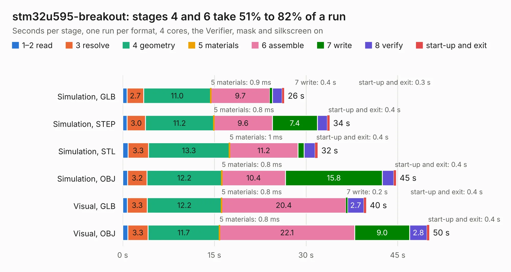

# 2192. stm32u595-breakout

Board 2,192 of the 3,125 of [Corpus Testing](../Corpus-Testing.md), on [Corpus Page 21](../CorpusTestingPages/Corpus-Testing-21.md#2192-stm32u595-breakout).

| Mode and format | 1–2 read | 3 resolve | 4 geometry | 5 materials | 6 assemble | 7 write | 8 verify | start-up and exit | Total |
|---|---:|---:|---:|---:|---:|---:|---:|---:|---:|
| Simulation, GLB | 0.7 | 2.7 | 11.0 | 0.9&nbsp;ms | 9.7 | 0.4 | 1.6 | 0.3 | 26.4 |
| Simulation, STEP | 0.7 | 3.0 | 11.2 | 0.8&nbsp;ms | 9.6 | 7.4 | 1.6 | 0.4 | 33.8 |
| Simulation, STL | 0.9 | 3.3 | 13.3 | 1&nbsp;ms | 11.2 | 1.0 | 1.8 | 0.4 | 31.9 |
| Simulation, OBJ | 0.8 | 3.2 | 12.2 | 0.8&nbsp;ms | 10.4 | 15.8 | 1.9 | 0.4 | 44.7 |
| Visual, GLB | 0.8 | 3.3 | 12.2 | 0.8&nbsp;ms | 20.4 | 0.2 | 2.7 | 0.4 | 39.8 |
| Visual, OBJ | 0.8 | 3.3 | 11.7 | 0.8&nbsp;ms | 22.1 | 9.0 | 2.8 | 0.4 | 50.2 |

<table align="center"><tr><td valign="top">

| Board | Repo: [oresat/oresat-kicad](https://github.com/oresat/oresat-kicad) Board: `stm32u595-breakout.kicad_pcb` |
|---|---|
| Folder | oresat-design-blocks / stm32u595-design-block |
| Complexity | 356&nbsp;/&nbsp;1000 (size&nbsp;241, features&nbsp;115) |
| KESE&nbsp;features | through vias, slotted holes, rounded, trapezoid or chamfered pads, filled zones, curved board outline, stack-up, dielectric εr and tanδ, copper finish, mask and silkscreen colours |
| Tested | 9th November 2026 |
| Copper&nbsp;layers | 4 |
| File&nbsp;format | KiCad 9 (20241229) |
| Parts,&nbsp;tracks,&nbsp;vias | 61, 1,060, 268 |
| Triangles,&nbsp;simulation | 2,289,584 in 129 parts |
| Verifier | PASS in all six runs |

</td><td valign="top">

<table>
<tr><th>File type</th><th>File size</th><th>Peak memory used</th></tr>
<tr><th colspan="3" align="left">Simulation</th></tr>
<tr><td>GLB</td><td align="right">79&nbsp;MB</td><td align="right">796&nbsp;MB</td></tr>
<tr><td>STEP</td><td align="right">299&nbsp;MB</td><td align="right">942&nbsp;MB</td></tr>
<tr><td>STL</td><td align="right">114&nbsp;MB</td><td align="right">793&nbsp;MB</td></tr>
<tr><td>OBJ</td><td align="right">244&nbsp;MB</td><td align="right">1.5&nbsp;GB</td></tr>
<tr><th colspan="3" align="left">Visual</th></tr>
<tr><td>GLB</td><td align="right">44&nbsp;MB</td><td align="right">845&nbsp;MB</td></tr>
<tr><td>OBJ</td><td align="right">136&nbsp;MB</td><td align="right">978&nbsp;MB</td></tr>
</table>

</td></tr></table>

| Previous | Next |
|:---|---:|
| [2191. synthesizer-IF-Si4112](b2191b_oresat-kicad_synthesizer-IF-Si4112.md) | [2193. amp-PA-TQP7M9105-with-detect](b2193b_oresat-kicad_amp-PA-TQP7M9105-with-detect.md) |
