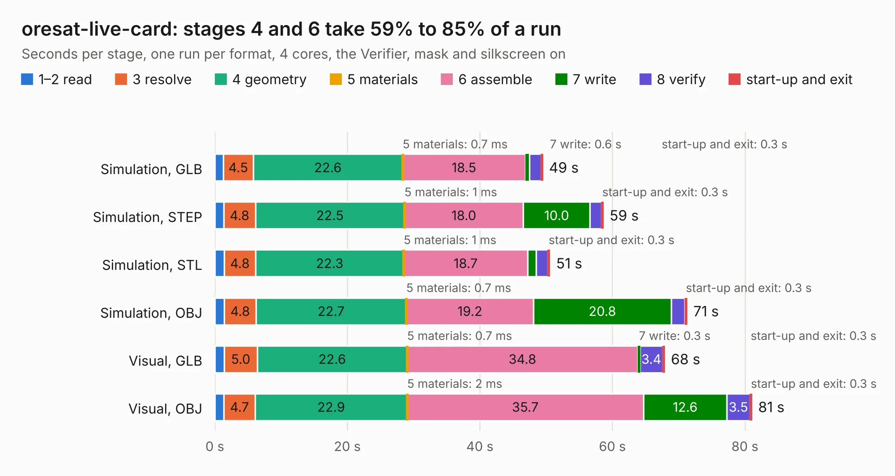

# 2192. oresat-live-card

Board 2,192 of the 3,116 of [Corpus Testing](../Corpus-Testing.md), on [Corpus Page 21](../CorpusTestingPages/Corpus-Testing-21.md#2192-oresat-live-card).

| Mode and format | 1–2 read | 3 resolve | 4 geometry | 5 materials | 6 assemble | 7 write | 8 verify | start-up and exit | Total |
|---|---:|---:|---:|---:|---:|---:|---:|---:|---:|
| Simulation, GLB | 1.3 | 4.5 | 22.6 | 0.7&nbsp;ms | 18.5 | 0.6 | 1.7 | 0.3 | 49.5 |
| Simulation, STEP | 1.3 | 4.8 | 22.5 | 1&nbsp;ms | 18.0 | 10.0 | 1.7 | 0.3 | 58.6 |
| Simulation, STL | 1.4 | 4.8 | 22.3 | 1&nbsp;ms | 18.7 | 1.3 | 1.7 | 0.3 | 50.5 |
| Simulation, OBJ | 1.4 | 4.8 | 22.7 | 0.7&nbsp;ms | 19.2 | 20.8 | 2.1 | 0.3 | 71.2 |
| Visual, GLB | 1.4 | 5.0 | 22.6 | 0.7&nbsp;ms | 34.8 | 0.3 | 3.4 | 0.3 | 67.9 |
| Visual, OBJ | 1.4 | 4.7 | 22.9 | 2&nbsp;ms | 35.7 | 12.6 | 3.5 | 0.3 | 81.0 |

<table align="center"><tr><td valign="top">

| Board | Repo: [oresat/oresat-proto-card](https://github.com/oresat/oresat-proto-card) Board: `oresat-live-card.kicad_pcb` |
|---|---|
| Folder | a8-proto-card / cad-files |
| Complexity | 352&nbsp;/&nbsp;1000 (size&nbsp;287, features&nbsp;65) |
| KESE&nbsp;features | through vias, rounded, trapezoid or chamfered pads, drill offsets, filled zones, curved board outline |
| Tested | 9th November 2026 |
| Copper&nbsp;layers | 4 |
| File&nbsp;format | KiCad 6 (20211014) |
| Parts,&nbsp;tracks,&nbsp;vias | 239, 1,681, 632 |
| Triangles,&nbsp;simulation | 3,866,432 in 258 parts |
| Verifier | PASS in all six runs |

</td><td valign="top">

<table>
<tr><th>File type</th><th>File size</th><th>Peak memory used</th></tr>
<tr><th colspan="3" align="left">Simulation</th></tr>
<tr><td>GLB</td><td align="right">137&nbsp;MB</td><td align="right">1.3&nbsp;GB</td></tr>
<tr><td>STEP</td><td align="right">670&nbsp;MB</td><td align="right">1.7&nbsp;GB</td></tr>
<tr><td>STL</td><td align="right">193&nbsp;MB</td><td align="right">1.3&nbsp;GB</td></tr>
<tr><td>OBJ</td><td align="right">420&nbsp;MB</td><td align="right">2.6&nbsp;GB</td></tr>
<tr><th colspan="3" align="left">Visual</th></tr>
<tr><td>GLB</td><td align="right">83&nbsp;MB</td><td align="right">1.5&nbsp;GB</td></tr>
<tr><td>OBJ</td><td align="right">260&nbsp;MB</td><td align="right">1.8&nbsp;GB</td></tr>
</table>

</td></tr></table>

| Previous | Next |
|:---|---:|
| [2191. HGS_Reflector](b2191b_oresat-live-handheld-ground-station_HGS-Reflector.md) | [2193. oresat-proto-card](b2193b_oresat-proto-card_m0-proto-card_oresat-proto-card.md) |
