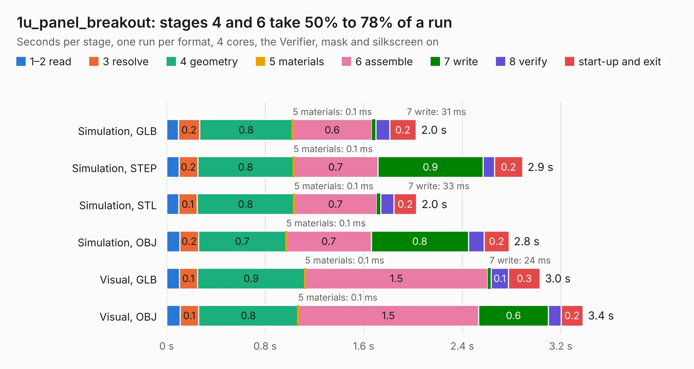

# 2193. 1u_panel_breakout

Board 2,193 of the 3,108 of [Corpus Testing](../Corpus-Testing.md), on [Corpus Page 21](../CorpusTestingPages/Corpus-Testing-21.md#2193-1u_panel_breakout).

| Mode and format | 1–2 read | 3 resolve | 4 geometry | 5 materials | 6 assemble | 7 write | 8 verify | start-up and exit | Total |
|---|---:|---:|---:|---:|---:|---:|---:|---:|---:|
| Simulation, GLB | 96&nbsp;ms | 0.2 | 0.8 | 0.1&nbsp;ms | 0.6 | 31&nbsp;ms | 0.1 | 0.2 | 2.0 |
| Simulation, STEP | 0.1 | 0.2 | 0.8 | 0.1&nbsp;ms | 0.7 | 0.9 | 93&nbsp;ms | 0.2 | 2.9 |
| Simulation, STL | 98&nbsp;ms | 0.1 | 0.8 | 0.1&nbsp;ms | 0.7 | 33&nbsp;ms | 0.1 | 0.2 | 2.0 |
| Simulation, OBJ | 0.1 | 0.2 | 0.7 | 0.1&nbsp;ms | 0.7 | 0.8 | 0.1 | 0.2 | 2.8 |
| Visual, GLB | 0.1 | 0.1 | 0.9 | 0.1&nbsp;ms | 1.5 | 24&nbsp;ms | 0.1 | 0.3 | 3.0 |
| Visual, OBJ | 0.1 | 0.1 | 0.8 | 0.1&nbsp;ms | 1.5 | 0.6 | 0.1 | 0.2 | 3.4 |

<table align="center"><tr><td valign="top">

| Board | Repo: [oresat/oresat-solar-hardware](https://github.com/oresat/oresat-solar-hardware) Board: `1u_panel_breakout.kicad_pcb` |
|---|---|
| Folder | solar-module-breakout |
| Complexity | 164&nbsp;/&nbsp;1000 (size&nbsp;104, features&nbsp;60) |
| KESE&nbsp;features | through vias, arc tracks, filled zones, curved board outline |
| Tested | 9th November 2026 |
| Copper&nbsp;layers | 2 |
| File&nbsp;format | KiCad 9 (20241229) |
| Parts,&nbsp;tracks,&nbsp;vias | 3, 44, 13 |
| Triangles,&nbsp;simulation | 158,634 in 17 parts |
| Note | panel |
| Verifier | PASS in all six runs |

</td><td valign="top">

<table>
<tr><th>File type</th><th>File size</th><th>Peak memory used</th></tr>
<tr><th colspan="3" align="left">Simulation</th></tr>
<tr><td>GLB</td><td align="right">5.6&nbsp;MB</td><td align="right">193&nbsp;MB</td></tr>
<tr><td>STEP</td><td align="right">25&nbsp;MB</td><td align="right">206&nbsp;MB</td></tr>
<tr><td>STL</td><td align="right">7.9&nbsp;MB</td><td align="right">207&nbsp;MB</td></tr>
<tr><td>OBJ</td><td align="right">16&nbsp;MB</td><td align="right">199&nbsp;MB</td></tr>
<tr><th colspan="3" align="left">Visual</th></tr>
<tr><td>GLB</td><td align="right">3.8&nbsp;MB</td><td align="right">167&nbsp;MB</td></tr>
<tr><td>OBJ</td><td align="right">11&nbsp;MB</td><td align="right">166&nbsp;MB</td></tr>
</table>

</td></tr></table>

| Previous | Next |
|:---|---:|
| [2192. solar-module-1u-si](b2192b_oresat-solar-hardware_solar-module-1u-si_solar-module-1u-si.md) | [2194. connector-breakout](b2194b_oresat-solar-simulator-hardware_connector-breakout.md) |
