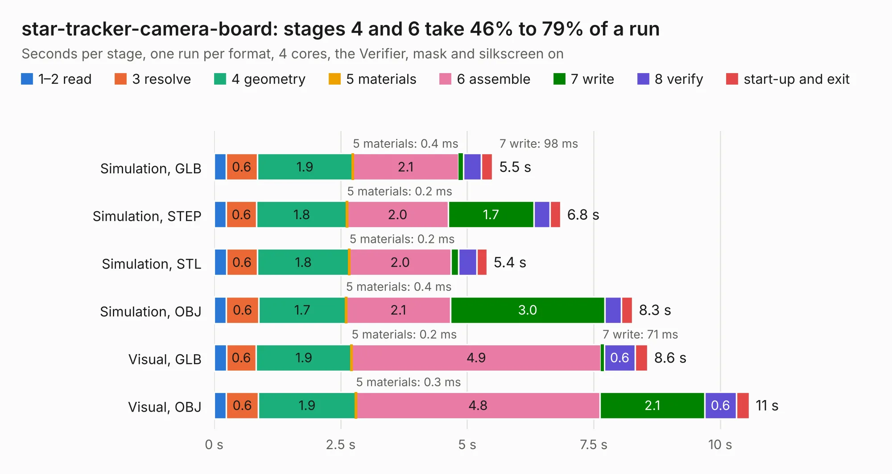

# 2194. star-tracker-camera-board

Board 2,194 of the 3,102 of [Corpus Testing](../Corpus-Testing.md), on [Corpus Page 21](../CorpusTestingPages/Corpus-Testing-21.md#2194-star-tracker-camera-board).

| Mode and format | 1–2 read | 3 resolve | 4 geometry | 5 materials | 6 assemble | 7 write | 8 verify | start-up and exit | Total |
|---|---:|---:|---:|---:|---:|---:|---:|---:|---:|
| Simulation, GLB | 0.2 | 0.6 | 1.9 | 0.4&nbsp;ms | 2.1 | 98&nbsp;ms | 0.4 | 0.2 | 5.5 |
| Simulation, STEP | 0.2 | 0.6 | 1.8 | 0.2&nbsp;ms | 2.0 | 1.7 | 0.3 | 0.2 | 6.8 |
| Simulation, STL | 0.2 | 0.6 | 1.8 | 0.2&nbsp;ms | 2.0 | 0.1 | 0.4 | 0.2 | 5.4 |
| Simulation, OBJ | 0.2 | 0.6 | 1.7 | 0.4&nbsp;ms | 2.1 | 3.0 | 0.3 | 0.2 | 8.3 |
| Visual, GLB | 0.2 | 0.6 | 1.9 | 0.2&nbsp;ms | 4.9 | 71&nbsp;ms | 0.6 | 0.2 | 8.6 |
| Visual, OBJ | 0.2 | 0.6 | 1.9 | 0.3&nbsp;ms | 4.8 | 2.1 | 0.6 | 0.3 | 10.6 |

<table align="center"><tr><td valign="top">

| Board | Repo: [oresat/oresat-star-tracker-hardware](https://github.com/oresat/oresat-star-tracker-hardware) Board: `star-tracker-camera-board.kicad_pcb` |
|---|---|
| Folder | hardware / star-tracker-camera-board |
| Complexity | 310&nbsp;/&nbsp;1000 (size&nbsp;180, features&nbsp;130) |
| KESE&nbsp;features | through vias, custom pads, rounded, trapezoid or chamfered pads, filled zones, copper drawings, curved board outline, stack-up, dielectric εr and tanδ, copper finish, mask and silkscreen colours |
| Tested | 9th November 2026 |
| Copper&nbsp;layers | 4 |
| File&nbsp;format | KiCad 10 (20260206) |
| Parts,&nbsp;tracks,&nbsp;vias | 36, 393, 99 |
| Triangles,&nbsp;simulation | 610,342 in 55 parts |
| Verifier | PASS in all six runs |

</td><td valign="top">

<table>
<tr><th>File type</th><th>File size</th><th>Peak memory used</th></tr>
<tr><th colspan="3" align="left">Simulation</th></tr>
<tr><td>GLB</td><td align="right">21&nbsp;MB</td><td align="right">343&nbsp;MB</td></tr>
<tr><td>STEP</td><td align="right">95&nbsp;MB</td><td align="right">390&nbsp;MB</td></tr>
<tr><td>STL</td><td align="right">31&nbsp;MB</td><td align="right">336&nbsp;MB</td></tr>
<tr><td>OBJ</td><td align="right">63&nbsp;MB</td><td align="right">459&nbsp;MB</td></tr>
<tr><th colspan="3" align="left">Visual</th></tr>
<tr><td>GLB</td><td align="right">15&nbsp;MB</td><td align="right">392&nbsp;MB</td></tr>
<tr><td>OBJ</td><td align="right">45&nbsp;MB</td><td align="right">383&nbsp;MB</td></tr>
</table>

</td></tr></table>

| Previous | Next |
|:---|---:|
| [2193. star-tracker-camera-board](b2193b_oresat-star-tracker-hardware_hardware-star-tracker-2-0-star-tracker-camera-board-2-0_star-tracker-camera-board.md) | [2195. star-tracker-card](b2195b_oresat-star-tracker-hardware_hardware-star-tracker-card_star-tracker-card.md) |
