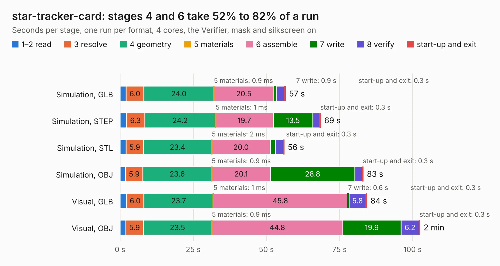

# 2195. star-tracker-card

Board 2,195 of the 3,102 of [Corpus Testing](../Corpus-Testing.md), on [Corpus Page 21](../CorpusTestingPages/Corpus-Testing-21.md#2195-star-tracker-card).

| Mode and format | 1–2 read | 3 resolve | 4 geometry | 5 materials | 6 assemble | 7 write | 8 verify | start-up and exit | Total |
|---|---:|---:|---:|---:|---:|---:|---:|---:|---:|
| Simulation, GLB | 2.1 | 6.0 | 24.0 | 0.9&nbsp;ms | 20.5 | 0.9 | 2.7 | 0.3 | 56.5 |
| Simulation, STEP | 2.1 | 6.3 | 24.2 | 1&nbsp;ms | 19.7 | 13.5 | 2.4 | 0.3 | 68.6 |
| Simulation, STL | 2.1 | 5.9 | 23.4 | 2&nbsp;ms | 20.0 | 1.7 | 2.8 | 0.3 | 56.1 |
| Simulation, OBJ | 1.9 | 5.9 | 23.6 | 0.9&nbsp;ms | 20.1 | 28.8 | 2.6 | 0.3 | 83.2 |
| Visual, GLB | 2.2 | 6.0 | 23.7 | 1&nbsp;ms | 45.8 | 0.6 | 5.8 | 0.3 | 84.4 |
| Visual, OBJ | 2.0 | 5.9 | 23.5 | 0.9&nbsp;ms | 44.8 | 19.9 | 6.2 | 0.3 | 102.5 |

<table align="center"><tr><td valign="top">

| Board | Repo: [oresat/oresat-star-tracker-hardware](https://github.com/oresat/oresat-star-tracker-hardware) Board: `star-tracker-card.kicad_pcb` |
|---|---|
| Folder | hardware / star-tracker-card |
| Complexity | 408&nbsp;/&nbsp;1000 (size&nbsp;288, features&nbsp;120) |
| KESE&nbsp;features | through vias, rounded, trapezoid or chamfered pads, drill offsets, arc tracks, filled zones, stack-up, dielectric εr and tanδ, copper finish, mask and silkscreen colours |
| Tested | 9th November 2026 |
| Copper&nbsp;layers | 4 |
| File&nbsp;format | KiCad 10 (20260206) |
| Parts,&nbsp;tracks,&nbsp;vias | 164, 3,450, 657 |
| Triangles,&nbsp;simulation | 5,239,886 in 447 parts |
| Verifier | PASS in all six runs |

</td><td valign="top">

<table>
<tr><th>File type</th><th>File size</th><th>Peak memory used</th></tr>
<tr><th colspan="3" align="left">Simulation</th></tr>
<tr><td>GLB</td><td align="right">182&nbsp;MB</td><td align="right">1.6&nbsp;GB</td></tr>
<tr><td>STEP</td><td align="right">850&nbsp;MB</td><td align="right">2.1&nbsp;GB</td></tr>
<tr><td>STL</td><td align="right">262&nbsp;MB</td><td align="right">1.6&nbsp;GB</td></tr>
<tr><td>OBJ</td><td align="right">572&nbsp;MB</td><td align="right">3.5&nbsp;GB</td></tr>
<tr><th colspan="3" align="left">Visual</th></tr>
<tr><td>GLB</td><td align="right">126&nbsp;MB</td><td align="right">2.1&nbsp;GB</td></tr>
<tr><td>OBJ</td><td align="right">408&nbsp;MB</td><td align="right">2.7&nbsp;GB</td></tr>
</table>

</td></tr></table>

| Previous | Next |
|:---|---:|
| [2194. star-tracker-camera-board](b2194b_oresat-star-tracker-hardware_hardware-star-tracker-camera-board_star-tracker-camera-board.md) | [2196. GPIO to motor](b2196b_reaction-wheels_GPIO-to-motor.md) |
