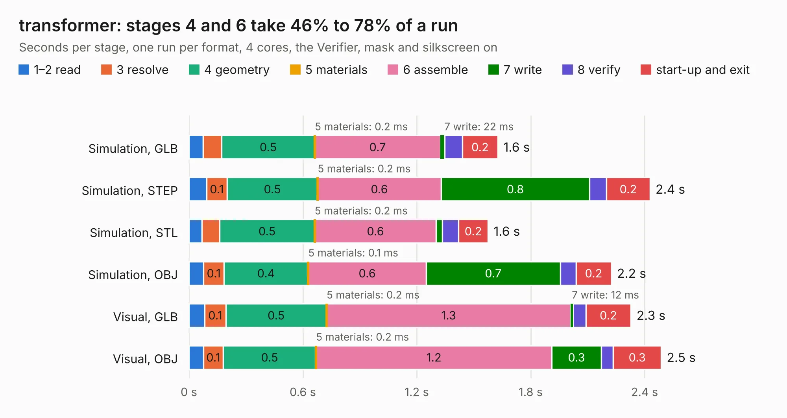

# 2196. transformer

Board 2,196 of the 3,122 of [Corpus Testing](../Corpus-Testing.md), on [Corpus Page 21](../CorpusTestingPages/Corpus-Testing-21.md#2196-transformer).

| Mode and format | 1–2 read | 3 resolve | 4 geometry | 5 materials | 6 assemble | 7 write | 8 verify | start-up and exit | Total |
|---|---:|---:|---:|---:|---:|---:|---:|---:|---:|
| Simulation, GLB | 75&nbsp;ms | 97&nbsp;ms | 0.5 | 0.2&nbsp;ms | 0.7 | 22&nbsp;ms | 94&nbsp;ms | 0.2 | 1.6 |
| Simulation, STEP | 93&nbsp;ms | 0.1 | 0.5 | 0.2&nbsp;ms | 0.6 | 0.8 | 89&nbsp;ms | 0.2 | 2.4 |
| Simulation, STL | 68&nbsp;ms | 93&nbsp;ms | 0.5 | 0.2&nbsp;ms | 0.6 | 32&nbsp;ms | 86&nbsp;ms | 0.2 | 1.6 |
| Simulation, OBJ | 78&nbsp;ms | 0.1 | 0.4 | 0.1&nbsp;ms | 0.6 | 0.7 | 82&nbsp;ms | 0.2 | 2.2 |
| Visual, GLB | 84&nbsp;ms | 0.1 | 0.5 | 0.2&nbsp;ms | 1.3 | 12&nbsp;ms | 68&nbsp;ms | 0.2 | 2.3 |
| Visual, OBJ | 76&nbsp;ms | 0.1 | 0.5 | 0.2&nbsp;ms | 1.2 | 0.3 | 64&nbsp;ms | 0.3 | 2.5 |

<table align="center"><tr><td valign="top">

| Board | Repo: [oresat/oresat-live-handheld-ground-station](https://github.com/oresat/oresat-live-handheld-ground-station) Board: `transformer.kicad_pcb` |
|---|---|
| Folder | PCB-Legos / transformer |
| Complexity | 244&nbsp;/&nbsp;1000 (size&nbsp;124, features&nbsp;120) |
| KESE&nbsp;features | through vias, custom pads, rounded, trapezoid or chamfered pads, filled zones, stack-up, dielectric εr and tanδ, mask and silkscreen colours, castellated pads |
| Tested | 9th November 2026 |
| Copper&nbsp;layers | 4 |
| File&nbsp;format | KiCad 6 (20211014) |
| Parts,&nbsp;tracks,&nbsp;vias | 2, 21, 33 |
| Triangles,&nbsp;simulation | 149,868 in 18 parts |
| Verifier | PASS in all six runs |

</td><td valign="top">

<table>
<tr><th>File type</th><th>File size</th><th>Peak memory used</th></tr>
<tr><th colspan="3" align="left">Simulation</th></tr>
<tr><td>GLB</td><td align="right">5.2&nbsp;MB</td><td align="right">190&nbsp;MB</td></tr>
<tr><td>STEP</td><td align="right">21&nbsp;MB</td><td align="right">195&nbsp;MB</td></tr>
<tr><td>STL</td><td align="right">7.5&nbsp;MB</td><td align="right">186&nbsp;MB</td></tr>
<tr><td>OBJ</td><td align="right">15&nbsp;MB</td><td align="right">191&nbsp;MB</td></tr>
<tr><th colspan="3" align="left">Visual</th></tr>
<tr><td>GLB</td><td align="right">2.0&nbsp;MB</td><td align="right">162&nbsp;MB</td></tr>
<tr><td>OBJ</td><td align="right">5.5&nbsp;MB</td><td align="right">161&nbsp;MB</td></tr>
</table>

</td></tr></table>

| Previous | Next |
|:---|---:|
| [2195. LNA](b2195b_oresat-live-handheld-ground-station_LNA.md) | [2197. HGS_Reflector](b2197b_oresat-live-handheld-ground-station_HGS-Reflector.md) |
