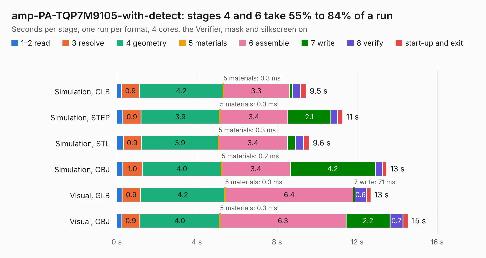

# 2197. amp-PA-TQP7M9105-with-detect

Board 2,197 of the 3,131 of [Corpus Testing](../Corpus-Testing.md), on [Corpus Page 21](../CorpusTestingPages/Corpus-Testing-21.md#2197-amp-pa-tqp7m9105-with-detect).

| Mode and format | 1–2 read | 3 resolve | 4 geometry | 5 materials | 6 assemble | 7 write | 8 verify | start-up and exit | Total |
|---|---:|---:|---:|---:|---:|---:|---:|---:|---:|
| Simulation, GLB | 0.2 | 0.9 | 4.2 | 0.3&nbsp;ms | 3.3 | 0.2 | 0.4 | 0.3 | 9.5 |
| Simulation, STEP | 0.3 | 0.9 | 3.9 | 0.3&nbsp;ms | 3.4 | 2.1 | 0.3 | 0.3 | 11.3 |
| Simulation, STL | 0.3 | 0.9 | 3.9 | 0.3&nbsp;ms | 3.4 | 0.4 | 0.4 | 0.3 | 9.6 |
| Simulation, OBJ | 0.3 | 1.0 | 4.0 | 0.2&nbsp;ms | 3.4 | 4.2 | 0.4 | 0.2 | 13.5 |
| Visual, GLB | 0.3 | 0.9 | 4.2 | 0.3&nbsp;ms | 6.4 | 71&nbsp;ms | 0.6 | 0.2 | 12.7 |
| Visual, OBJ | 0.3 | 0.9 | 4.0 | 0.3&nbsp;ms | 6.3 | 2.2 | 0.7 | 0.3 | 14.6 |

<table align="center"><tr><td valign="top">

| Board | Repo: [oresat/oresat-kicad](https://github.com/oresat/oresat-kicad) Board: `amp-PA-TQP7M9105-with-detect.kicad_pcb` |
|---|---|
| Folder | oresat-design-blocks / tqp7m9105-design-block |
| Complexity | 256&nbsp;/&nbsp;1000 (size&nbsp;186, features&nbsp;70) |
| KESE&nbsp;features | through vias, rounded, trapezoid or chamfered pads, arc tracks, filled zones, curved board outline |
| Tested | 9th November 2026 |
| Copper&nbsp;layers | 4 |
| File&nbsp;format | KiCad 9 (20241229) |
| Parts,&nbsp;tracks,&nbsp;vias | 46, 178, 230 |
| Triangles,&nbsp;simulation | 869,786 in 41 parts |
| Verifier | PASS in all six runs |

</td><td valign="top">

<table>
<tr><th>File type</th><th>File size</th><th>Peak memory used</th></tr>
<tr><th colspan="3" align="left">Simulation</th></tr>
<tr><td>GLB</td><td align="right">30&nbsp;MB</td><td align="right">430&nbsp;MB</td></tr>
<tr><td>STEP</td><td align="right">85&nbsp;MB</td><td align="right">514&nbsp;MB</td></tr>
<tr><td>STL</td><td align="right">43&nbsp;MB</td><td align="right">416&nbsp;MB</td></tr>
<tr><td>OBJ</td><td align="right">88&nbsp;MB</td><td align="right">624&nbsp;MB</td></tr>
<tr><th colspan="3" align="left">Visual</th></tr>
<tr><td>GLB</td><td align="right">15&nbsp;MB</td><td align="right">399&nbsp;MB</td></tr>
<tr><td>OBJ</td><td align="right">44&nbsp;MB</td><td align="right">405&nbsp;MB</td></tr>
</table>

</td></tr></table>

| Previous | Next |
|:---|---:|
| [2196. stm32u595-breakout](b2196b_oresat-kicad_stm32u595-breakout.md) | [2198. 50_ohm_microstrip_experiment](b2198b_oresat-live-handheld-ground-station_50-ohm-microstrip-experiment.md) |
