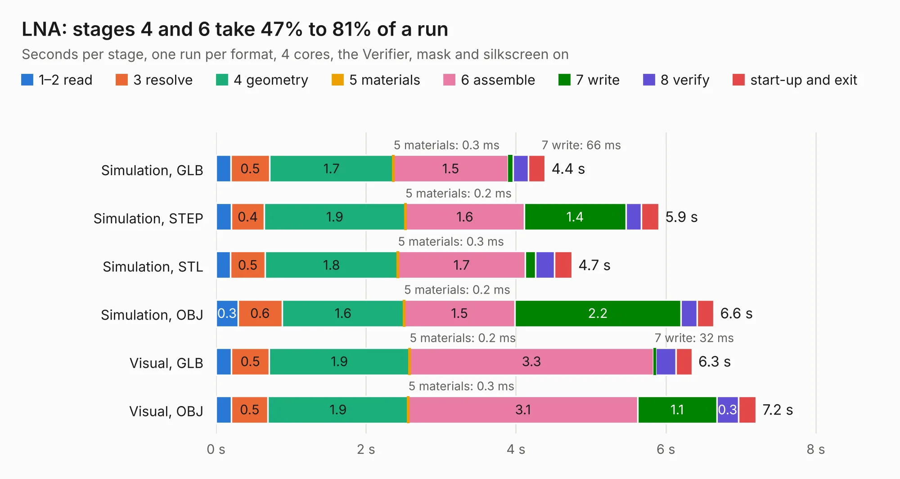

# 2201. LNA

Board 2,201 of the 3,131 of [Corpus Testing](../Corpus-Testing.md), on [Corpus Page 21](../CorpusTestingPages/Corpus-Testing-21.md#2201-lna).

| Mode and format | 1–2 read | 3 resolve | 4 geometry | 5 materials | 6 assemble | 7 write | 8 verify | start-up and exit | Total |
|---|---:|---:|---:|---:|---:|---:|---:|---:|---:|
| Simulation, GLB | 0.2 | 0.5 | 1.7 | 0.3&nbsp;ms | 1.5 | 66&nbsp;ms | 0.2 | 0.2 | 4.4 |
| Simulation, STEP | 0.2 | 0.4 | 1.9 | 0.2&nbsp;ms | 1.6 | 1.4 | 0.2 | 0.2 | 5.9 |
| Simulation, STL | 0.2 | 0.5 | 1.8 | 0.3&nbsp;ms | 1.7 | 0.1 | 0.3 | 0.2 | 4.7 |
| Simulation, OBJ | 0.3 | 0.6 | 1.6 | 0.2&nbsp;ms | 1.5 | 2.2 | 0.2 | 0.2 | 6.6 |
| Visual, GLB | 0.2 | 0.5 | 1.9 | 0.2&nbsp;ms | 3.3 | 32&nbsp;ms | 0.3 | 0.2 | 6.3 |
| Visual, OBJ | 0.2 | 0.5 | 1.9 | 0.3&nbsp;ms | 3.1 | 1.1 | 0.3 | 0.2 | 7.2 |

<table align="center"><tr><td valign="top">

| Board | Repo: [oresat/oresat-live-handheld-ground-station](https://github.com/oresat/oresat-live-handheld-ground-station) Board: `LNA.kicad_pcb` |
|---|---|
| Folder | PCB-Legos / LNA |
| Complexity | 249&nbsp;/&nbsp;1000 (size&nbsp;174, features&nbsp;75) |
| KESE&nbsp;features | through vias, rounded, trapezoid or chamfered pads, filled zones, stack-up, dielectric εr and tanδ |
| Tested | 9th November 2026 |
| Copper&nbsp;layers | 4 |
| File&nbsp;format | KiCad 6 (20211014) |
| Parts,&nbsp;tracks,&nbsp;vias | 42, 110, 107 |
| Triangles,&nbsp;simulation | 454,982 in 44 parts |
| Verifier | PASS in all six runs |

</td><td valign="top">

<table>
<tr><th>File type</th><th>File size</th><th>Peak memory used</th></tr>
<tr><th colspan="3" align="left">Simulation</th></tr>
<tr><td>GLB</td><td align="right">16&nbsp;MB</td><td align="right">344&nbsp;MB</td></tr>
<tr><td>STEP</td><td align="right">61&nbsp;MB</td><td align="right">352&nbsp;MB</td></tr>
<tr><td>STL</td><td align="right">23&nbsp;MB</td><td align="right">321&nbsp;MB</td></tr>
<tr><td>OBJ</td><td align="right">48&nbsp;MB</td><td align="right">377&nbsp;MB</td></tr>
<tr><th colspan="3" align="left">Visual</th></tr>
<tr><td>GLB</td><td align="right">9.1&nbsp;MB</td><td align="right">296&nbsp;MB</td></tr>
<tr><td>OBJ</td><td align="right">27&nbsp;MB</td><td align="right">297&nbsp;MB</td></tr>
</table>

</td></tr></table>

| Previous | Next |
|:---|---:|
| [2200. open_stub_experiment](b2200b_oresat-live-handheld-ground-station_open-stub-experiment.md) | [2202. transformer](b2202b_oresat-live-handheld-ground-station_transformer.md) |
