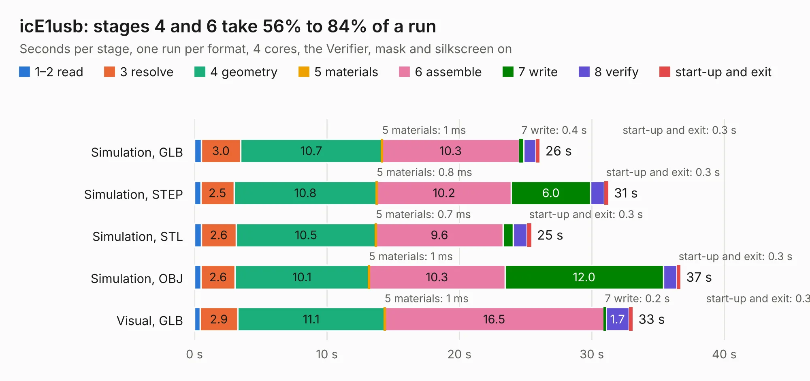

# 2202. icE1usb

Board 2,202 of the 3,100 of [Corpus Testing](../Corpus-Testing.md), on [Corpus Page 21](../CorpusTestingPages/Corpus-Testing-21.md#2202-ice1usb).

| Mode and format | 1–2 read | 3 resolve | 4 geometry | 5 materials | 6 assemble | 7 write | 8 verify | start-up and exit | Total |
|---|---:|---:|---:|---:|---:|---:|---:|---:|---:|
| Simulation, GLB | 0.5 | 3.0 | 10.7 | 1&nbsp;ms | 10.3 | 0.4 | 0.9 | 0.3 | 26.1 |
| Simulation, STEP | 0.5 | 2.5 | 10.8 | 0.8&nbsp;ms | 10.2 | 6.0 | 1.0 | 0.3 | 31.2 |
| Simulation, STL | 0.5 | 2.6 | 10.5 | 0.7&nbsp;ms | 9.6 | 0.8 | 1.0 | 0.3 | 25.4 |
| Simulation, OBJ | 0.5 | 2.6 | 10.1 | 1&nbsp;ms | 10.3 | 12.0 | 1.0 | 0.3 | 36.7 |
| Visual, GLB | 0.4 | 2.9 | 11.1 | 1&nbsp;ms | 16.5 | 0.2 | 1.7 | 0.3 | 33.1 |
| Visual, OBJ | 0.5 | 2.4 | 10.3 | 0.8&nbsp;ms | 15.6 | 6.3 | 2.2 | 0.3 | 37.6 |

<table align="center"><tr><td valign="top">

| Board | Repo: [osmocom/osmo-e1-hardware](https://github.com/osmocom/osmo-e1-hardware) Board: `icE1usb.kicad_pcb` |
|---|---|
| Folder | hardware / icE1usb / r1.0 |
| Complexity | 316&nbsp;/&nbsp;1000 (size&nbsp;251, features&nbsp;65) |
| KESE&nbsp;features | through vias, slotted holes, rounded, trapezoid or chamfered pads, filled zones, curved board outline |
| Tested | 9th November 2026 |
| Copper&nbsp;layers | 4 |
| File&nbsp;format | KiCad 5 (20171130) |
| Parts,&nbsp;tracks,&nbsp;vias | 116, 1,582, 185 |
| Triangles,&nbsp;simulation | 1,857,088 in 169 parts |
| Verifier | PASS in all six runs |

</td><td valign="top">

<table>
<tr><th>File type</th><th>File size</th><th>Peak memory used</th></tr>
<tr><th colspan="3" align="left">Simulation</th></tr>
<tr><td>GLB</td><td align="right">64&nbsp;MB</td><td align="right">669&nbsp;MB</td></tr>
<tr><td>STEP</td><td align="right">275&nbsp;MB</td><td align="right">834&nbsp;MB</td></tr>
<tr><td>STL</td><td align="right">93&nbsp;MB</td><td align="right">640&nbsp;MB</td></tr>
<tr><td>OBJ</td><td align="right">195&nbsp;MB</td><td align="right">1.3&nbsp;GB</td></tr>
<tr><th colspan="3" align="left">Visual</th></tr>
<tr><td>GLB</td><td align="right">35&nbsp;MB</td><td align="right">815&nbsp;MB</td></tr>
<tr><td>OBJ</td><td align="right">107&nbsp;MB</td><td align="right">870&nbsp;MB</td></tr>
</table>

</td></tr></table>

| Previous | Next |
|:---|---:|
| [2201. icE1usb-panel](b2201b_osmo-e1-hardware_icE1usb-panel.md) | [2203. clk-input-fmc](b2203b_clk-input-fmc_clk-input-fmc.md) |
