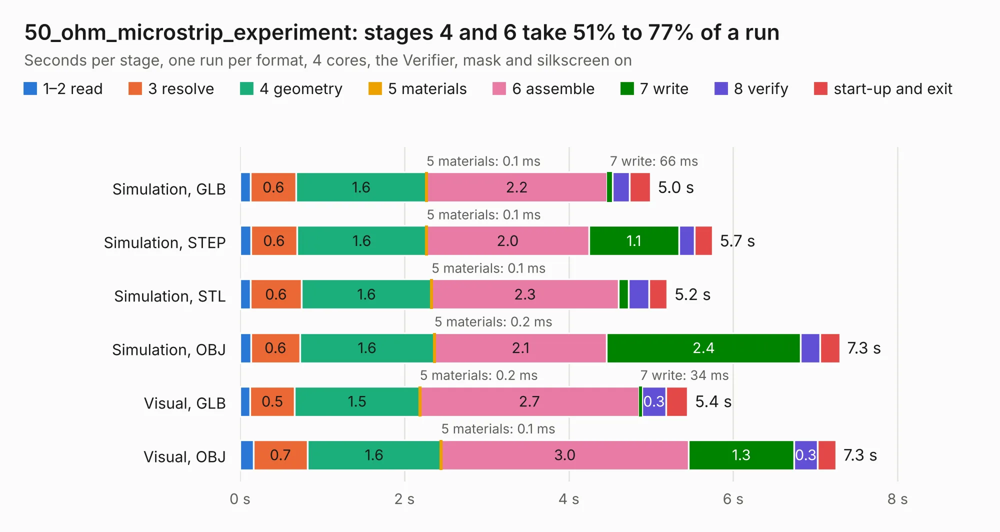

# 2203. 50_ohm_microstrip_experiment

Board 2,203 of the 3,138 of [Corpus Testing](../Corpus-Testing.md), on [Corpus Page 21](../CorpusTestingPages/Corpus-Testing-21.md#2203-50_ohm_microstrip_experiment).

| Mode and format | 1–2 read | 3 resolve | 4 geometry | 5 materials | 6 assemble | 7 write | 8 verify | start-up and exit | Total |
|---|---:|---:|---:|---:|---:|---:|---:|---:|---:|
| Simulation, GLB | 0.1 | 0.6 | 1.6 | 0.1&nbsp;ms | 2.2 | 66&nbsp;ms | 0.2 | 0.3 | 5.0 |
| Simulation, STEP | 0.1 | 0.6 | 1.6 | 0.1&nbsp;ms | 2.0 | 1.1 | 0.2 | 0.2 | 5.7 |
| Simulation, STL | 0.1 | 0.6 | 1.6 | 0.1&nbsp;ms | 2.3 | 0.1 | 0.3 | 0.2 | 5.2 |
| Simulation, OBJ | 0.1 | 0.6 | 1.6 | 0.2&nbsp;ms | 2.1 | 2.4 | 0.2 | 0.2 | 7.3 |
| Visual, GLB | 0.1 | 0.5 | 1.5 | 0.2&nbsp;ms | 2.7 | 34&nbsp;ms | 0.3 | 0.3 | 5.4 |
| Visual, OBJ | 0.2 | 0.7 | 1.6 | 0.1&nbsp;ms | 3.0 | 1.3 | 0.3 | 0.2 | 7.3 |

<table align="center"><tr><td valign="top">

| Board | Repo: [oresat/oresat-live-handheld-ground-station](https://github.com/oresat/oresat-live-handheld-ground-station) Board: `50_ohm_microstrip_experiment.kicad_pcb` |
|---|---|
| Folder | PCB-Legos / Antenna tester / 50_ohm_microstrip_experiment |
| Complexity | 240&nbsp;/&nbsp;1000 (size&nbsp;165, features&nbsp;75) |
| KESE&nbsp;features | through vias, rounded, trapezoid or chamfered pads, filled zones, stack-up, dielectric εr and tanδ |
| Tested | 9th November 2026 |
| Copper&nbsp;layers | 4 |
| File&nbsp;format | KiCad 6 (20211014) |
| Parts,&nbsp;tracks,&nbsp;vias | 10, 21, 202 |
| Triangles,&nbsp;simulation | 417,758 in 20 parts |
| Verifier | PASS in all six runs |

</td><td valign="top">

<table>
<tr><th>File type</th><th>File size</th><th>Peak memory used</th></tr>
<tr><th colspan="3" align="left">Simulation</th></tr>
<tr><td>GLB</td><td align="right">14&nbsp;MB</td><td align="right">307&nbsp;MB</td></tr>
<tr><td>STEP</td><td align="right">23&nbsp;MB</td><td align="right">331&nbsp;MB</td></tr>
<tr><td>STL</td><td align="right">21&nbsp;MB</td><td align="right">307&nbsp;MB</td></tr>
<tr><td>OBJ</td><td align="right">42&nbsp;MB</td><td align="right">340&nbsp;MB</td></tr>
<tr><th colspan="3" align="left">Visual</th></tr>
<tr><td>GLB</td><td align="right">7.4&nbsp;MB</td><td align="right">268&nbsp;MB</td></tr>
<tr><td>OBJ</td><td align="right">22&nbsp;MB</td><td align="right">271&nbsp;MB</td></tr>
</table>

</td></tr></table>

| Previous | Next |
|:---|---:|
| [2202. amp-PA-TQP7M9105-with-detect](b2202b_oresat-kicad_amp-PA-TQP7M9105-with-detect.md) | [2204. HGS_antenna_tester](b2204b_oresat-live-handheld-ground-station_HGS-antenna-tester.md) |
