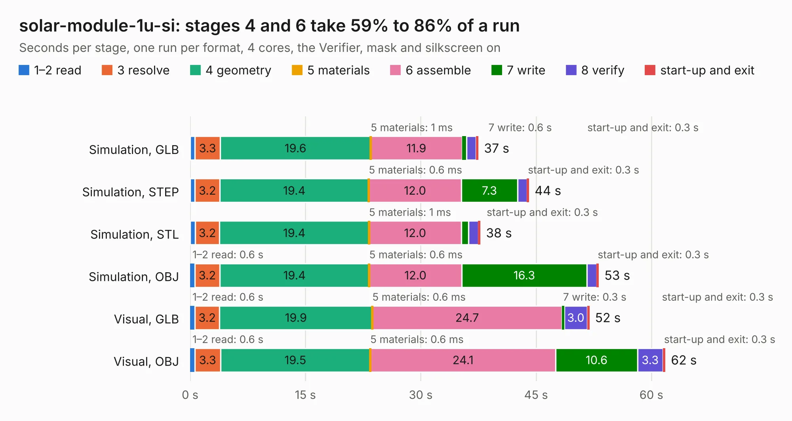

# 2203. solar-module-1u-si

Board 2,203 of the 3,119 of [Corpus Testing](../Corpus-Testing.md), on [Corpus Page 21](../CorpusTestingPages/Corpus-Testing-21.md#2203-solar-module-1u-si).

| Mode and format | 1–2 read | 3 resolve | 4 geometry | 5 materials | 6 assemble | 7 write | 8 verify | start-up and exit | Total |
|---|---:|---:|---:|---:|---:|---:|---:|---:|---:|
| Simulation, GLB | 0.6 | 3.3 | 19.6 | 1&nbsp;ms | 11.9 | 0.6 | 1.3 | 0.3 | 37.5 |
| Simulation, STEP | 0.6 | 3.2 | 19.4 | 0.6&nbsp;ms | 12.0 | 7.3 | 1.2 | 0.3 | 44.1 |
| Simulation, STL | 0.7 | 3.2 | 19.4 | 1&nbsp;ms | 12.0 | 1.0 | 1.3 | 0.3 | 37.8 |
| Simulation, OBJ | 0.6 | 3.2 | 19.4 | 0.6&nbsp;ms | 12.0 | 16.3 | 1.3 | 0.3 | 53.1 |
| Visual, GLB | 0.6 | 3.2 | 19.9 | 0.6&nbsp;ms | 24.7 | 0.3 | 3.0 | 0.3 | 51.9 |
| Visual, OBJ | 0.6 | 3.3 | 19.5 | 0.6&nbsp;ms | 24.1 | 10.6 | 3.3 | 0.3 | 61.8 |

<table align="center"><tr><td valign="top">

| Board | Repo: [oresat/oresat-solar-hardware](https://github.com/oresat/oresat-solar-hardware) Board: `solar-module-1u-si.kicad_pcb` |
|---|---|
| Folder | solar-module-1u-si |
| Complexity | 381&nbsp;/&nbsp;1000 (size&nbsp;246, features&nbsp;135) |
| KESE&nbsp;features | through vias, custom pads, rounded, trapezoid or chamfered pads, arc tracks, filled zones, copper drawings, stack-up, dielectric εr and tanδ, copper finish, mask and silkscreen colours |
| Tested | 9th November 2026 |
| Copper&nbsp;layers | 2 |
| File&nbsp;format | KiCad 9 (20241229) |
| Parts,&nbsp;tracks,&nbsp;vias | 115, 807, 1,271 |
| Triangles,&nbsp;simulation | 3,165,724 in 112 parts |
| Verifier | PASS in all six runs |

</td><td valign="top">

<table>
<tr><th>File type</th><th>File size</th><th>Peak memory used</th></tr>
<tr><th colspan="3" align="left">Simulation</th></tr>
<tr><td>GLB</td><td align="right">109&nbsp;MB</td><td align="right">1.1&nbsp;GB</td></tr>
<tr><td>STEP</td><td align="right">409&nbsp;MB</td><td align="right">1.4&nbsp;GB</td></tr>
<tr><td>STL</td><td align="right">158&nbsp;MB</td><td align="right">1.1&nbsp;GB</td></tr>
<tr><td>OBJ</td><td align="right">337&nbsp;MB</td><td align="right">2.1&nbsp;GB</td></tr>
<tr><th colspan="3" align="left">Visual</th></tr>
<tr><td>GLB</td><td align="right">66&nbsp;MB</td><td align="right">1.3&nbsp;GB</td></tr>
<tr><td>OBJ</td><td align="right">209&nbsp;MB</td><td align="right">1.4&nbsp;GB</td></tr>
</table>

</td></tr></table>

| Previous | Next |
|:---|---:|
| [2202. solar-module-1u-si](b2202b_oresat-solar-hardware_solar-module-1u-si-MCXN_solar-module-1u-si.md) | [2204. 1u_panel_breakout](b2204b_oresat-solar-hardware_1u-panel-breakout.md) |
