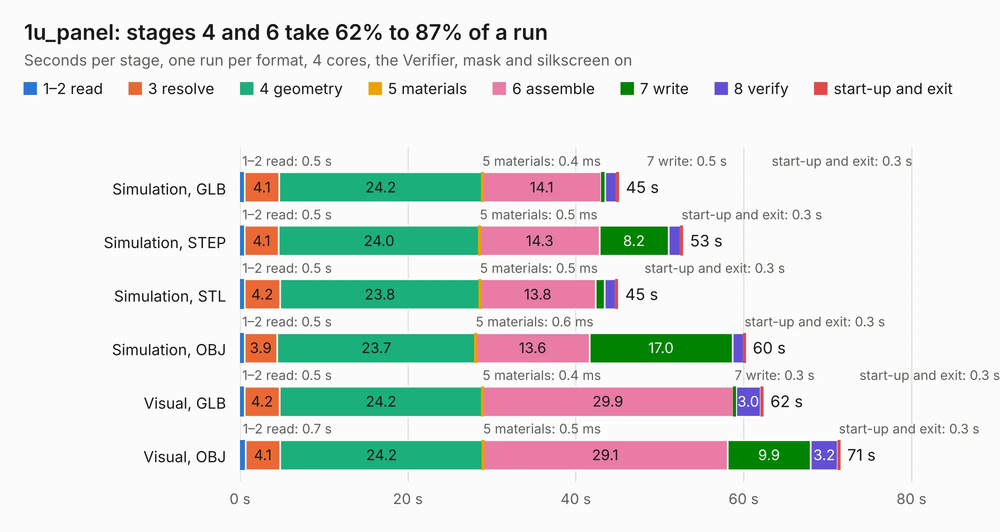

# 2207. 1u_panel

Board 2,207 of the 3,131 of [Corpus Testing](../Corpus-Testing.md), on [Corpus Page 21](../CorpusTestingPages/Corpus-Testing-21.md#2207-1u_panel).

| Mode and format | 1–2 read | 3 resolve | 4 geometry | 5 materials | 6 assemble | 7 write | 8 verify | start-up and exit | Total |
|---|---:|---:|---:|---:|---:|---:|---:|---:|---:|
| Simulation, GLB | 0.5 | 4.1 | 24.2 | 0.4&nbsp;ms | 14.1 | 0.5 | 1.3 | 0.3 | 45.1 |
| Simulation, STEP | 0.5 | 4.1 | 24.0 | 0.5&nbsp;ms | 14.3 | 8.2 | 1.4 | 0.3 | 52.8 |
| Simulation, STL | 0.5 | 4.2 | 23.8 | 0.5&nbsp;ms | 13.8 | 1.1 | 1.3 | 0.3 | 45.0 |
| Simulation, OBJ | 0.5 | 3.9 | 23.7 | 0.6&nbsp;ms | 13.6 | 17.0 | 1.3 | 0.3 | 60.2 |
| Visual, GLB | 0.5 | 4.2 | 24.2 | 0.4&nbsp;ms | 29.9 | 0.3 | 3.0 | 0.3 | 62.3 |
| Visual, OBJ | 0.7 | 4.1 | 24.2 | 0.5&nbsp;ms | 29.1 | 9.9 | 3.2 | 0.3 | 71.5 |

<table align="center"><tr><td valign="top">

| Board | Repo: [oresat/oresat-solar-hardware](https://github.com/oresat/oresat-solar-hardware) Board: `1u_panel.kicad_pcb` |
|---|---|
| Folder | 1u_panel / kicad |
| Complexity | 262&nbsp;/&nbsp;1000 (size&nbsp;202, features&nbsp;60) |
| KESE&nbsp;features | through vias, rounded, trapezoid or chamfered pads, arc tracks, filled zones |
| Tested | 9th November 2026 |
| Copper&nbsp;layers | 2 |
| File&nbsp;format | KiCad 7 (20221018) |
| Parts,&nbsp;tracks,&nbsp;vias | 77, 707, 1,280 |
| Triangles,&nbsp;simulation | 3,191,626 in 95 parts |
| Note | panel |
| Verifier | PASS in all six runs |

</td><td valign="top">

<table>
<tr><th>File type</th><th>File size</th><th>Peak memory used</th></tr>
<tr><th colspan="3" align="left">Simulation</th></tr>
<tr><td>GLB</td><td align="right">110&nbsp;MB</td><td align="right">1.0&nbsp;GB</td></tr>
<tr><td>STEP</td><td align="right">406&nbsp;MB</td><td align="right">1.4&nbsp;GB</td></tr>
<tr><td>STL</td><td align="right">160&nbsp;MB</td><td align="right">1.1&nbsp;GB</td></tr>
<tr><td>OBJ</td><td align="right">338&nbsp;MB</td><td align="right">2.1&nbsp;GB</td></tr>
<tr><th colspan="3" align="left">Visual</th></tr>
<tr><td>GLB</td><td align="right">65&nbsp;MB</td><td align="right">1.2&nbsp;GB</td></tr>
<tr><td>OBJ</td><td align="right">201&nbsp;MB</td><td align="right">1.4&nbsp;GB</td></tr>
</table>

</td></tr></table>

| Previous | Next |
|:---|---:|
| [2206. oresat-proto-card](b2206b_oresat-proto-card_mcxn-proto-card_oresat-proto-card.md) | [2208. solar-extension](b2208b_oresat-solar-hardware_solar-extension.md) |
