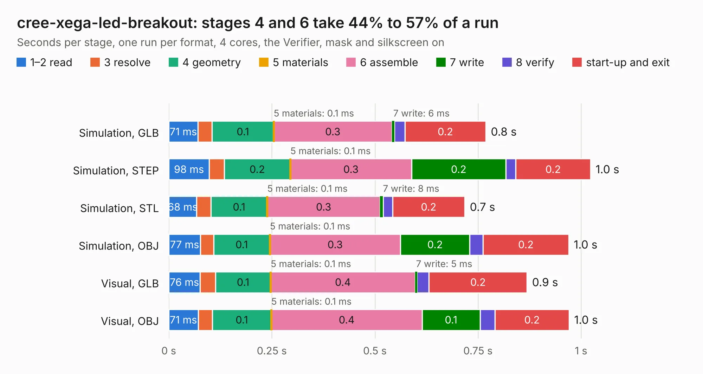

# 2208. cree-xega-led-breakout

Board 2,208 of the 3,120 of [Corpus Testing](../Corpus-Testing.md), on [Corpus Page 21](../CorpusTestingPages/Corpus-Testing-21.md#2208-cree-xega-led-breakout).

| Mode and format | 1–2 read | 3 resolve | 4 geometry | 5 materials | 6 assemble | 7 write | 8 verify | start-up and exit | Total |
|---|---:|---:|---:|---:|---:|---:|---:|---:|---:|
| Simulation, GLB | 71&nbsp;ms | 35&nbsp;ms | 0.1 | 0.1&nbsp;ms | 0.3 | 6&nbsp;ms | 25&nbsp;ms | 0.2 | 0.8 |
| Simulation, STEP | 98&nbsp;ms | 36&nbsp;ms | 0.2 | 0.1&nbsp;ms | 0.3 | 0.2 | 24&nbsp;ms | 0.2 | 1.0 |
| Simulation, STL | 68&nbsp;ms | 35&nbsp;ms | 0.1 | 0.1&nbsp;ms | 0.3 | 8&nbsp;ms | 22&nbsp;ms | 0.2 | 0.7 |
| Simulation, OBJ | 77&nbsp;ms | 32&nbsp;ms | 0.1 | 0.1&nbsp;ms | 0.3 | 0.2 | 32&nbsp;ms | 0.2 | 1.0 |
| Visual, GLB | 76&nbsp;ms | 37&nbsp;ms | 0.1 | 0.1&nbsp;ms | 0.4 | 5&nbsp;ms | 29&nbsp;ms | 0.2 | 0.9 |
| Visual, OBJ | 71&nbsp;ms | 35&nbsp;ms | 0.1 | 0.1&nbsp;ms | 0.4 | 0.1 | 36&nbsp;ms | 0.2 | 1.0 |

<table align="center"><tr><td valign="top">

| Board | Repo: [oresat/oresat-solar-simulator-hardware](https://github.com/oresat/oresat-solar-simulator-hardware) Board: `cree-xega-led-breakout.kicad_pcb` |
|---|---|
| Folder | boards / cree-xega-led-breakout |
| Complexity | 100&nbsp;/&nbsp;1000 (size&nbsp;70, features&nbsp;30) |
| KESE&nbsp;features | filled zones, curved board outline |
| Tested | 9th November 2026 |
| Copper&nbsp;layers | 2 |
| File&nbsp;format | KiCad 8 (20240108) |
| Parts,&nbsp;tracks,&nbsp;vias | 5, 7, 0 |
| Triangles,&nbsp;simulation | 31,162 in 15 parts |
| Verifier | PASS in all six runs |

</td><td valign="top">

<table>
<tr><th>File type</th><th>File size</th><th>Peak memory used</th></tr>
<tr><th colspan="3" align="left">Simulation</th></tr>
<tr><td>GLB</td><td align="right">1.1&nbsp;MB</td><td align="right">64&nbsp;MB</td></tr>
<tr><td>STEP</td><td align="right">5.5&nbsp;MB</td><td align="right">68&nbsp;MB</td></tr>
<tr><td>STL</td><td align="right">1.6&nbsp;MB</td><td align="right">65&nbsp;MB</td></tr>
<tr><td>OBJ</td><td align="right">3.0&nbsp;MB</td><td align="right">70&nbsp;MB</td></tr>
<tr><th colspan="3" align="left">Visual</th></tr>
<tr><td>GLB</td><td align="right">788&nbsp;kB</td><td align="right">78&nbsp;MB</td></tr>
<tr><td>OBJ</td><td align="right">2.1&nbsp;MB</td><td align="right">88&nbsp;MB</td></tr>
</table>

</td></tr></table>

| Previous | Next |
|:---|---:|
| [2207. controller-board](b2207b_oresat-solar-simulator-hardware_controller-board.md) | [2209. sensor-board](b2209b_oresat-solar-simulator-hardware_sensor-board.md) |
