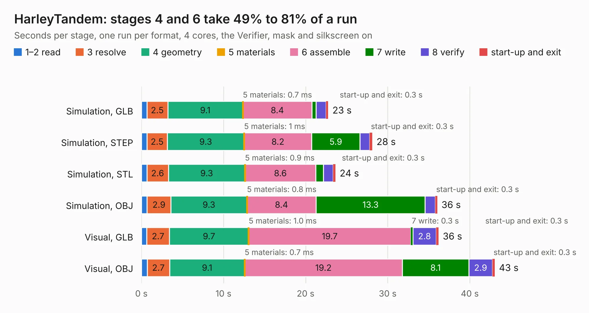

# 2209. HarleyTandem

Board 2,209 of the 3,103 of [Corpus Testing](../Corpus-Testing.md), on [Corpus Page 21](../CorpusTestingPages/Corpus-Testing-21.md#2209-harleytandem).

| Mode and format | 1–2 read | 3 resolve | 4 geometry | 5 materials | 6 assemble | 7 write | 8 verify | start-up and exit | Total |
|---|---:|---:|---:|---:|---:|---:|---:|---:|---:|
| Simulation, GLB | 0.7 | 2.5 | 9.1 | 0.7&nbsp;ms | 8.4 | 0.5 | 1.2 | 0.3 | 22.8 |
| Simulation, STEP | 0.7 | 2.5 | 9.3 | 1&nbsp;ms | 8.2 | 5.9 | 1.2 | 0.3 | 28.1 |
| Simulation, STL | 0.7 | 2.6 | 9.3 | 0.9&nbsp;ms | 8.6 | 0.9 | 1.2 | 0.3 | 23.6 |
| Simulation, OBJ | 0.7 | 2.9 | 9.3 | 0.8&nbsp;ms | 8.4 | 13.3 | 1.2 | 0.3 | 36.0 |
| Visual, GLB | 0.7 | 2.7 | 9.7 | 1.0&nbsp;ms | 19.7 | 0.3 | 2.8 | 0.3 | 36.2 |
| Visual, OBJ | 0.7 | 2.7 | 9.1 | 0.7&nbsp;ms | 19.2 | 8.1 | 2.9 | 0.3 | 43.0 |

<table align="center"><tr><td valign="top">

| Board | Repo: [osrf/ovc](https://github.com/osrf/ovc) Board: `HarleyTandem.kicad_pcb` |
|---|---|
| Folder | ovc0 / hardware / HarleyTandem |
| Complexity | 334&nbsp;/&nbsp;1000 (size&nbsp;289, features&nbsp;45) |
| KESE&nbsp;features | through vias, filled zones, curved board outline |
| Tested | 9th November 2026 |
| Copper&nbsp;layers | 6 |
| File&nbsp;format | KiCad 4 (4) |
| Parts,&nbsp;tracks,&nbsp;vias | 118, 6,483, 276 |
| Triangles,&nbsp;simulation | 2,715,904 in 132 parts |
| Verifier | PASS in all six runs |

</td><td valign="top">

<table>
<tr><th>File type</th><th>File size</th><th>Peak memory used</th></tr>
<tr><th colspan="3" align="left">Simulation</th></tr>
<tr><td>GLB</td><td align="right">94&nbsp;MB</td><td align="right">935&nbsp;MB</td></tr>
<tr><td>STEP</td><td align="right">358&nbsp;MB</td><td align="right">995&nbsp;MB</td></tr>
<tr><td>STL</td><td align="right">136&nbsp;MB</td><td align="right">913&nbsp;MB</td></tr>
<tr><td>OBJ</td><td align="right">290&nbsp;MB</td><td align="right">1.8&nbsp;GB</td></tr>
<tr><th colspan="3" align="left">Visual</th></tr>
<tr><td>GLB</td><td align="right">57&nbsp;MB</td><td align="right">1.2&nbsp;GB</td></tr>
<tr><td>OBJ</td><td align="right">178&nbsp;MB</td><td align="right">1.3&nbsp;GB</td></tr>
</table>

</td></tr></table>

| Previous | Next |
|:---|---:|
| [2208. HarleyGhostRider](b2208b_ovc_HarleyGhostRider.md) | [2210. HarleyTandemRevB](b2210b_ovc_HarleyTandemRevB.md) |
