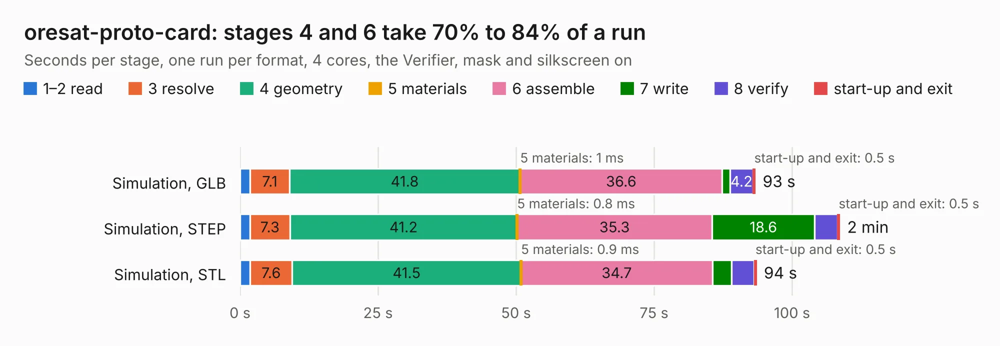

# 2210. oresat-proto-card

Board 2,210 of the 3,138 of [Corpus Testing](../Corpus-Testing.md), on [Corpus Page 21](../CorpusTestingPages/Corpus-Testing-21.md#2210-oresat-proto-card).

| Mode and format | 1–2 read | 3 resolve | 4 geometry | 5 materials | 6 assemble | 7 write | 8 verify | start-up and exit | Total |
|---|---:|---:|---:|---:|---:|---:|---:|---:|---:|
| Simulation, GLB | 1.9 | 7.1 | 41.8 | 1&nbsp;ms | 36.6 | 1.4 | 4.2 | 0.5 | 93.4 |
| Simulation, STEP | 1.8 | 7.3 | 41.2 | 0.8&nbsp;ms | 35.3 | 18.6 | 4.1 | 0.5 | 108.7 |
| Simulation, STL | 1.8 | 7.6 | 41.5 | 0.9&nbsp;ms | 34.7 | 3.4 | 4.1 | 0.5 | 93.6 |
| Simulation, OBJ | 1.8 | 7.1 | 41.1 | 2&nbsp;ms | 34.7 | 49.5 | 3.6 | 0.4 | 138.3 |
| Visual, GLB | 1.7 | 7.0 | 41.9 | 1&nbsp;ms | 64.0 | 0.6 | 6.4 | 0.4 | 122.0 |
| Visual, OBJ | 1.8 | 7.2 | 42.2 | 0.9&nbsp;ms | 65.9 | 22.0 | 7.0 | 0.3 | 146.5 |

<table align="center"><tr><td valign="top">

| Board | Repo: [oresat/oresat-proto-card](https://github.com/oresat/oresat-proto-card) Board: `oresat-proto-card.kicad_pcb` |
|---|---|
| Folder | m0-proto-card |
| Complexity | 335&nbsp;/&nbsp;1000 (size&nbsp;220, features&nbsp;115) |
| KESE&nbsp;features | through vias, custom pads, rounded, trapezoid or chamfered pads, drill offsets, filled zones, copper drawings, stack-up, dielectric εr and tanδ, mask and silkscreen colours |
| Tested | 9th November 2026 |
| Copper&nbsp;layers | 4 |
| File&nbsp;format | KiCad 7 (20221018) |
| Parts,&nbsp;tracks,&nbsp;vias | 102, 1,230, 987 |
| Triangles,&nbsp;simulation | 7,532,398 in 150 parts |
| Verifier | PASS in all six runs |

</td><td valign="top">

<table>
<tr><th>File type</th><th>File size</th><th>Peak memory used</th></tr>
<tr><th colspan="3" align="left">Simulation</th></tr>
<tr><td>GLB</td><td align="right">256&nbsp;MB</td><td align="right">1.9&nbsp;GB</td></tr>
<tr><td>STEP</td><td align="right">927&nbsp;MB</td><td align="right">2.4&nbsp;GB</td></tr>
<tr><td>STL</td><td align="right">377&nbsp;MB</td><td align="right">1.8&nbsp;GB</td></tr>
<tr><td>OBJ</td><td align="right">812&nbsp;MB</td><td align="right">4.8&nbsp;GB</td></tr>
<tr><th colspan="3" align="left">Visual</th></tr>
<tr><td>GLB</td><td align="right">116&nbsp;MB</td><td align="right">2.2&nbsp;GB</td></tr>
<tr><td>OBJ</td><td align="right">377&nbsp;MB</td><td align="right">2.5&nbsp;GB</td></tr>
</table>

</td></tr></table>

| Previous | Next |
|:---|---:|
| [2209. oresat-live-card](b2209b_oresat-proto-card_oresat-live-card.md) | [2211. oresat-proto-card](b2211b_oresat-proto-card_mcxn-proto-card_oresat-proto-card.md) |
