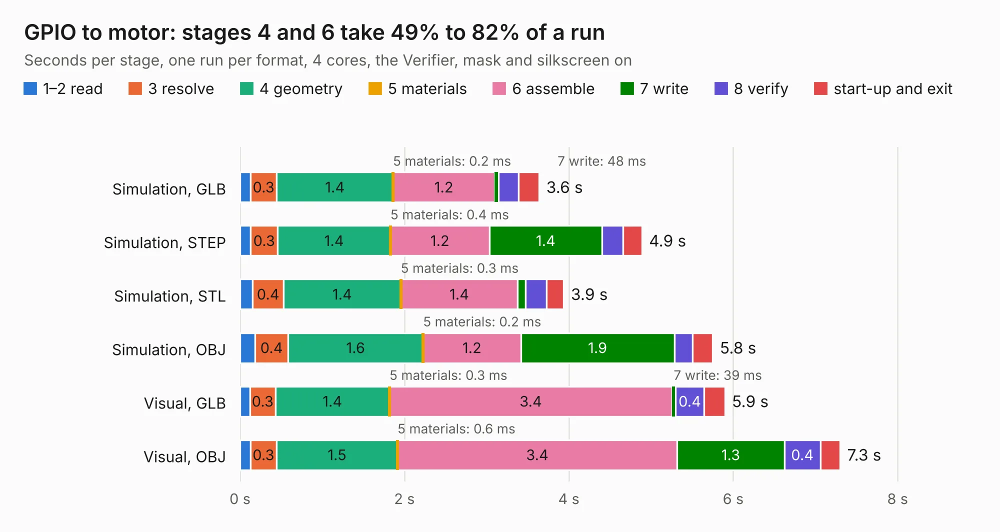

# 2211. GPIO to motor

Board 2,211 of the 3,117 of [Corpus Testing](../Corpus-Testing.md), on [Corpus Page 21](../CorpusTestingPages/Corpus-Testing-21.md#2211-gpio-to-motor).

| Mode and format | 1–2 read | 3 resolve | 4 geometry | 5 materials | 6 assemble | 7 write | 8 verify | start-up and exit | Total |
|---|---:|---:|---:|---:|---:|---:|---:|---:|---:|
| Simulation, GLB | 0.1 | 0.3 | 1.4 | 0.2&nbsp;ms | 1.2 | 48&nbsp;ms | 0.2 | 0.2 | 3.6 |
| Simulation, STEP | 0.1 | 0.3 | 1.4 | 0.4&nbsp;ms | 1.2 | 1.4 | 0.3 | 0.2 | 4.9 |
| Simulation, STL | 0.2 | 0.4 | 1.4 | 0.3&nbsp;ms | 1.4 | 96&nbsp;ms | 0.3 | 0.2 | 3.9 |
| Simulation, OBJ | 0.2 | 0.4 | 1.6 | 0.2&nbsp;ms | 1.2 | 1.9 | 0.2 | 0.2 | 5.8 |
| Visual, GLB | 0.1 | 0.3 | 1.4 | 0.3&nbsp;ms | 3.4 | 39&nbsp;ms | 0.4 | 0.2 | 5.9 |
| Visual, OBJ | 0.1 | 0.3 | 1.5 | 0.6&nbsp;ms | 3.4 | 1.3 | 0.4 | 0.2 | 7.3 |

<table align="center"><tr><td valign="top">

| Board | Repo: [oresat/reaction-wheels](https://github.com/oresat/reaction-wheels) Board: `GPIO to motor.kicad_pcb` |
|---|---|
| Folder | Edison_GPIO_Motor_Board |
| Complexity | 193&nbsp;/&nbsp;1000 (size&nbsp;148, features&nbsp;45) |
| KESE&nbsp;features | through vias, filled zones, curved board outline |
| Tested | 9th November 2026 |
| Copper&nbsp;layers | 2 |
| File&nbsp;format | KiCad 4 (4) |
| Parts,&nbsp;tracks,&nbsp;vias | 11, 326, 85 |
| Triangles,&nbsp;simulation | 399,388 in 41 parts |
| Verifier | PASS in all six runs |

</td><td valign="top">

<table>
<tr><th>File type</th><th>File size</th><th>Peak memory used</th></tr>
<tr><th colspan="3" align="left">Simulation</th></tr>
<tr><td>GLB</td><td align="right">13&nbsp;MB</td><td align="right">267&nbsp;MB</td></tr>
<tr><td>STEP</td><td align="right">54&nbsp;MB</td><td align="right">301&nbsp;MB</td></tr>
<tr><td>STL</td><td align="right">20&nbsp;MB</td><td align="right">287&nbsp;MB</td></tr>
<tr><td>OBJ</td><td align="right">39&nbsp;MB</td><td align="right">311&nbsp;MB</td></tr>
<tr><th colspan="3" align="left">Visual</th></tr>
<tr><td>GLB</td><td align="right">9.0&nbsp;MB</td><td align="right">274&nbsp;MB</td></tr>
<tr><td>OBJ</td><td align="right">26&nbsp;MB</td><td align="right">274&nbsp;MB</td></tr>
</table>

</td></tr></table>

| Previous | Next |
|:---|---:|
| [2210. star-tracker-card](b2210b_oresat-star-tracker-hardware_hardware-star-tracker-card_star-tracker-card.md) | [2212. Edison_Motor_Servo](b2212b_reaction-wheels_Edison-Motor-Servo.md) |
